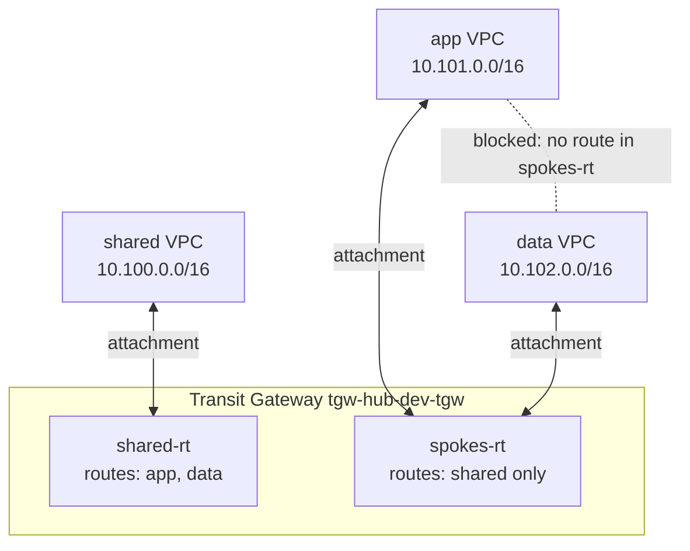
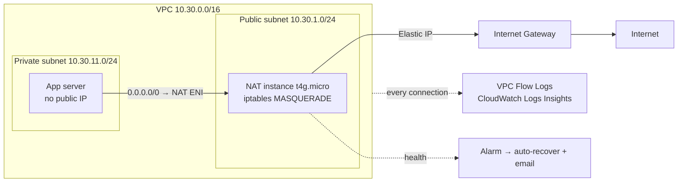
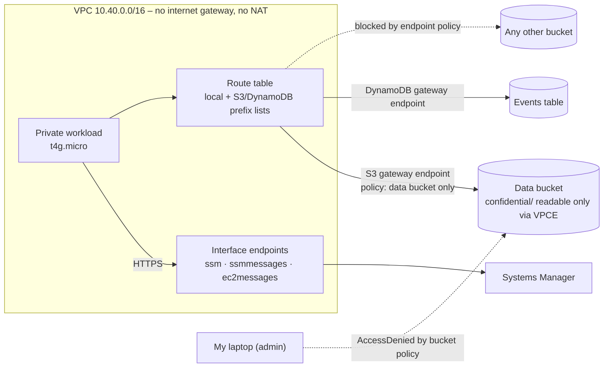
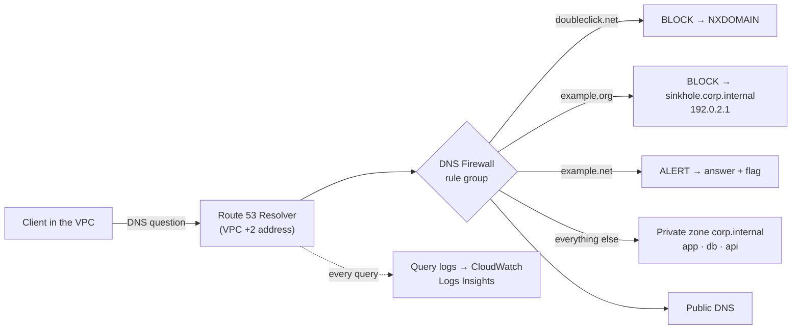
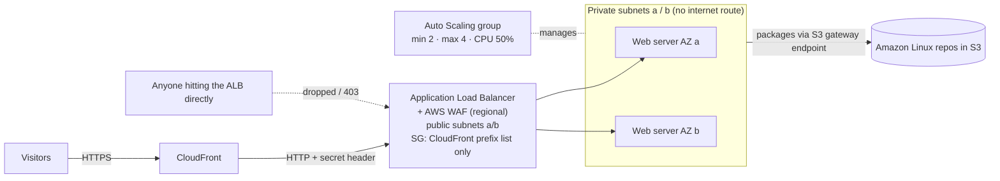
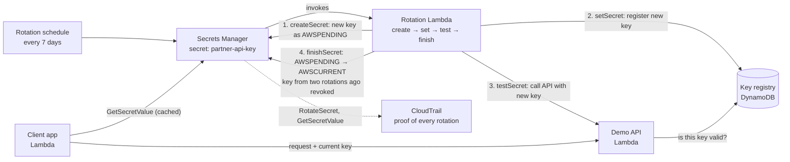
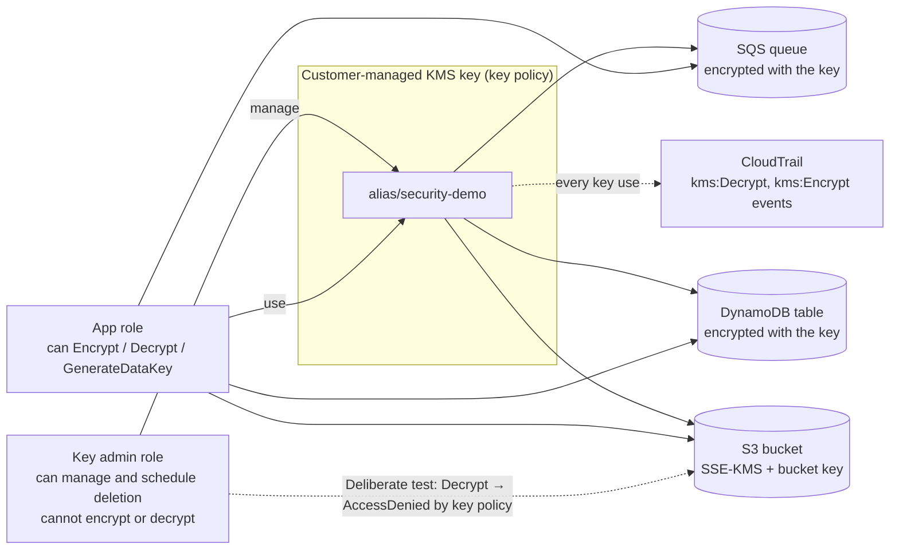
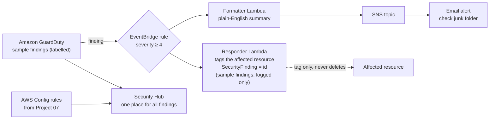
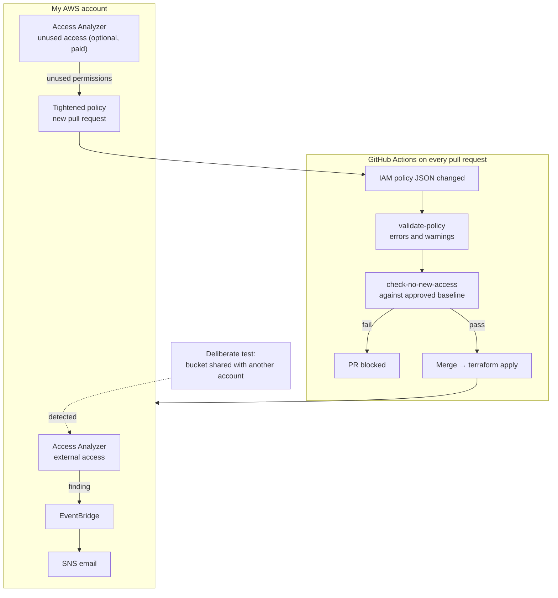
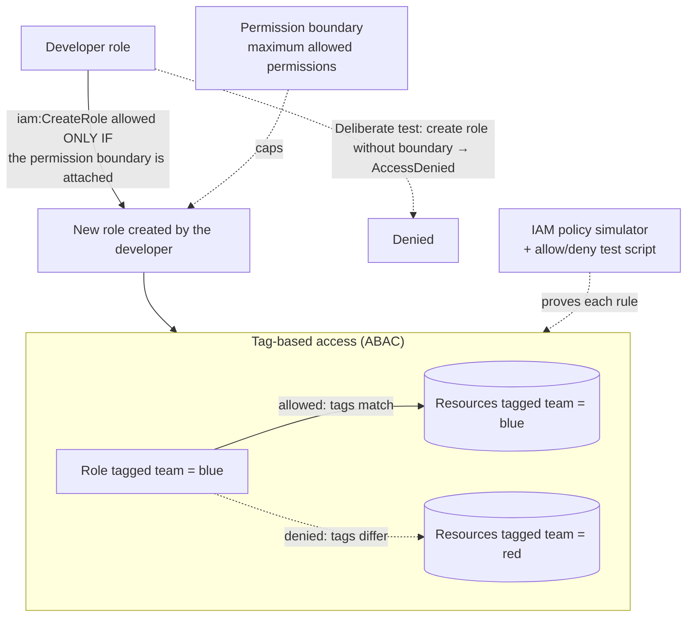

# ☁️ Discovering Cloud Engineering

**Aspiring Junior Cloud / DevOps Engineer** building hands-on AWS projects with Terraform, Python, containers and CI/CD, with a focus on security and cost control.

📍 Johannesburg, South Africa · 🎯 Open to Junior Cloud, DevOps and Platform Engineer roles

<!-- Add your links here before publishing -->
[LinkedIn](https://www.linkedin.com/in/your-profile) · [Email](mailto:your-email@example.com) · [CV](link-to-your-cv)

---

## ⚡ At a Glance (30-second summary)

- **Seven tracks, 37 projects planned:** the **Cloud Engineering** track (01–07) is built; **Networking** (08–12) is being built 19–23 October 2026; **Security, Observability, Kubernetes, Automation and FinOps** (13–37) follow through November. Each project is deployed from code (Infrastructure as Code) and torn down after testing to keep costs near zero.
- **Security first:** least-privilege IAM, encryption, no SSH access, secrets in AWS Secrets Manager, vulnerability scanning in CI/CD, and an account-wide audit trail with compliance rules.
- **Tested and automated:** unit tests, security tests, and GitHub Actions pipelines.
- **Cost-aware by design:** built in my own AWS account with a budget alert; every README states what the project costs per hour and how it's torn down.
- **Honest about what went wrong:** every project ends with a **Lessons Learned** section of the real errors I hit and how I fixed them.

## 🧰 Core Skills

| Area | Tools |
|------|-------|
| **Cloud (AWS)** | EC2, VPC, S3, Lambda, API Gateway, DynamoDB, RDS, ECS Fargate, ECR, ALB, Step Functions, EventBridge, SQS, SNS |
| **Infrastructure as Code** | Terraform, CloudFormation |
| **Containers** | Docker (multi-stage, non-root images) |
| **CI/CD** | GitHub Actions, Trivy image scanning |
| **Security** | IAM least privilege, KMS, Secrets Manager, CloudTrail, AWS Config, SSM Session Manager |
| **Networking** | VPC design, public and private subnets, route tables, internet gateway, security groups |
| **Monitoring** | CloudWatch Logs, metrics and alarms, SNS alerting |
| **Languages & OS** | Python, T-SQL, Bash, Linux (Ubuntu, Amazon Linux) |
| **Testing** | pytest, moto, Postman/Newman |

## 📂 Projects

### Cloud Engineering track

| # | Project | What it demonstrates | Key tech | Status |
|---|---------|----------------------|----------|--------|
| 01 | [Static Website on S3](https://github.com/masegoleroux-commits/Discovering-Cloud-Engineering/tree/main/cloud-pro_1/01-static-website-s3) | Infrastructure as Code basics: provision, deploy and destroy a website from code | S3, Terraform | ✅ Complete (torn down to avoid cost) |
| 02 | [Secure Payments Data API](https://github.com/masegoleroux-commits/Discovering-Cloud-Engineering/tree/main/cloud-pro_2/02-secure-payments-api) | Protecting sensitive data: card masking, stored-procedure-only access, 27 automated security tests | Lambda, API Gateway, RDS SQL Server, Secrets Manager, KMS, CloudFormation | 🟡 Code complete, deployment in progress |
| 03 | [Serverless Notes API](https://github.com/masegoleroux-commits/Discovering-Cloud-Engineering/tree/main/cloud-pro_3/03-serverless-notes-api) | Serverless REST API with least-privilege IAM and zero-cost unit tests | API Gateway, Lambda, DynamoDB, Terraform | ✅ Complete (torn down to avoid cost) |
| 04 | [VPC + Hardened Web Server](https://github.com/masegoleroux-commits/Discovering-Cloud-Engineering/tree/main/cloud-pro_4/04-vpc-hardened-web-server) | Networking from scratch and server hardening with no SSH | VPC, EC2, SSM, CloudWatch, Terraform | ✅ Complete (torn down to avoid cost) |
| 05 | [Containerised App on ECS Fargate](https://github.com/masegoleroux-commits/Discovering-Cloud-Engineering/tree/main/cloud-pro_5/05-ecs-fargate-cicd) | Automated releases from git push to production, with security scanning and auto-rollback | Docker, ECS Fargate, ECR, GitHub Actions, Trivy | ✅ Complete (torn down to avoid cost) |
| 06 | [Event-Driven CSV Pipeline](https://github.com/masegoleroux-commits/Discovering-Cloud-Engineering/tree/main/cloud-pro_6/06-event-driven-csv-pipeline) | Reliable data processing: retries, error handling and no silently lost files | S3, EventBridge, Step Functions, SQS | ✅ Complete (torn down to avoid cost) |
| 07 | [AWS Security Baseline](https://github.com/masegoleroux-commits/Discovering-Cloud-Engineering/tree/main/cloud-pro_7/07-aws-security-baseline) | Account-wide auditing, compliance checks and security alerting, proved with deliberate test violations | CloudTrail, AWS Config, CloudWatch | ✅ Complete (torn down to avoid cost) |

### 🌐 Networking track

| # | Project | What it demonstrates | Key tech | Status |
|---|---------|----------------------|----------|--------|
| 08 | [Hub-and-Spoke Network with Transit Gateway](https://github.com/masegoleroux-commits/Discovering-Cloud-Engineering/tree/main/cloud-pro_8/08-transit-gateway-hub-spoke) | Controlling and proving which VPCs can talk to which | Transit Gateway, TGW route tables, Reachability Analyzer | 📅 Building Mon 19 Oct 2026 |
| 09 | [Private Subnets with a NAT Instance and Flow Logs](https://github.com/masegoleroux-commits/Discovering-Cloud-Engineering/tree/main/cloud-pro_9/09-nat-instance-flow-logs) | Outbound internet for private subnets built from first principles, and reading real traffic | NAT instance, iptables, Elastic IP, VPC Flow Logs, Logs Insights | 📅 Building Tue 20 Oct 2026 |
| 10 | [Zero-Internet Workload with VPC Endpoints](https://github.com/masegoleroux-commits/Discovering-Cloud-Engineering/tree/main/cloud-pro_10/10-vpc-endpoints-zero-internet) | AWS access with no route to the internet, and no way to copy data out | Gateway + interface endpoints, endpoint policies, `aws:SourceVpce` | 📅 Building Wed 21 Oct 2026 |
| 11 | [Private DNS and Route 53 DNS Firewall](https://github.com/masegoleroux-commits/Discovering-Cloud-Engineering/tree/main/cloud-pro_11/11-private-dns-dns-firewall) | Internal names, plus blocking bad domains before a connection is made | Route 53 private zones, Resolver DNS Firewall, query logging | 📅 Building Thu 22 Oct 2026 |
| 12 | [HA Web Tier behind CloudFront and AWS WAF](https://github.com/masegoleroux-commits/Discovering-Cloud-Engineering/tree/main/cloud-pro_12/12-cloudfront-waf-ha-web) | How a real public site is fronted, protected and kept running when a server fails | CloudFront, AWS WAF, ALB, Auto Scaling, origin protection | 📅 Building Fri 23 Oct 2026 |

### 🔐 Security & Identity (📅 planned 26–30 Oct 2026)

| # | Project | What it will demonstrate | Key tech | Status |
|---|---------|--------------------------|----------|--------|
| 13 | [Automatic Secret Rotation](https://github.com/masegoleroux-commits/Discovering-Cloud-Engineering/tree/main/cloud-pro_13/13-secret-rotation) | A secret that rotates itself on a schedule, with the app picking up the new value and the old one revoked, plus proof of the rotation in CloudTrail | Secrets Manager, rotation Lambda, CloudTrail, Python | 📅 Planned |
| 14 | [KMS Encryption and Key Policies](https://github.com/masegoleroux-commits/Discovering-Cloud-Engineering/tree/main/cloud-pro_14/14-kms-encryption-key-policies) | A customer-managed key whose policy separates key **admins** from key **users**; S3, DynamoDB and SQS encrypted with it; a deliberate "access denied by key policy" test | AWS KMS, key policies, grants, S3, DynamoDB | 📅 Planned |
| 15 | [Threat Detection Pipeline](https://github.com/masegoleroux-commits/Discovering-Cloud-Engineering/tree/main/cloud-pro_15/15-threat-detection-pipeline) | GuardDuty findings (from AWS's built-in **sample findings**, labelled as samples) routed through EventBridge to a formatted email and a Lambda that tags the affected resource | GuardDuty, Security Hub, EventBridge, SNS, Lambda | 📅 Planned |
| 16 | [Least-Privilege Audit with Access Analyzer](https://github.com/masegoleroux-commits/Discovering-Cloud-Engineering/tree/main/cloud-pro_16/16-access-analyzer-least-privilege) | Policies checked in CI with IAM Access Analyzer policy validation; an account analyzer finding resources shared outside the account; unused-permission findings turned into tighter policies | IAM Access Analyzer, GitHub Actions, IAM | 📅 Planned |
| 17 | [Permission Boundaries and Tag-Based Access (ABAC)](https://github.com/masegoleroux-commits/Discovering-Cloud-Engineering/tree/main/cloud-pro_17/17-permission-boundaries-abac) | Developers can create their own roles but can never exceed a permission boundary; access decided by matching tags, proved with allow/deny tests | IAM permission boundaries, ABAC, IAM policy simulator, Terraform | 📅 Planned |

### 📈 Observability & SRE (📅 planned 2–6 Nov 2026)

| # | Project | What it will demonstrate | Key tech | Status |
|---|---------|--------------------------|----------|--------|
| 18 | SLOs and an Error Budget | An availability and latency SLO for the Project 03 API, an error-budget dashboard, and a burn-rate alarm; a deliberate error spike (labelled) shows the budget burning | CloudWatch metrics, metric math, dashboards, alarms | 📅 Planned |
| 19 | Distributed Tracing Across Lambdas | One request followed across API Gateway, two Lambdas and DynamoDB, finding the slow step in the trace | OpenTelemetry (ADOT), AWS X-Ray, Lambda | 📅 Planned |
| 20 | Load Test and Auto Scaling | A deliberate, labelled load test with k6 from my laptop; an Auto Scaling group scaling out and back in; the results graphed | EC2 Auto Scaling (t3.micro), ALB, k6, CloudWatch | 📅 Planned |
| 21 | Structured Logging and Log Analytics | JSON logs from every component, saved Logs Insights queries, metric filters turning log lines into alarms, and retention set for cost | CloudWatch Logs, Logs Insights, metric filters | 📅 Planned |
| 22 | Chaos Experiment and Runbook | A deliberate fault injection (stop an instance, add latency) with stop conditions, a canary detecting it, and a runbook that was actually followed | AWS FIS, CloudWatch Synthetics, alarms, SNS | 📅 Planned |

### ☸️ Kubernetes (📅 planned 9–13 Nov 2026)

| # | Project | What it will demonstrate | Key tech | Status |
|---|---------|--------------------------|----------|--------|
| 23 | Kubernetes Fundamentals (local) | The Project 05 app on a local cluster with Deployments, Services, Ingress, health probes, resource limits and an autoscaler | k3d (or kind), kubectl, Docker | 📅 Planned |
| 24 | Packaging with Helm | The app as a Helm chart with per-environment values, and a CI pipeline that lints and validates the chart before merge | Helm, helm lint, kubeconform, GitHub Actions | 📅 Planned |
| 25 | GitOps with Argo CD | The cluster syncing itself from Git: a commit changes production, a revert rolls it back, and manual drift is undone automatically | Argo CD, Helm, k3d | 📅 Planned |
| 26 | Kubernetes Security | Network policies blocking pod-to-pod traffic, Pod Security Standards rejecting a privileged pod, and image scanning in the cluster | NetworkPolicy, Pod Security Admission, Kyverno, Trivy | 📅 Planned |
| 27 | A Short EKS Session | The same chart on Amazon EKS for one session, with pods getting AWS permissions through **EKS Pod Identity**, then torn down the same day | Amazon EKS, managed node group (t3.small), Pod Identity, Terraform | 📅 Planned |

### 🤖 Automation & Platform (📅 planned 16–20 Nov 2026)

| # | Project | What it will demonstrate | Key tech | Status |
|---|---------|--------------------------|----------|--------|
| 28 | Ansible over SSM (no SSH) | Ansible configuring EC2 servers through Systems Manager, with no SSH port or key; the playbook run twice to show idempotency | Ansible, `aws_ssm` connection, EC2 (t3.micro), S3 | 📅 Planned |
| 29 | Golden Image Pipeline with Packer | A hardened Amazon Linux image built from code, scanned, tagged with its version, then used by a launch template; old images cleaned up automatically | Packer, EC2 Image Builder concepts, Amazon Inspector (optional) | 📅 Planned |
| 30 | Patching and Automation Runbooks | A patch baseline and maintenance window keeping servers up to date, and an Automation runbook that fixes a common problem in one click | SSM Patch Manager, maintenance windows, Automation documents | 📅 Planned |
| 31 | Reusable, Tested Terraform Modules | A versioned module library with `terraform test`, tflint and Checkov security scanning in CI, used by other projects | Terraform modules, terraform test, tflint, Checkov, GitHub Actions | 📅 Planned |
| 32 | Self-Service Environments | A GitHub Actions button that creates a short-lived environment, checks it against policy (OPA/Conftest) before apply, and destroys it automatically after a set time | GitHub Actions `workflow_dispatch`, OPA/Conftest, Terraform, EventBridge Scheduler | 📅 Planned |

### 💰 Cost / FinOps (📅 planned 23–27 Nov 2026)

| # | Project | What it will demonstrate | Key tech | Status |
|---|---------|--------------------------|----------|--------|
| 33 | Budgets and Anomaly Alerts as Code | Budgets and Cost Anomaly Detection created by Terraform, with alerts to email | AWS Budgets, Cost Anomaly Detection, Terraform | 📅 Planned |
| 34 | Out-of-Hours Auto-Shutdown | Tagged dev resources stopped every evening and started every morning, with the saving calculated | EventBridge Scheduler, Lambda, resource tags | 📅 Planned |
| 35 | Waste Finder Report | A weekly email listing unattached disks, unused Elastic IPs, old snapshots and idle instances, with their monthly cost | Lambda, EC2 and EBS APIs, SNS, EventBridge Scheduler | 📅 Planned |
| 36 | Tagging Policy and Auto-Tagging | A Config rule flagging untagged resources, and a Lambda that tags new resources with their creator from CloudTrail | AWS Config `required-tags`, CloudTrail, EventBridge, Lambda | 📅 Planned |
| 37 | Cost Report from Billing Data | Billing data exported to S3 and queried with Athena: cost by service, by project tag and by day | Data Exports (CUR 2.0), S3, Athena, Glue | 📅 Planned |

### 🗓️ Release schedule

| Dates | Track | Projects |
|-------|-------|----------|
| 12–15 Oct 2026 | Cloud Engineering | 03–07 published |
| 19–23 Oct 2026 | 🌐 Networking | 08–12 |
| 26–30 Oct 2026 | 🔐 Security & Identity | 13–17 |
| 2–6 Nov 2026 | 📈 Observability & SRE | 18–22 |
| 9–13 Nov 2026 | ☸️ Kubernetes | 23–27 |
| 16–20 Nov 2026 | 🤖 Automation & Platform | 28–32 |
| 23–27 Nov 2026 | 💰 Cost / FinOps | 33–37 |

---

## 🏗️ Architecture Diagrams

Each diagram shows how the AWS services in a project connect. Click a project to expand it.

### Cloud Engineering track

<b>01 – Static Website on S3</b>

Terraform creates everything; visitors read the site straight from the S3 website endpoint.

<b>02 – Secure Payments Data API</b>

The API reaches the database only through two stored procedures; credentials come from Secrets Manager.

<b>03 – Serverless Notes API</b>

One function handles all four routes; its IAM role can touch only the notes table and its own logs.

<b>04 – VPC + Hardened Web Server</b>

Only port 80 is open. Administration goes through SSM, so there is no SSH port or key pair.

<b>05 – Containerised App on ECS Fargate</b>

A release is blocked if Trivy finds a critical vulnerability, and ECS rolls back automatically if the new version fails health checks.

<b>06 – Event-Driven CSV Pipeline</b>

Temporary errors are retried; invalid files are never retried and always end up in the dead-letter queue with a reason.

<b>07 – AWS Security Baseline</b>

CloudTrail records who did what; AWS Config checks whether resources break the rules. Together they detect and explain issues.

### 🌐 Networking track

The designs for projects 08–12. They show what each project will build; screenshots of the real deployments are added as each one is finished.

<b>08 – Hub-and-Spoke Network with Transit Gateway</b> (📅 building Mon 19 Oct)

App and data VPCs can reach shared services but not each other. The block comes from routing alone, and Reachability Analyzer proves it.

<b>09 – Private Subnets with a NAT Instance and Flow Logs</b> (📅 building Tue 20 Oct)

The private server has no public IP; all its outbound traffic leaves through a NAT instance I configure myself, and every connection is recorded in Flow Logs.

<b>10 – Zero-Internet Workload with VPC Endpoints</b> (📅 building Wed 21 Oct)

No internet gateway, no NAT: AWS services are reached privately through endpoints, and endpoint and bucket policies stop data leaving.

<b>11 – Private DNS and Route 53 DNS Firewall</b> (📅 building Thu 22 Oct)

Every DNS question passes the firewall first: bad domains are blocked, sinkholed or flagged, and internal names resolve only inside the VPC.

<b>12 – HA Web Tier behind CloudFront and AWS WAF</b> (📅 building Fri 23 Oct)

Visitors reach the site only through CloudFront and a WAF-protected load balancer; servers in two AZs replace themselves if they fail.

### 🔐 Security & Identity track

The designs for projects 13–17, built 26–30 October 2026. Screenshots of the real deployments are added as each one is finished.

<b>13 – Automatic Secret Rotation</b> (📅 planned)

The secret changes itself every 7 days in four steps; the app always reads the current version, and CloudTrail proves each rotation.

<b>14 – KMS Encryption and Key Policies</b> (📅 planned)

The key policy separates people who **manage** the key from those who **use** it; a deliberate test shows the admin role being refused a decrypt.

<b>15 – Threat Detection Pipeline</b> (📅 planned)

GuardDuty sample findings (clearly labelled) become a readable email, and the affected resource is tagged so it is easy to find; nothing is deleted automatically.

<b>16 – Least-Privilege Audit with Access Analyzer</b> (📅 planned)

Risky IAM policies are stopped in the pull request before they reach AWS, and anything shared outside the account triggers an alert.

<b>17 – Permission Boundaries and Tag-Based Access</b> (📅 planned)

Developers can create roles, but never beyond the boundary; tags decide which resources each role can reach, proved with allow and deny tests.

> Diagrams are written in [Mermaid](https://mermaid.js.org/), which GitHub renders automatically, so they stay up to date with the code.

---

## 🔍 Project Details

### Cloud Engineering track

### 01 – Static Website on S3

A website hosted on Amazon S3 and deployed entirely with Terraform: bucket creation, static hosting, a public-read policy for the site files, and the page upload.

**Shows:** the core Infrastructure as Code workflow (`init`, `plan`, `apply`, `destroy`) and cost awareness. The live site was taken down to avoid charges and can be redeployed in one command.

### 02 – Secure Payments Data API

A secured REST and SOAP API in front of a SQL Server payments database, using synthetic (made-up) data.

**Shows:**
* **Data protection:** card numbers masked in T-SQL; credentials stored in AWS Secrets Manager
* **Least privilege:** the API login can run only two specific stored procedures
* **Database skills:** tables, stored procedures, roles, and versioned migrations with rollback
* **Security testing:** 27 Postman/Newman assertions covering SQL injection and XML attacks
* **Networking:** deployed inside a private VPC

**Status:** code complete, linted and unit-tested. Deployment is in progress. I've solved several sandbox restrictions (password generation, inline IAM policies, policy deletion) and am troubleshooting a CloudFormation rollback.

### 03 – Serverless Notes API

A REST API to create, read, list and delete notes, built on API Gateway, Python Lambda and DynamoDB, all deployed with Terraform.

**Shows:**
* **Least-privilege IAM:** the function can perform 4 actions on one table and nothing else
* **Testing without cost:** unit tests run against mocked AWS (moto), never touching the cloud
* **Guardrails:** API throttling and validated limits for timeout and memory

### 04 – VPC + Hardened Web Server

A two-zone network built by hand, with one Nginx web server.

**Shows:**
* **Networking:** public and private subnets, route tables and an internet gateway, written without pre-built modules
* **No SSH:** administration only through AWS SSM Session Manager, so there is no open admin port
* **Hardening:** IMDSv2 required, encrypted disk, server version hidden
* **Monitoring:** logs and metrics in CloudWatch, with email alarms
* **Real-world constraints:** fixed deployments blocked by my AWS Organization's region policy (SCP) by moving everything to eu-north-1

### 05 – Containerised App on ECS Fargate

A Python web service packaged in a container and released automatically on every code push.

**Shows:**
* **CI/CD:** test → build → security scan → push → deploy, blocked if critical vulnerabilities are found
* **Safe releases:** zero-downtime rolling deploys with automatic rollback if the new version fails
* **Secure containers:** small multi-stage image running as a non-root user
* **Least-privilege CI:** when my organisation blocked OIDC, GitHub Actions used a dedicated IAM user that can only update this one app
* **Supply-chain safety:** third-party GitHub Actions pinned to a commit SHA after a pinned tag disappeared

### 06 – Event-Driven CSV Pipeline

Uploading a CSV file automatically starts a workflow that validates it and loads it into a database.

**Shows:**
* **Reliability:** automatic retries for temporary errors; rejected files go to a dead-letter queue with the reason
* **Alerting:** email on every success and every rejection
* **Safe re-runs:** uploading the same file twice doesn't create duplicate records

### 07 – AWS Security Baseline

Account-wide security controls for my AWS account.

**Shows:**
* **Audit trail:** every API call recorded, with tamper-evident logs
* **Compliance checks:** 6 automated rules covering public buckets, open SSH, encryption, instance metadata security and the account password policy
* **Alerting:** alarms for root account use, denied API calls, firewall changes and logins without MFA
* **Proof it works:** deliberately created violations (open SSH, IMDSv1, an unencrypted disk, a denied API call), clearly labelled as tests, and a findings log with a code review of projects 03–06 against the same rules

### 🌐 Networking track (building 19–23 October 2026)

These are the plans for each project. Each section will be updated with real results, screenshots and lessons learned as the project is finished.

### 08 – Hub-and-Spoke Network with Transit Gateway

Three VPCs joined through one Transit Gateway, with route tables that let the app and data networks reach shared services but not each other.

**Will show:**
* **Segmentation by routing:** separate Transit Gateway route tables for shared services and spokes
* **IP planning:** non-overlapping address ranges across three VPCs and two Availability Zones
* **Proof, not assumption:** VPC Reachability Analyzer showing which paths are reachable and which are blocked, and why
* **Policy as code:** one Terraform setting opens or closes the app-to-data path

### 09 – Private Subnets with a NAT Instance and Flow Logs

A private server with no public IP that reaches the internet through a NAT router I configure myself.

**Will show:**
* **NAT from first principles:** IP forwarding, iptables MASQUERADE and the EC2 source/destination check
* **Traffic visibility:** VPC Flow Logs with saved Logs Insights queries for rejected traffic, top talkers and outbound traffic
* **Self-healing:** a CloudWatch alarm that recovers the NAT instance automatically
* **Cost trade-off:** roughly 70% cheaper than a managed NAT gateway, with the reliability trade-offs written down

### 10 – Zero-Internet Workload with VPC Endpoints

A server in a VPC with no internet route at all, which still uses S3, DynamoDB and Systems Manager privately.

**Will show:**
* **Private access to AWS:** gateway endpoints for S3 and DynamoDB, interface endpoints with private DNS for Systems Manager
* **Data-exfiltration guard:** endpoint policies that only allow the project's own bucket and table
* **Defence in depth:** a bucket policy that refuses even an administrator outside the VPC

### 11 – Private DNS and Route 53 DNS Firewall

Internal names that exist only inside the VPC, and a DNS firewall that stops bad domains before a connection is made.

**Will show:**
* **Private DNS:** a Route 53 private hosted zone with internal records
* **DNS Firewall:** three actions: block, sinkhole and alert
* **Visibility:** every DNS query logged and searchable with Logs Insights

### 12 – HA Web Tier behind CloudFront and AWS WAF

A web tier across two Availability Zones, reachable only through CloudFront and an AWS WAF-protected load balancer.

**Will show:**
* **High availability:** an Auto Scaling group across two AZs that replaces failed servers
* **Edge protection:** AWS WAF with a rate limit and AWS managed rule sets
* **Origin protection:** the load balancer only accepts CloudFront's IP ranges and a secret header
* **Private servers:** no internet route; packages install through an S3 gateway endpoint

### 🔐 Security & Identity track (planned 26–30 October 2026)

The plans for each project. Each section will be updated with real results, screenshots and lessons learned as the project is finished.

### 13 – Automatic Secret Rotation

An API key that replaces itself on a schedule: a rotation Lambda creates, registers, tests and promotes a new key, the app always reads the current one, and CloudTrail proves every rotation.

**Will show:**
* **Custom rotation Lambda** implementing Secrets Manager's four steps: `createSecret`, `setSecret`, `testSecret`, `finishSecret`
* **Version stages** (`AWSPENDING`, `AWSCURRENT`, `AWSPREVIOUS`) and why the test step comes *before* the switch
* **Zero-downtime rotation:** the current and previous keys both stay valid, so a client holding a cached key never fails
* **Client-side caching** so the app doesn't call Secrets Manager on every request

### 14 – KMS Encryption and Key Policies

One customer-managed KMS key encrypting S3, DynamoDB and SQS, with a key policy that separates the people who **manage** the key from the applications that **use** it, proved with a deliberate access-denied test.

**Will show:**
* **Customer-managed key** with automatic yearly rotation turned on
* **Separation of duties:** a key-admin role can manage and schedule deletion of the key but **cannot** encrypt or decrypt
* **One key, three services:** S3 (with an S3 Bucket Key to cut KMS calls), DynamoDB and SQS
* **How key policies and IAM combine,** including why the account statement in the key policy lets IAM grant access

### 15 – Threat Detection Pipeline

GuardDuty findings turned into readable email alerts within a minute, with the affected resource tagged for investigation, and Security Hub gathering findings from GuardDuty and my Project 07 Config rules in one place.

**Will show:**
* **GuardDuty** threat detection, tested with AWS's built-in **sample findings** (clearly labelled as samples, never presented as real attacks)
* **EventBridge rule** filtering findings by severity
* **Formatter Lambda** turning finding JSON into a short, plain-English email
* **Safe automated response:** a Lambda that only **tags** the affected resource and never deletes anything

### 16 – Least-Privilege Audit with Access Analyzer

Risky IAM policies stopped in the pull request before they reach AWS, anything shared outside my account flagged within minutes, and unused permissions turned into tighter policies.

**Will show:**
* **Policy validation in CI:** `validate-policy` flags errors, security warnings and bad practice on every pull request
* **Custom policy checks:** `check-no-new-access` fails the build if a change grants more than the approved baseline
* **External access analyzer** finding resources shared outside my account, with EventBridge alerts
* **Deliberate test:** a bucket policy granting another AWS account access, caught by the analyzer

### 17 – Permission Boundaries and Tag-Based Access

Developers can create their own IAM roles but can never give them more than a permission boundary allows, and tags decide which resources each team can reach, proved with allow and deny tests.

**Will show:**
* **Permission boundary** that sets the maximum permissions of any role a developer creates
* **Escalation guardrails:** developers can't create a role without the boundary, remove it, or edit the boundary policy
* **ABAC:** a role tagged `team = blue` can reach only resources tagged `team = blue`, using `aws:PrincipalTag` and `aws:ResourceTag`
* **Automated allow/deny tests** with a script and the IAM policy simulator, including deliberate denied attempts

---

## 💡 How I Work

- **Everything is code:** each project can be rebuilt from scratch and fully deleted with one command.
- **Cost-conscious:** resources are torn down after testing; nothing runs unnecessarily.
- **Documented decisions:** each project includes architecture diagrams, decision records explaining why I chose one option over another, and a runbook.
- **Learning from failure:** every project's README ends with the real errors I hit, their cause and the fix.
- **Honest results:** test data is synthetic and labelled; any deliberate failures or load tests are clearly marked.

## 🤝 Let's Connect

I'm actively looking for Junior Cloud, DevOps or Platform Engineer opportunities. I'd be glad to walk you through any of these projects.

[LinkedIn](https://www.linkedin.com/in/your-profile) · [Email](mailto:your-email@example.com)
