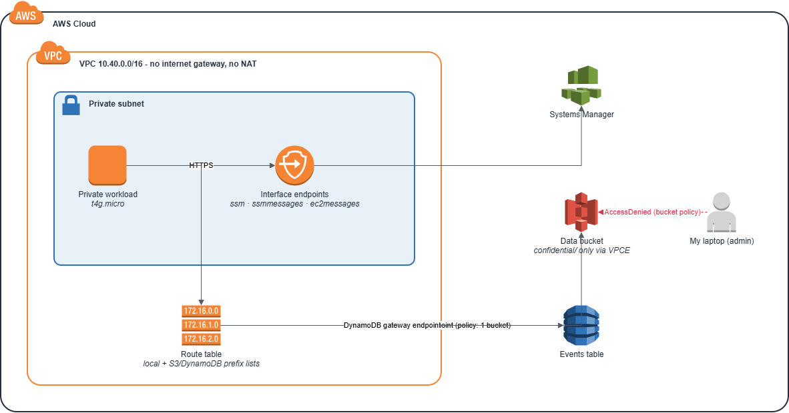
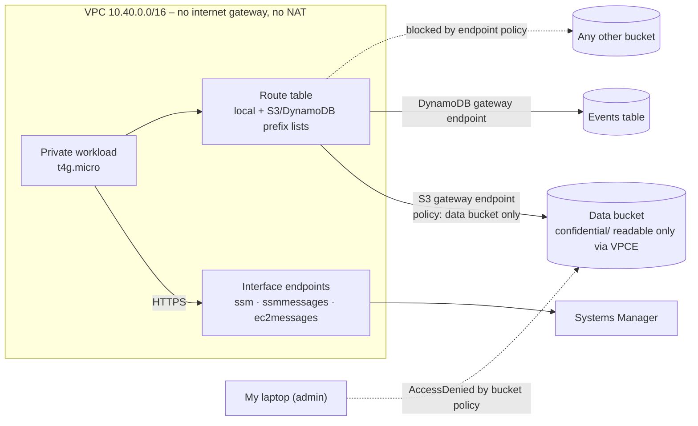
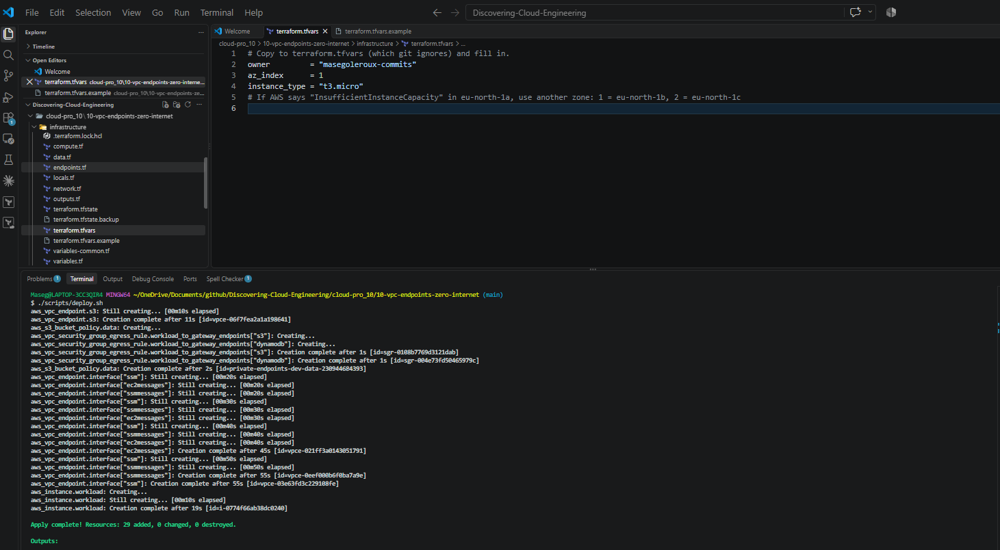
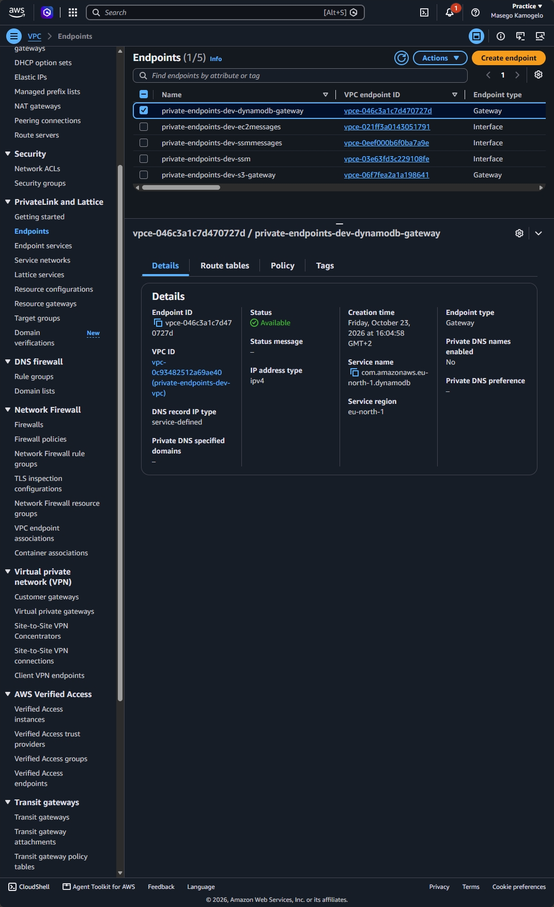
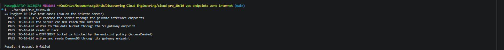
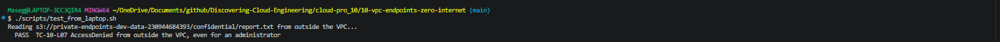
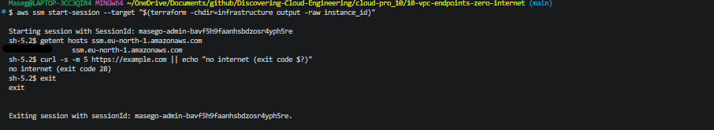
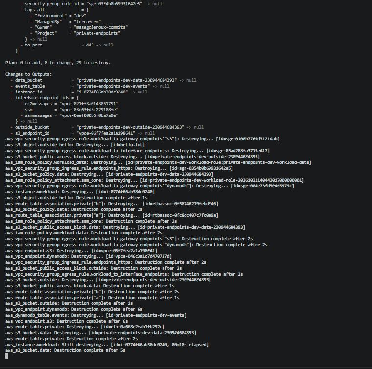

# 🔒 10 – Zero-Internet Workload with VPC Endpoints

**A server in a VPC with no internet gateway and no NAT still uses S3, DynamoDB and Systems Manager privately, and endpoint and bucket policies make sure its data can only go where it's allowed.**

<p align="center">
  
</p>

> 🌐 Part of the **Networking track** of [Discovering Cloud Engineering](../../README.md).

## 💡 Why I Built This

Projects 04 and 09 gave private servers a route *out to the internet*. But many regulated workloads (banking, health, payments) aren't allowed internet access at all. I wanted to learn how AWS services are reached **without leaving the AWS network**, and how to stop data being copied out, a risk that IAM alone doesn't cover: a stolen credential can still upload to an attacker's bucket. This project taught me the difference between **gateway and interface endpoints**, **private DNS**, and three layers of policy (IAM, endpoint and bucket) working together.

## 🎯 The Problem It Solves

Data-exfiltration and compliance rules often say: "this system must not reach the internet, and its data must never leave our own buckets". Teams need a way for private servers to use AWS services anyway, and evidence that the controls work, including against an administrator outside the network.

## 🧠 What This Project Shows

- **A VPC with no internet path at all**: no internet gateway, no NAT, no public IPs
- **Gateway endpoints** (free) for S3 and DynamoDB, which add prefix-list routes to the route table
- **Interface endpoints** with **private DNS**, so the normal SSM service names resolve to private IPs inside the VPC
- **Endpoint policies** as a data-exfiltration guard: only the project's bucket and table work through the endpoints
- **Bucket policy with `aws:SourceVpce`**: confidential objects can only be read from inside the VPC, even by an admin
- **Defence in depth proof**: IAM deliberately allows a second bucket, so the block is shown to come from the endpoint policy
- **Security groups that reference prefix lists** for tight, explicit egress

## 🛠️ Technologies

`Amazon VPC` · `Gateway VPC endpoints` · `Interface VPC endpoints (PrivateLink)` · `Endpoint policies` · `S3 bucket policies` · `DynamoDB` · `SSM Run Command` · `EC2 Graviton` · `IAM` · `Terraform` · `Bash`

## 🏗️ Architecture



| Piece | What it does |
|-------|--------------|
| Private workload | t4g.micro in a private subnet; no public IP, no inbound rules |
| S3 gateway endpoint | Free; its policy allows only the project's data bucket |
| DynamoDB gateway endpoint | Free; its policy allows only the events table |
| Interface endpoints | `ssm`, `ssmmessages`, `ec2messages`: what Session Manager and Run Command need |
| Data bucket policy | Denies reading `confidential/*` unless the request comes through the S3 endpoint |
| Outside bucket | A decoy the workload's IAM role *can* access, but the endpoint policy blocks |

## 🧰 Services Used, in Detail

Every service and tool in this project: what it is, how it works, exactly how this project uses it, why I chose it, and what it costs. Expand a service below for the full detail.

| Service | What it is |
| --- | --- |
| **Amazon VPC with no internet path** | A private network with no internet gateway, no NAT and no public IPs. |
| **Gateway VPC endpoints (S3 and DynamoDB)** | A free, private path from a VPC to S3 or DynamoDB. |
| **Interface VPC endpoints (AWS PrivateLink)** | A network interface with a private IP inside the VPC that represents an AWS service. |
| **Endpoint policies** | A policy on an endpoint that limits what can be done **through** it. |
| **S3 bucket policy with `aws:SourceVpce`** | A bucket rule that checks which endpoint a request came through. |
| **Amazon DynamoDB and S3** | The data stores the workload is allowed to use. |
| **Security groups with prefix lists** | Firewall rules that can name an AWS-managed list of IP ranges instead of individual addresses. |
| **AWS Systems Manager (Run Command) and IAM** | Runs the tests on the server and controls its permissions. |
| **Terraform** | Infrastructure as Code. |

<details>
<summary><b>Amazon VPC with no internet path</b></summary>

- **What it is:** A private network with no internet gateway, no NAT and no public IPs.
- **How it works:** Without a route to the internet, the only way to reach AWS services is through VPC endpoints.
- **How this project uses it:** `10.40.0.0/16` with private subnets only, and one t4g.micro workload server (IMDSv2, encrypted disk).
- **Why this choice:** Many regulated workloads are not allowed internet access at all.
- **Cost:** Free.

</details>

<details>
<summary><b>Gateway VPC endpoints (S3 and DynamoDB)</b></summary>

- **What it is:** A free, private path from a VPC to S3 or DynamoDB.
- **How it works:** The endpoint adds a route to the route table whose destination is an AWS **prefix list** (the service's IP ranges). Traffic to those ranges goes to the endpoint instead of the internet.
- **How this project uses it:** One gateway endpoint each for S3 and DynamoDB, both with **endpoint policies** that allow only the project's own bucket and table.
- **Why this choice:** Gateway endpoints are free and exist only for these two services.
- **Cost:** Free.

</details>

<details>
<summary><b>Interface VPC endpoints (AWS PrivateLink)</b></summary>

- **What it is:** A network interface with a private IP inside the VPC that represents an AWS service.
- **How it works:** With **private DNS** switched on, the normal service name (for example `ssm.eu-north-1.amazonaws.com`) resolves to the endpoint's private IP inside the VPC, so tools work without any change.
- **How this project uses it:** Three interface endpoints, `ssm`, `ssmmessages` and `ec2messages`, which Systems Manager needs to manage the server.
- **Why this choice:** They let me run commands on a server that has no route out.
- **Cost:** About $0.01 an hour each per Availability Zone: $0.03 an hour for the three.

</details>

<details>
<summary><b>Endpoint policies</b></summary>

- **What it is:** A policy on an endpoint that limits what can be done **through** it.
- **How it works:** AWS allows a request only if the IAM policy, the endpoint policy and any resource policy all allow it.
- **How this project uses it:** The workload's IAM role deliberately allows a second bucket. The endpoint policy does not, so the test proves it is the endpoint policy that blocks copying data to a bucket outside the project.
- **Why this choice:** IAM alone doesn't stop a stolen credential uploading to an attacker's bucket; the endpoint policy does.
- **Cost:** Free.

</details>

<details>
<summary><b>S3 bucket policy with `aws:SourceVpce`</b></summary>

- **What it is:** A bucket rule that checks which endpoint a request came through.
- **How it works:** `aws:SourceVpce` is set on requests arriving through a VPC endpoint; a Deny when it doesn't match blocks everything else.
- **How this project uses it:** Confidential objects can only be read through this VPC's endpoint. Even my administrator user is refused from my laptop (`test_from_laptop.sh` expects AccessDenied).
- **Why this choice:** It keeps data inside the network boundary, whoever holds the credentials.
- **Cost:** Free.

</details>

<details>
<summary><b>Amazon DynamoDB and S3</b></summary>

- **What it is:** The data stores the workload is allowed to use.
- **How it works:** Both are reached only through the gateway endpoints.
- **How this project uses it:** One table and one bucket; the test script writes and reads both from inside the VPC.
- **Why this choice:** They give the endpoint policies something real to protect.
- **Cost:** Within the Free Tier.

</details>

<details>
<summary><b>Security groups with prefix lists</b></summary>

- **What it is:** Firewall rules that can name an AWS-managed list of IP ranges instead of individual addresses.
- **How it works:** A rule can reference the S3 or DynamoDB prefix list; AWS keeps the list up to date.
- **How this project uses it:** The workload's outbound rules allow only HTTPS to the VPC range and to the S3 and DynamoDB prefix lists.
- **Why this choice:** Egress is tight and explicit instead of `0.0.0.0/0`.
- **Cost:** Free.

</details>

<details>
<summary><b>AWS Systems Manager (Run Command) and IAM</b></summary>

- **What it is:** Runs the tests on the server and controls its permissions.
- **How it works:** Run Command reaches the server through the interface endpoints.
- **How this project uses it:** `run_tests.sh` runs a test script on the server and reads `RESULT name ok|BAD` lines. The instance role has the managed SSM policy plus access to the project data.
- **Why this choice:** No SSH, no internet, and still fully manageable.
- **Cost:** Free.

</details>

<details>
<summary><b>Terraform</b></summary>

- **What it is:** Infrastructure as Code.
- **How it works:** Terraform reads `.tf` files that describe the end state, compares them with a state file of what it built before, and makes only the API calls needed to close the gap. `plan` shows the changes; `apply` makes them; `destroy` removes everything it created. Offline `terraform test` files in `infrastructure/tests/` use a mock AWS provider, so the rules are checked for free on every push, before anything is deployed.
- **How this project uses it:** The offline tests check that no internet gateway or NAT exists and that the endpoint and bucket policies contain the right conditions.
- **Why this choice:** Policy mistakes are caught before deploying.
- **Cost:** Free.

</details>

## 🚀 Quickstart

```bash
cd cloud-pro_10/10-vpc-endpoints-zero-internet
cp infrastructure/terraform.tfvars.example infrastructure/terraform.tfvars   # set owner
./scripts/deploy.sh
./scripts/run_tests.sh           # no internet; S3 + DynamoDB work; other bucket blocked
./scripts/test_from_laptop.sh    # AccessDenied, even for an admin
./scripts/destroy.sh
```

New to this project? Follow the full step-by-step guide: **[docs/START-HERE.md](docs/START-HERE.md)**. Short operations card: [docs/runbook.md](docs/runbook.md).

## 🧩 Key Design Decisions

- [0001 – Gateway endpoints for S3 and DynamoDB](docs/adr/0001-gateway-endpoints.md)
- [0002 – Interface endpoints in one AZ](docs/adr/0002-interface-endpoints-one-az.md)
- [0003 – Three layers of policy](docs/adr/0003-three-policy-layers.md)

## 🔐 Security Highlights

- **No route to the internet** exists, so malware or a misconfiguration can't call out
- **Endpoint policies** stop the workload using *any* other bucket or table, even with valid credentials
- **`aws:SourceVpce` bucket condition** keeps confidential data inside the network boundary
- **Tight egress:** the workload's security group only allows HTTPS to the VPC and the S3/DynamoDB prefix lists
- IMDSv2 required, encrypted disk, access through SSM only

## 🧪 Test Cases

**15 test cases**, each with an ID (full list: [docs/TEST-CASES.md](docs/TEST-CASES.md)).

| Level | Cases | Needs AWS? | How to run |
|-------|-------|------------|------------|
| Offline Terraform tests | 9 | No, free | `terraform -chdir=infrastructure test` |
| Live tests (PASS/FAIL) | 7 | Yes | `./scripts/run_tests.sh`, `./scripts/test_from_laptop.sh` |

The offline tests run against a mocked AWS, so a broken security rule fails before anything is deployed. Deliberate tests are labelled as such.

## 📸 Screenshots

| # | What it proves | Image |
|---|----------------|-------|
| 1 | Infrastructure deployed from code |  |
| 2 | Route table: no internet route, only endpoint prefix lists |  |
| 3 | Two gateway and three interface endpoints |  |
| 4 | S3 endpoint policy allows one bucket only |  |
| 5 | Bucket policy: confidential data only via the endpoint |  |
| 6 | All five tests run on the private server |  |
| 7 | Even an admin is refused from outside the VPC |  |
| 8 | AWS service names resolve to private IPs |  |
| 9 | Everything torn down |  |

## 💰 Cost and Teardown

Built and tested in my own AWS account. Gateway endpoints are free. Interface endpoints cost about **$0.01 per hour each per AZ**; three in one AZ is **$0.03/hour**. With the t4g.micro (~$0.0042/hour), the project runs at about **$0.035 per hour**, roughly **$0.10 for a session**. No public IPs are used. `./scripts/destroy.sh` removes everything.

_Estimates from AWS list prices, October 2026; prices in eu-north-1 (Stockholm), where this was built, are similar. Check your own bill in Billing → Cost Explorer._

## 📚 Lessons Learned

<!-- Fill in after you build it: what broke, how you fixed it, what you'd change. Only write what actually happened. -->
