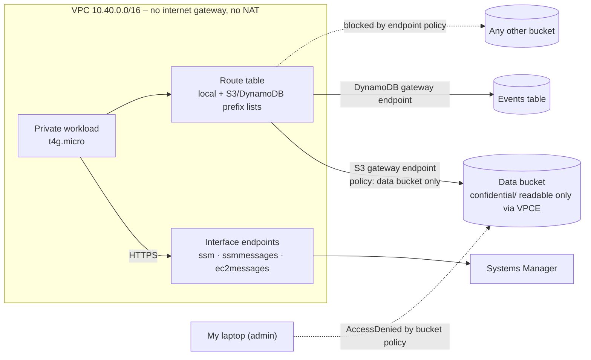

# Architecture

## How the workload reaches S3 with no internet

1. The AWS CLI on the instance calls `s3.eu-north-1.amazonaws.com`, which resolves to **public** S3 addresses.
2. The private route table has a route for the S3 **prefix list** (`pl-…`), pointing at the gateway endpoint. Traffic to those addresses goes there instead of needing an internet gateway.
3. The **endpoint policy** is checked: only the project's data bucket is allowed.
4. S3 sees the request arrive through endpoint `vpce-…`, so the bucket policy's `aws:SourceVpce` condition is met.

## How it reaches Systems Manager

`ssm.eu-north-1.amazonaws.com` normally resolves to public addresses. With an interface endpoint and **private DNS**, Route 53 inside the VPC answers with the endpoint's **private IP** (10.40.1.x), so the request never leaves the VPC.

| Component | AWS name |
|-----------|----------|
| VPC | `private-endpoints-dev-vpc` |
| Gateway endpoints | `private-endpoints-dev-s3-gateway`, `-dynamodb-gateway` |
| Interface endpoints | `private-endpoints-dev-ssm`, `-ssmmessages`, `-ec2messages` |
| Workload | `private-endpoints-dev-workload` |
| Buckets | `private-endpoints-dev-data-<account>`, `private-endpoints-dev-outside-<account>` |
| Table | `private-endpoints-dev-events` |
