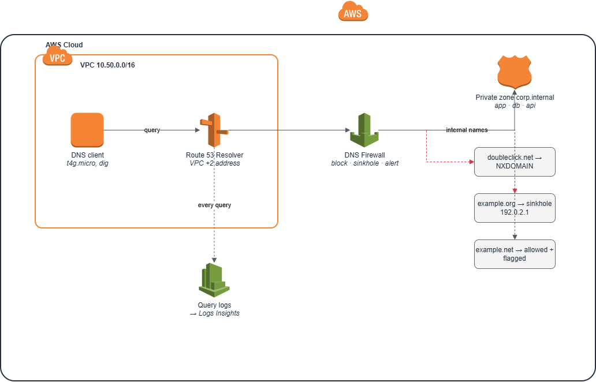
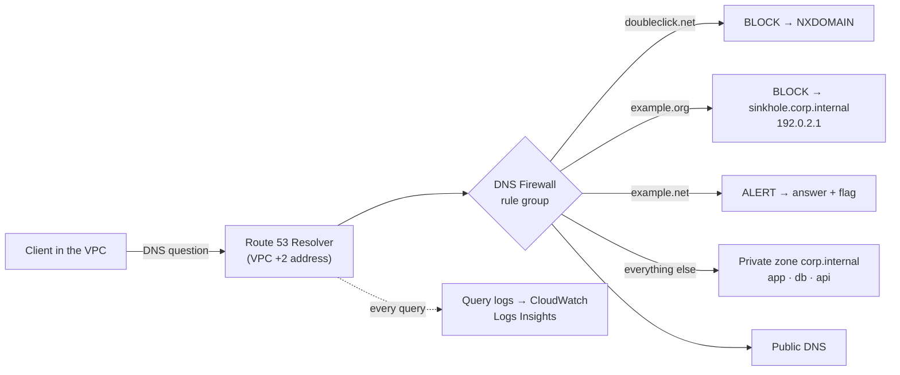
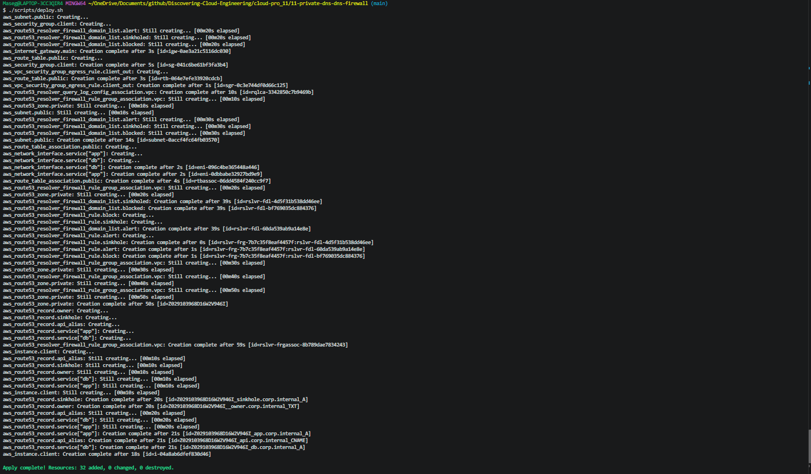
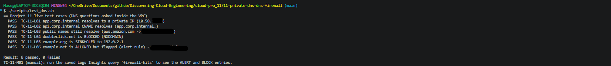
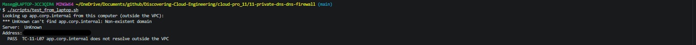
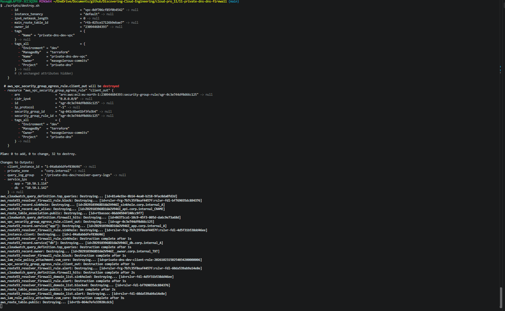

# 🧭 11 – Private DNS and Route 53 Resolver DNS Firewall

**Internal names that only exist inside the VPC, a DNS firewall that blocks, sinkholes or flags domains before a connection is ever made, and a searchable log of every DNS question asked.**

<p align="center">
  
</p>

> 🌐 Part of the **Networking track** of [Discovering Cloud Engineering](../../README.md).

## 💡 Why I Built This

Every connection starts with a DNS lookup, so DNS is both the first thing to break ("it's always DNS") and one of the first places attackers hide. Malware uses DNS to find its control servers and even to smuggle data out. In my earlier projects I used DNS without thinking about it. I built this to understand **how name resolution actually works inside a VPC**, how companies give internal systems friendly names that the internet can't see, and how a **DNS firewall** stops a bad connection at the lookup stage, with logs to prove it. It sits where networking and security meet.

## 🎯 The Problem It Solves

Applications shouldn't connect to internal services by IP address, and internal names shouldn't leak to the internet. Security teams also need to block known-bad domains for every server at once, without installing anything on each machine, and to see which systems tried to reach them.

## 🧠 What This Project Shows

- **Private hosted zone** (`corp.internal`) associated with one VPC: A, CNAME and TXT records invisible from the internet
- **Route 53 Resolver DNS Firewall** with three actions: **BLOCK with NXDOMAIN**, **BLOCK with a sinkhole override**, and **ALERT**
- **Rule priorities and VPC association priority**, and how the firewall is evaluated before any answer is returned
- **Resolver query logging** to CloudWatch, with saved Logs Insights queries for firewall hits and top names
- **Testing from inside the VPC** with SSM Run Command and `dig`, and proving names don't resolve from outside

## 🛠️ Technologies

`Amazon Route 53 (private hosted zones)` · `Route 53 Resolver` · `Route 53 Resolver DNS Firewall` · `Resolver query logging` · `CloudWatch Logs Insights` · `Amazon VPC` · `EC2 Graviton` · `SSM Run Command` · `dig` · `Terraform`

## 🏗️ Architecture



| Piece | What it does |
|-------|--------------|
| Private zone `corp.internal` | `app` and `db` A records, `api` CNAME, `sinkhole`, `_owner` TXT |
| Blocked list | `doubleclick.net`: answered NXDOMAIN, as if it didn't exist |
| Sinkholed list | `example.org`: redirected to `sinkhole.corp.internal` (192.0.2.1) |
| Alert list | `example.net`: allowed, but every lookup is flagged in the logs |
| Query logging | Every DNS question in the VPC, to CloudWatch Logs |
| Client | t4g.micro used to run `dig` from inside the VPC |

## 🧰 Services Used, in Detail

Every service and tool in this project: what it is, how it works, exactly how this project uses it, why I chose it, and what it costs. Expand a service below for the full detail.

| Service | What it is |
| --- | --- |
| **Amazon Route 53 private hosted zone** | A DNS zone that answers only inside the VPCs it is associated with. |
| **Route 53 Resolver** | The DNS server built into every VPC, at the VPC range's base address plus two (here `10.50.0.2`). |
| **Route 53 Resolver DNS Firewall** | Filters DNS lookups against domain lists before an answer is returned. |
| **Resolver query logging** | Records every DNS query: who asked, which name, and what the answer or firewall action was. |
| **Amazon EC2 and Systems Manager (Run Command)** | A small client server to run the lookups from, managed without SSH. |
| **Terraform** | Infrastructure as Code. |

<details>
<summary><b>Amazon Route 53 private hosted zone</b></summary>

- **What it is:** A DNS zone that answers only inside the VPCs it is associated with.
- **How it works:** Inside the VPC, the Route 53 Resolver checks private zones first; outside, the names don't exist.
- **How this project uses it:** `corp.internal` associated with one VPC (`10.50.0.0/16`), with an A record for the app server, a CNAME (`api` → `app`), a TXT owner record and an A record for the sinkhole at `192.0.2.1` (an address reserved for documentation, so it goes nowhere).
- **Why this choice:** Applications use names instead of IP addresses, and internal names don't leak to the internet.
- **Cost:** $0.50 a month per zone, but zones deleted within 12 hours of creation aren't charged.

</details>

<details>
<summary><b>Route 53 Resolver</b></summary>

- **What it is:** The DNS server built into every VPC, at the VPC range's base address plus two (here `10.50.0.2`).
- **How it works:** Every lookup from an instance goes to it. It applies any DNS Firewall rules first, then answers from associated private zones, or from public DNS for everything else.
- **How this project uses it:** Used as-is: the project adds the private zone, the firewall and query logging on top.
- **Why this choice:** Controlling the VPC's own resolver covers every server at once, with nothing installed on them.
- **Cost:** Free for lookups from inside the VPC.

</details>

<details>
<summary><b>Route 53 Resolver DNS Firewall</b></summary>

- **What it is:** Filters DNS lookups against domain lists before an answer is returned.
- **How it works:** A rule group holds rules in priority order; each rule matches a domain list and takes an action: ALLOW, BLOCK or ALERT. BLOCK can answer NXDOMAIN (the name doesn't exist) or **override** the answer with a chosen name.
- **How this project uses it:** Three rules: block `doubleclick.net` with NXDOMAIN (priority 100); sinkhole `example.org` with a CNAME to `sinkhole.corp.internal` (priority 200); and ALERT on `example.net`, which allows it but logs it. The domains are harmless test stand-ins for bad domains.
- **Why this choice:** A bad connection is stopped at the lookup stage, before any packet reaches the bad server.
- **Cost:** About $0.60 per million queries; close to zero here.

</details>

<details>
<summary><b>Resolver query logging</b></summary>

- **What it is:** Records every DNS query: who asked, which name, and what the answer or firewall action was.
- **How it works:** A query log configuration is associated with the VPC and sends records to CloudWatch Logs.
- **How this project uses it:** Logs go to a log group with 1-day retention, with saved Logs Insights queries for firewall hits and top names.
- **Why this choice:** Query logs show which server tried to reach a bad domain, which is key evidence in an incident.
- **Cost:** A few cents per GB; close to zero here.

</details>

<details>
<summary><b>Amazon EC2 and Systems Manager (Run Command)</b></summary>

- **What it is:** A small client server to run the lookups from, managed without SSH.
- **How it works:** Run Command runs `dig` on the server and returns the output.
- **How this project uses it:** One t4g.micro (IMDSv2, encrypted disk, no inbound rules). `test_dns.sh` checks the private name, the CNAME, a public name, the NXDOMAIN block, the sinkhole answer and the alert. `test_from_laptop.sh` proves the names don't resolve from outside.
- **Why this choice:** Tests must run from inside the VPC, because that's the only place the zone exists.
- **Cost:** About $0.01 an hour with its public IP.

</details>

<details>
<summary><b>Terraform</b></summary>

- **What it is:** Infrastructure as Code.
- **How it works:** Terraform reads `.tf` files that describe the end state, compares them with a state file of what it built before, and makes only the API calls needed to close the gap. `plan` shows the changes; `apply` makes them; `destroy` removes everything it created. Offline `terraform test` files in `infrastructure/tests/` use a mock AWS provider, so the rules are checked for free on every push, before anything is deployed.
- **How this project uses it:** Domain lists are variables, validated to end with a dot as Route 53 requires.
- **Why this choice:** Changing what is blocked is a reviewed code change.
- **Cost:** Free.

</details>

## 🚀 Quickstart

```bash
cd cloud-pro_11/11-private-dns-dns-firewall
cp infrastructure/terraform.tfvars.example infrastructure/terraform.tfvars   # set owner
./scripts/deploy.sh
./scripts/test_dns.sh            # private, public, blocked, sinkholed and alert answers
./scripts/test_from_laptop.sh    # corp.internal can't be resolved from outside
./scripts/destroy.sh
```

New to this project? Follow the full step-by-step guide: **[docs/START-HERE.md](docs/START-HERE.md)**. Short operations card: [docs/runbook.md](docs/runbook.md).

## 🧩 Key Design Decisions

- [0001 – Private hosted zone for internal names](docs/adr/0001-private-hosted-zone.md)
- [0002 – DNS Firewall instead of host-based blocking](docs/adr/0002-dns-firewall.md)
- [0003 – Sinkhole as well as NXDOMAIN](docs/adr/0003-sinkhole-and-nxdomain.md)

## 🔐 Security Highlights

- Internal names are **only answerable inside the VPC**; outsiders can't map the network
- Bad domains are stopped **before any connection is made**, for every server in the VPC, with nothing installed on them
- **Sinkholing** sends infected machines to a known address, so they can be spotted in other logs
- **Query logs** record which address asked for which name, which is essential evidence in an incident
- The client has no inbound rules, IMDSv2 and an encrypted disk; access is through SSM only

## 🧪 Test Cases

**15 test cases**, each with an ID (full list: [docs/TEST-CASES.md](docs/TEST-CASES.md)).

| Level | Cases | Needs AWS? | How to run |
|-------|-------|------------|------------|
| Offline Terraform tests | 7 | No, free | `terraform -chdir=infrastructure test` |
| Live tests (PASS/FAIL) | 7 | Yes | `./scripts/test_dns.sh`, `./scripts/test_from_laptop.sh` |
| Manual checks | 1 | Yes | Console (see the guide) |

The offline tests run against a mocked AWS, so a broken security rule fails before anything is deployed. Deliberate tests are labelled as such.

## 📸 Screenshots

| # | What it proves | Image |
|---|----------------|-------|
| 1 | Infrastructure deployed from code |  |
| 2 | Private hosted zone and its records |  |
| 3 | DNS Firewall rules: block, sinkhole, alert |  |
| 4 | All six DNS tests from inside the VPC |  |
| 5 | Private names don't resolve from the internet |  |
| 6 | Firewall hits found in the query logs |  |
| 7 | Most-queried names in the VPC |  |
| 8 | Everything torn down |  |

## 💰 Cost and Teardown

Built and tested in my own AWS account. The client instance and its public IP are about **$0.01 per hour**. DNS Firewall costs about $0.60 per million queries and query logs a few cents per GB, both close to zero here. A hosted zone costs $0.50 per month, but AWS doesn't charge for zones deleted within 12 hours of creation. A session costs roughly **$0.05**. `./scripts/destroy.sh` removes everything.

_Estimates from AWS list prices, October 2026; prices in eu-north-1 (Stockholm), where this was built, are similar. Check your own bill in Billing → Cost Explorer._

## 📚 Lessons Learned

<!-- Fill in after you build it: what broke, how you fixed it, what you'd change. Only write what actually happened. -->
