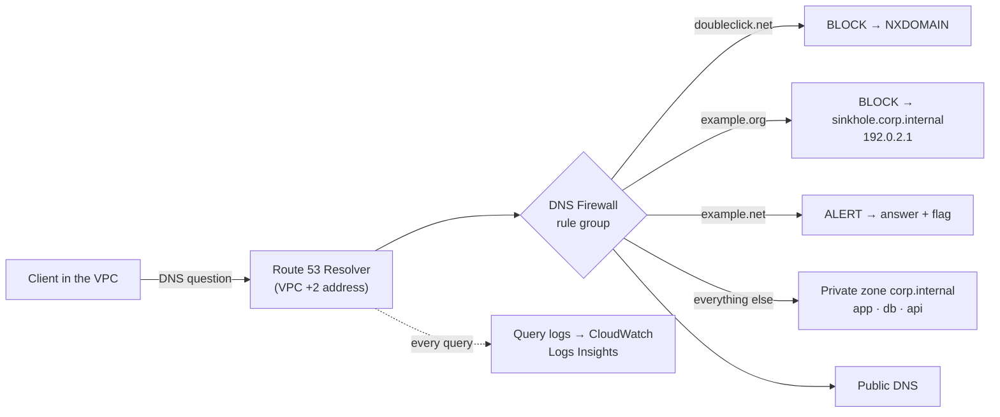

# Architecture

## What happens when the client looks up a name

1. The client asks the **Route 53 Resolver** at the VPC's `+2` address (10.50.0.2).
2. **DNS Firewall** checks the name against the rule group, in priority order: 100 block, 200 sinkhole, 300 alert.
3. If a BLOCK rule matches, the resolver answers immediately (NXDOMAIN, or the sinkhole CNAME). The real domain is never contacted.
4. Otherwise the resolver answers from the **private zone** (for `corp.internal`) or from public DNS.
5. Every question, its answer code and any firewall action are written to **query logs**.

| Component | AWS name |
|-----------|----------|
| VPC | `private-dns-dev-vpc` |
| Private zone | `corp.internal` |
| Domain lists | `private-dns-dev-blocked`, `-sinkholed`, `-alert` |
| Rule group | `private-dns-dev-rules` |
| Query log config / group | `private-dns-dev-query-logs`, `/private-dns-dev/resolver-query-logs` |
| Client | `private-dns-dev-client` |
