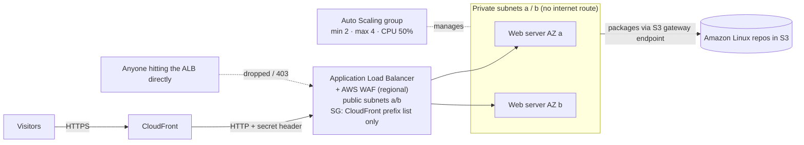
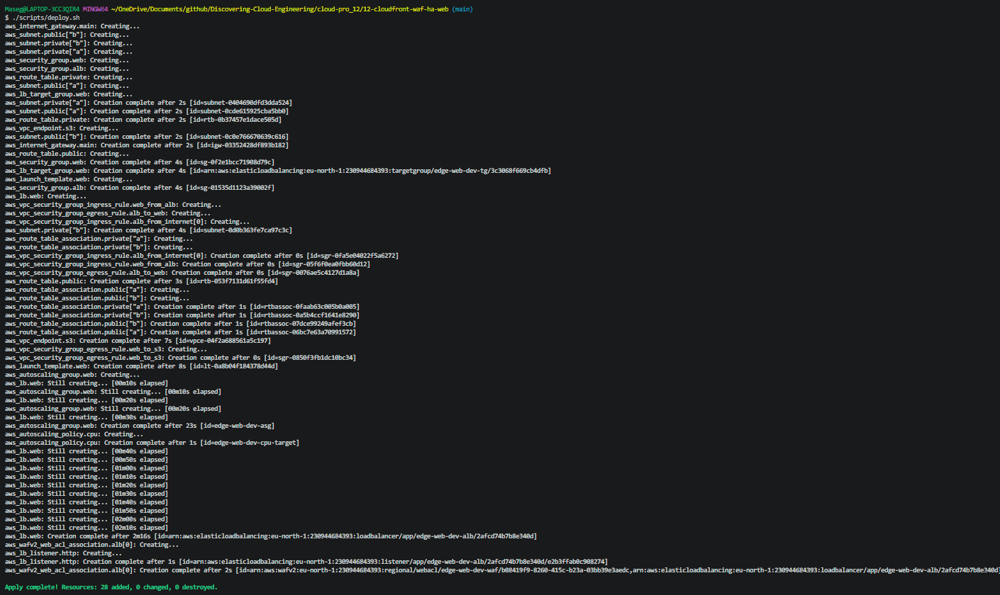
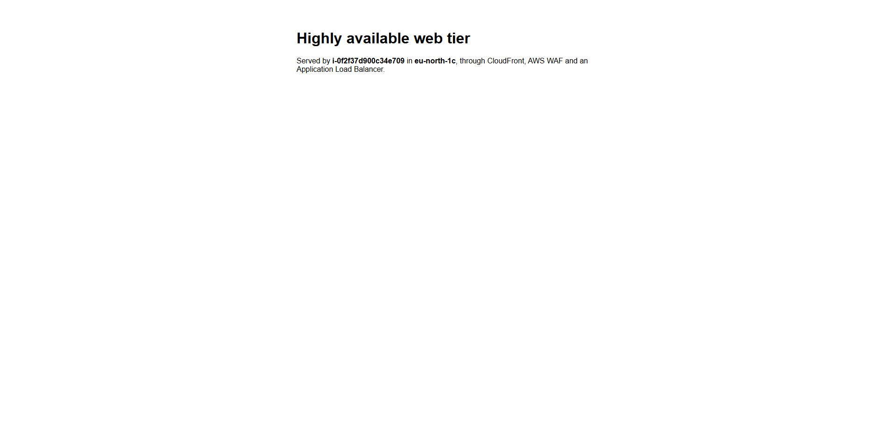
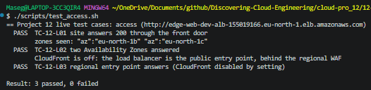
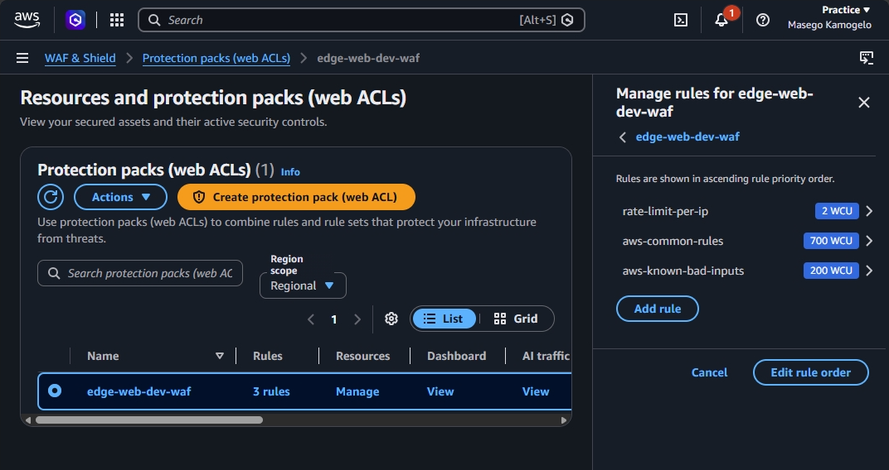
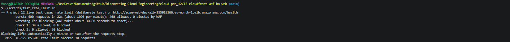
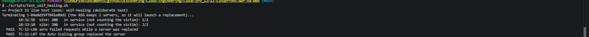
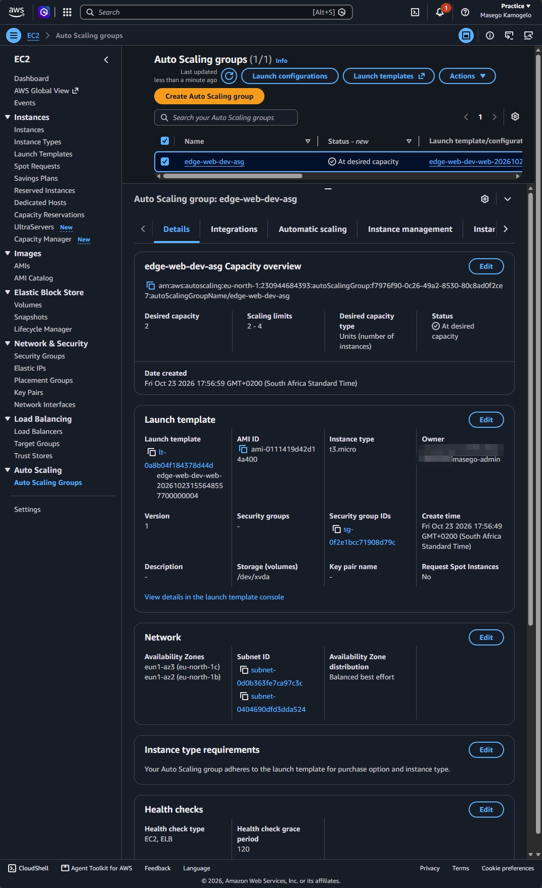
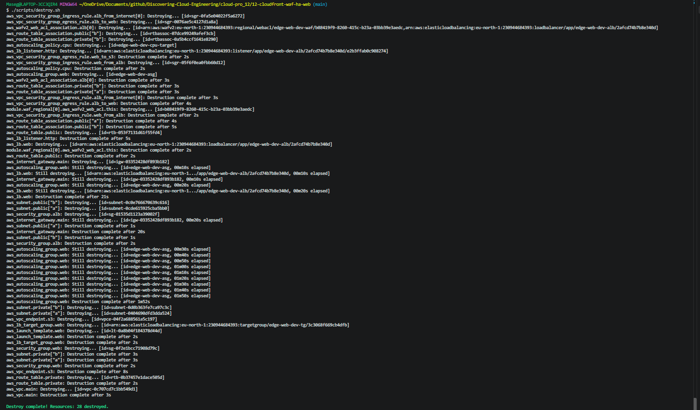

# 🛡️ 12 – Highly Available Web Tier behind CloudFront and AWS WAF

**A web tier spread across two Availability Zones in private subnets, reachable only through CloudFront and an AWS WAF-protected load balancer, with an origin that refuses anyone who tries to go around them.**

<p align="center">
  
</p>

> 🌐 Part of the **Networking track** of [Discovering Cloud Engineering](../../README.md).

## 💡 Why I Built This

Project 04 was one server in one AZ with its port open to the world. That's fine for learning, but it's not how a real website runs. I wanted to build the pattern most companies actually use at the edge: a **CDN in front**, a **web application firewall** that stops abuse before it reaches my servers, a **load balancer across two AZs**, and servers that **replace themselves** when they fail. The part I found most interesting was **origin protection**: a WAF is pointless if attackers can skip it and hit the load balancer directly, so I locked the origin down at both the network layer and the HTTP layer.

## 🎯 The Problem It Solves

Public websites face traffic spikes, bots, scrapers and attack payloads, and they're expected to stay up when a server or a whole data centre fails. They also need a single, controlled front door, so that security rules can't be bypassed by finding the server behind them.

## 🧠 What This Project Shows

- **High availability:** an Auto Scaling group across 2 AZs with ELB health checks and CPU target tracking
- **AWS WAF** on the load balancer with a per-visitor **rate limit** (using the real visitor IP from `X-Forwarded-For`), the **AWS Common Rule Set** and **Known Bad Inputs**. A switch moves it onto CloudFront instead, for accounts that allow us-east-1
- **Origin protection in two layers:** the ALB security group allows only CloudFront's **managed prefix list**, and the listener requires a **secret header** CloudFront adds
- **Private servers with no internet route:** packages install through an **S3 gateway endpoint**, because Amazon Linux 2023's repositories live in S3
- **Self-healing proof:** terminating a server mid-traffic, with zero failed requests
- **HTTPS for visitors** using CloudFront's default certificate, without buying a domain

## 🛠️ Technologies

`Amazon CloudFront` · `AWS WAF` · `Application Load Balancer` · `EC2 Auto Scaling` · `Launch templates` · `EC2 Graviton` · `Amazon VPC` · `Managed prefix lists` · `S3 gateway endpoint` · `Nginx` · `Terraform` · `Bash`

## 🏗️ Architecture



| Piece | What it does |
|-------|--------------|
| CloudFront | The only public entry point; HTTPS for visitors; adds the secret header |
| AWS WAF (regional) | On the ALB; blocks visitors over 100 requests/minute; AWS managed rules for common attacks |
| ALB | Public subnets in 2 AZs; accepts only CloudFront IP ranges *and* the secret header |
| Auto Scaling group | 2–4 Graviton web servers in private subnets; replaces unhealthy ones |
| S3 gateway endpoint | Lets private servers install Nginx with no internet route |

## 🧰 Services Used, in Detail

Every service and tool in this project: what it is, how it works, exactly how this project uses it, why I chose it, and what it costs. Expand a service below for the full detail.

| Service | What it is |
| --- | --- |
| **Amazon CloudFront** | A content delivery network: edge locations close to visitors receive requests and forward them to the origin. |
| **AWS WAF** | A web application firewall: inspects HTTP requests and blocks those that match rules. |
| **Application Load Balancer and managed prefix list** | The ALB spreads traffic across healthy servers in two Availability Zones; the prefix list is AWS's list of CloudFront addresses. |
| **EC2 Auto Scaling and launch templates** | Keeps the right number of servers running and replaces unhealthy ones. |
| **S3 gateway endpoint** | A free, private route to S3. |
| **Amazon VPC and Nginx** | The network, and the web server software. |
| **Terraform** | Infrastructure as Code. |

<details>
<summary><b>Amazon CloudFront</b></summary>

- **What it is:** A content delivery network: edge locations close to visitors receive requests and forward them to the origin.
- **How it works:** A **distribution** has an origin (here, the ALB) and cache behaviours. It can redirect HTTP to HTTPS and add custom headers to requests it sends to the origin.
- **How this project uses it:** One distribution using `PriceClass_100` (North America and Europe edges only, the cheapest), `redirect-to-https` for visitors with CloudFront's default certificate, caching disabled (the page is dynamic), and a secret `X-Origin-Verify` header added to every origin request. It talks to the ALB over HTTP because there is no custom domain for an ALB certificate (ADR 0003).
- **Why this choice:** It gives visitors HTTPS without buying a domain, and a single front door that the origin can insist on.
- **Cost:** Request and transfer charges are fractions of a cent here.

</details>

<details>
<summary><b>AWS WAF</b></summary>

- **What it is:** A web application firewall: inspects HTTP requests and blocks those that match rules.
- **How it works:** A **web ACL** holds rules in priority order. **Rate-based** rules count requests per visitor; **managed rule groups** are maintained by AWS.
- **How this project uses it:** A web ACL on the ALB (`REGIONAL` scope) with a rate limit of 100 requests per minute per visitor, using the real visitor IP from `X-Forwarded-For`, plus the AWS Common Rule Set and Known Bad Inputs. A variable moves it to CloudFront instead, which needs us-east-1.
- **Why this choice:** It stops floods and common attack payloads before they reach a server. My account only allows eu-north-1, so the default is regional.
- **Cost:** $5 a month per web ACL plus $1 per rule, prorated: about $0.011 an hour.

</details>

<details>
<summary><b>Application Load Balancer and managed prefix list</b></summary>

- **What it is:** The ALB spreads traffic across healthy servers in two Availability Zones; the prefix list is AWS's list of CloudFront addresses.
- **How it works:** Security groups can reference the managed prefix list `com.amazonaws.global.cloudfront.origin-facing`. Listener rules can check a header and return a fixed response if it's missing.
- **How this project uses it:** Origin protection in two layers: the ALB security group allows only CloudFront's prefix list, and the listener forwards only requests carrying the secret header; everything else gets an error. Invalid headers are dropped.
- **Why this choice:** A WAF is pointless if attackers can skip it and hit the ALB directly.
- **Cost:** About $0.0225 an hour plus 2 public IPv4 addresses at $0.005 an hour each.

</details>

<details>
<summary><b>EC2 Auto Scaling and launch templates</b></summary>

- **What it is:** Keeps the right number of servers running and replaces unhealthy ones.
- **How it works:** A **launch template** describes the server; the **Auto Scaling group** launches from it across subnets. With ELB health checks, a server the ALB marks unhealthy is replaced. **Target tracking** adds or removes servers to hold a metric near a target.
- **How this project uses it:** Minimum 2, maximum 4 t4g.micro servers across 2 AZs, ELB health checks, and target tracking at 50% average CPU. The template requires IMDSv2 with hop limit 1 and an encrypted disk. `test_self_healing.sh` terminates a server mid-traffic and checks that no requests fail.
- **Why this choice:** Two servers in two AZs survive one server or one data centre failing.
- **Cost:** Two t4g.micro servers: about $0.017 an hour.

</details>

<details>
<summary><b>S3 gateway endpoint</b></summary>

- **What it is:** A free, private route to S3.
- **How it works:** It adds the S3 prefix list to the private route table.
- **How this project uses it:** The web servers have no internet route. Amazon Linux 2023's package repositories are hosted in S3, so `dnf install nginx` works through this endpoint alone.
- **Why this choice:** Servers can install packages without a NAT gateway (about $32 a month).
- **Cost:** Free.

</details>

<details>
<summary><b>Amazon VPC and Nginx</b></summary>

- **What it is:** The network, and the web server software.
- **How it works:** Public subnets hold the ALB; private subnets hold the servers.
- **How this project uses it:** `10.60.0.0/16` over two AZs. Nginx serves a page showing which server answered, with its version hidden.
- **Why this choice:** Showing the server name makes load balancing and self-healing visible.
- **Cost:** Free.

</details>

<details>
<summary><b>Terraform</b></summary>

- **What it is:** Infrastructure as Code.
- **How it works:** Terraform reads `.tf` files that describe the end state, compares them with a state file of what it built before, and makes only the API calls needed to close the gap. `plan` shows the changes; `apply` makes them; `destroy` removes everything it created. Offline `terraform test` files in `infrastructure/tests/` use a mock AWS provider, so the rules are checked for free on every push, before anything is deployed.
- **How this project uses it:** The offline tests check the origin protection, the WAF rules and the Auto Scaling settings.
- **Why this choice:** Security rules can't be removed by accident without a failing test.
- **Cost:** Free.

</details>

## 🚀 Quickstart

```bash
cd cloud-pro_12/12-cloudfront-waf-ha-web
cp infrastructure/terraform.tfvars.example infrastructure/terraform.tfvars   # set owner
./scripts/deploy.sh              # 10-15 minutes: CloudFront takes a while
./scripts/test_access.sh         # works via CloudFront; direct ALB access blocked
./scripts/test_rate_limit.sh     # deliberate: WAF starts returning 403
./scripts/test_self_healing.sh   # deliberate: terminate a server, site stays up
./scripts/destroy.sh             # 10-15 minutes
```

New to this project? Follow the full step-by-step guide: **[docs/START-HERE.md](docs/START-HERE.md)**. Short operations card: [docs/runbook.md](docs/runbook.md).

## 🧩 Key Design Decisions

- [0001 – CloudFront in front, WAF on the load balancer](docs/adr/0001-cloudfront-waf-front-door.md)
- [0002 – Two-layer origin protection](docs/adr/0002-origin-protection.md)
- [0003 – HTTP between CloudFront and the ALB](docs/adr/0003-http-origin.md)
- [0004 – Private web servers with an S3 gateway endpoint](docs/adr/0004-private-servers-s3-endpoint.md)

## 🔐 Security Highlights

- **One front door:** the ALB drops connections from anything except CloudFront's address ranges
- **Secret header check:** even other CloudFront distributions can't use this ALB as their origin
- **WAF rate limiting and managed rules** stop floods and common attack payloads before they reach a server
- **Web servers have no public IPs and no internet route**; their only outbound path is HTTPS to S3
- IMDSv2 required (hop limit 1), encrypted disks, Nginx version hidden, invalid headers dropped at the ALB

## 🧪 Test Cases

**16 test cases**, each with an ID (full list: [docs/TEST-CASES.md](docs/TEST-CASES.md)).

| Level | Cases | Needs AWS? | How to run |
|-------|-------|------------|------------|
| Offline Terraform tests | 10 | No, free | `terraform -chdir=infrastructure test` |
| Live tests (PASS/FAIL) | 7 | Yes | `./scripts/test_access.sh`, `./scripts/test_rate_limit.sh`, `./scripts/test_self_healing.sh` |

The offline tests run against a mocked AWS, so a broken security rule fails before anything is deployed. Deliberate tests are labelled as such.

## 📸 Screenshots

| # | What it proves | Image |
|---|----------------|-------|
| 1 | Infrastructure deployed from code |  |
| 2 | The site over HTTPS through CloudFront |  |
| 3 | Load balanced across AZs; direct ALB access blocked |  |
| 4 | ALB only accepts CloudFront's address ranges |  |
| 5 | ALB requires the secret header, else 403 |  |
| 6 | Two healthy servers in two AZs |  |
| 7 | WAF rules: rate limit plus AWS managed rules |  |
| 8 | Rate limiting kicking in (deliberate test) |  |
| 9 | WAF's own record of the blocked requests |  |
| 10 | Site stays up while a server is replaced (deliberate test) |  |
| 11 | Auto Scaling activity: terminate and replace |  |
| 12 | Everything torn down |  |

## 💰 Cost and Teardown

Built and tested in my own AWS account. While deployed it costs about **$0.06 per hour**: the ALB (~$0.0225/hour), its 2 public IPv4 addresses ($0.01/hour), two t4g.micro servers (~$0.017/hour), and AWS WAF (a web ACL at $5/month plus $1/month per rule, prorated, about $0.011/hour). CloudFront and WAF request charges are fractions of a cent. A 4-hour session is roughly **$0.25**. `./scripts/destroy.sh` removes everything.

_Estimates from AWS list prices, October 2026; prices in eu-north-1 (Stockholm), where this was built, are similar. Check your own bill in Billing → Cost Explorer._

## 📚 Lessons Learned

<!-- Fill in after you build it: what broke, how you fixed it, what you'd change. Only write what actually happened. -->
