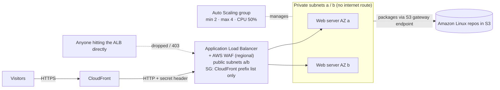

# Architecture

## What happens to a visitor's request

1. The browser connects to `dxxxx.cloudfront.net` over **HTTPS** at the nearest edge location.
2. CloudFront forwards the request to the ALB over HTTP, adding the **`X-Origin-Verify`** secret header and the visitor's IP in `X-Forwarded-For`.
3. The ALB's security group accepts the connection because it comes from a **CloudFront origin-facing** address.
4. **AWS WAF** (attached to the ALB) checks the request: is this visitor over 100 requests/minute? Does it match an attack pattern? If so, it returns a **403**.
5. The listener rule sees the correct header and forwards to the target group; requests without it get a **403**.
6. A healthy web server in either AZ answers. Its `/whoami` page shows which server and AZ handled the request.

## What happens when a server fails

The ALB health check (`/health` every 15 seconds) marks it unhealthy after 3 failures and stops sending it traffic. Because the Auto Scaling group uses the **ELB health check type**, it terminates the server and launches a replacement in the same AZ.

| Component | AWS name |
|-----------|----------|
| VPC / subnets | `edge-web-dev-vpc`, `-public-a/b`, `-private-a/b` |
| ALB / target group | `edge-web-dev-alb`, `edge-web-dev-tg` |
| Auto Scaling group | `edge-web-dev-asg` |
| WAF web ACL | `edge-web-dev-waf` (Regional, eu-north-1, attached to the ALB) |
| CloudFront | comment `edge-web-dev edge` |
