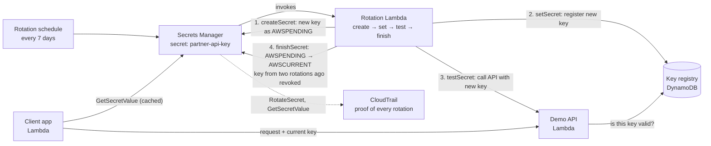
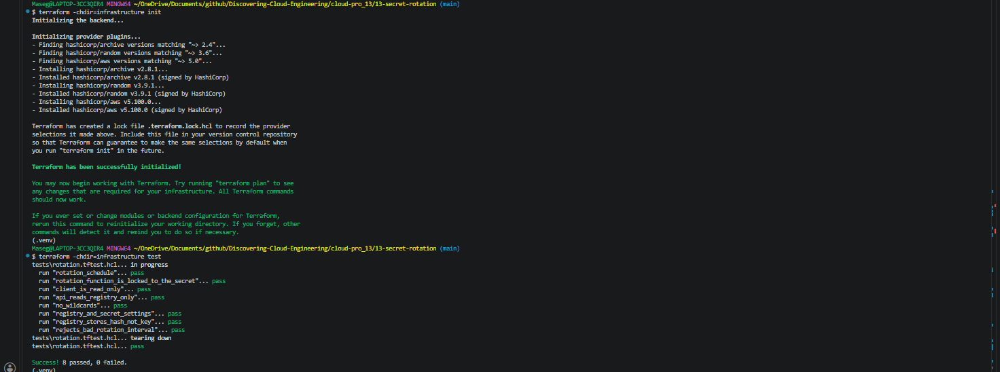
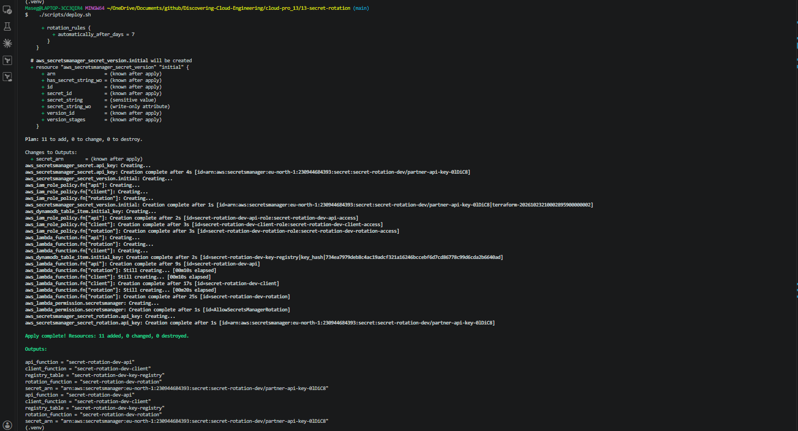
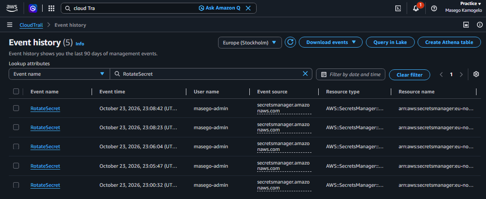
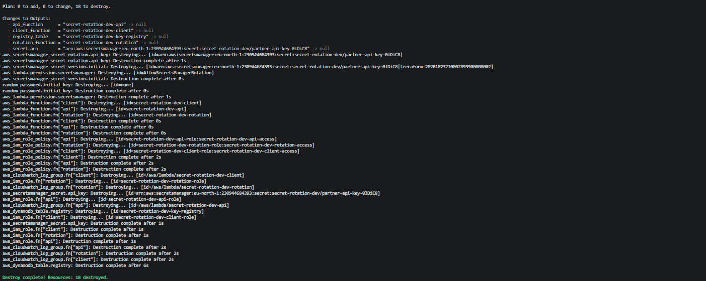

# 🔑 13 – Automatic Secret Rotation with AWS Secrets Manager

**An API key that replaces itself on a schedule: a rotation Lambda creates, registers, tests and promotes a new key, the app always reads the current one, and CloudTrail proves every rotation.**

> 🔐 Part of the **Security & Identity track** of [Discovering Cloud Engineering](../../README.md). Real-world context: [PROJECT-CONTEXT.md](../../PROJECT-CONTEXT.md#13--automatic-secret-rotation--discovery-planned).
>
> 📅 **Status: code and tests ready, building Monday 26 October 2026.** Screenshots and results are added when it has been deployed.

## 💡 Why I Built This

In Project 02 I moved a database password out of code and into Secrets Manager. But a secret that never changes is only half a fix: if it leaks, it works forever. Most breach reports I read while building Project 07 involved a long-lived credential. I wanted to learn how companies make secrets **short-lived** without breaking the applications that use them, and to understand the four-step rotation that AWS uses for its own database secrets well enough to write one myself.

## 🎯 The Problem It Solves

Teams store keys and passwords safely but almost never change them, because changing one by hand risks an outage. Auditors and frameworks such as PCI DSS expect credentials to be rotated regularly, and security teams need evidence that it happened.

## 🧠 What This Project Shows

- **Custom rotation Lambda** implementing Secrets Manager's four steps: `createSecret`, `setSecret`, `testSecret`, `finishSecret`
- **Version stages** (`AWSPENDING`, `AWSCURRENT`, `AWSPREVIOUS`) and why the test step comes *before* the switch
- **Zero-downtime rotation:** the current and previous keys both stay valid, so a client holding a cached key never fails
- **Client-side caching** so the app doesn't call Secrets Manager on every request
- **Least privilege:** only the rotation Lambda can write to the key registry; the app can only *read* the secret
- **Audit evidence:** CloudTrail shows every `RotateSecret` and who read the secret

## 🛠️ Technologies

`AWS Secrets Manager` · `AWS Lambda` · `Amazon DynamoDB` · `AWS CloudTrail` · `IAM` · `Terraform` · `Python`

## 🏗️ Architecture



| Piece | What it does |
|-------|--------------|
| Secret `partner-api-key` | The API key, with a rotation schedule every 7 days (and an on-demand "rotate now") |
| Rotation Lambda | Runs the four steps; only Secrets Manager can invoke it |
| Key registry (DynamoDB) | Stands in for a partner system that has to accept the new key; holds the current and previous keys |
| Demo API Lambda | Accepts a request only if its key is in the registry |
| Client app Lambda | Reads the secret (cached) and calls the API |
| CloudTrail | Records every rotation and every read of the secret |

## 🧰 Services Used, in Detail

Every service and tool in this project: what it is, how it works, exactly how this project uses it, why I chose it, and what it costs. Expand a service below for the full detail.

| Service | What it is |
| --- | --- |
| **AWS Secrets Manager** | Stores secrets such as API keys, encrypted, and can rotate them on a schedule. |
| **AWS Lambda (rotation, demo API and client)** | Three small functions: the rotation code, a pretend partner API and a pretend app. |
| **Amazon DynamoDB (key registry)** | Stands in for the partner's list of valid keys. |
| **AWS KMS** | Encrypts the secret at rest. |
| **AWS CloudTrail** | The audit record of API calls. |
| **AWS IAM** | Least-privilege roles for each function. |
| **Terraform, pytest and moto** | Infrastructure as Code, plus free tests. |

<details>
<summary><b>AWS Secrets Manager</b></summary>

- **What it is:** Stores secrets such as API keys, encrypted, and can rotate them on a schedule.
- **How it works:** Each secret has **versions** with labels: `AWSCURRENT` (in use), `AWSPENDING` (being rotated in) and `AWSPREVIOUS` (the last one). Rotation calls a Lambda four times: `createSecret`, `setSecret`, `testSecret`, `finishSecret`.
- **How this project uses it:** One secret, `secret-rotation-dev/partner-api-key`, rotated automatically every 7 days. `recovery_window_in_days = 0` deletes it immediately on destroy, because this is a practice project.
- **Why this choice:** Managed rotation with version labels means apps never need to know a rotation is happening.
- **Cost:** About $0.40 a month per secret (prorated) plus $0.05 per 10,000 API calls.

</details>

<details>
<summary><b>AWS Lambda (rotation, demo API and client)</b></summary>

- **What it is:** Three small functions: the rotation code, a pretend partner API and a pretend app.
- **How it works:** Secrets Manager invokes the rotation function with the step name and the new version's ID.
- **How this project uses it:** **Rotation**: creates a new key, registers it with the partner, tests it, then promotes it. A resource policy lets only Secrets Manager invoke it, for this one secret. **Demo API**: accepts a key only if it is in the registry. **Client**: reads the secret, caches it for 300 seconds, and calls the demo API.
- **Why this choice:** Writing the four steps myself shows exactly why the test step comes before the switch.
- **Cost:** Within the Free Tier.

</details>

<details>
<summary><b>Amazon DynamoDB (key registry)</b></summary>

- **What it is:** Stands in for the partner's list of valid keys.
- **How it works:** Items are looked up by key; here, a hash of the API key.
- **How this project uses it:** An on-demand table keyed on `key_hash` (the key itself is never stored). The current and previous keys both stay valid, so a client with a cached key never fails during a rotation.
- **Why this choice:** It makes the whole flow testable end to end without a real partner.
- **Cost:** Pay per request; cents at most.

</details>

<details>
<summary><b>AWS KMS</b></summary>

- **What it is:** Encrypts the secret at rest.
- **How it works:** Secrets Manager asks KMS for a data key to encrypt each secret version.
- **How this project uses it:** Uses the AWS managed key for Secrets Manager; the secret value is never written to logs or Terraform outputs.
- **Why this choice:** Encryption is on by default; a customer-managed key is covered in Project 14.
- **Cost:** Free for the AWS managed key.

</details>

<details>
<summary><b>AWS CloudTrail</b></summary>

- **What it is:** The audit record of API calls.
- **How it works:** Every `RotateSecret`, `PutSecretValue` and `GetSecretValue` call is recorded in the event history.
- **How this project uses it:** The event history shows each rotation and every read of the secret; it is checked in the console and captured as a screenshot.
- **Why this choice:** Auditors want evidence, not just a schedule.
- **Cost:** Event history (90 days) is free.

</details>

<details>
<summary><b>AWS IAM</b></summary>

- **What it is:** Least-privilege roles for each function.
- **How it works:** Each Lambda has its own role.
- **How this project uses it:** Only the rotation function can write to the registry and update the secret; the client can only call `GetSecretValue` on this one secret.
- **Why this choice:** A compromised app can read the key but never change it.
- **Cost:** Free.

</details>

<details>
<summary><b>Terraform, pytest and moto</b></summary>

- **What it is:** Infrastructure as Code, plus free tests.
- **How it works:** Terraform reads `.tf` files that describe the end state, compares them with a state file of what it built before, and makes only the API calls needed to close the gap. `plan` shows the changes; `apply` makes them; `destroy` removes everything it created. Offline `terraform test` files in `infrastructure/tests/` use a mock AWS provider, so the rules are checked for free on every push, before anything is deployed.
- **How this project uses it:** 13 unit tests cover the four rotation steps and the client cache with fake AWS services; 8 offline Terraform tests check the schedule and permissions.
- **Why this choice:** The rotation logic is proven before it touches a real secret.
- **Cost:** Free.

</details>

## 🚀 Quickstart

```bash
cd cloud-pro_13/13-secret-rotation
pip install -r requirements-dev.txt && pytest -v          # 13 unit test cases, free
terraform -chdir=infrastructure init && terraform -chdir=infrastructure test   # 8 offline test cases
cp infrastructure/terraform.tfvars.example infrastructure/terraform.tfvars   # set owner
./scripts/deploy.sh
./scripts/run_tests.sh      # 9 live test cases: two real rotations, PASS/FAIL each
./scripts/destroy.sh
```

New to this project? Follow the full step-by-step guide: **[docs/START-HERE.md](docs/START-HERE.md)**. Short operations card: [docs/runbook.md](docs/runbook.md).

## 🧪 Test Cases

**31 test cases**, each with an ID (full list: [docs/TEST-CASES.md](docs/TEST-CASES.md)).

| Level | Cases | Needs AWS? | Cost | How to run |
|-------|-------|------------|------|------------|
| Offline Terraform tests (T) | 8 | No | Free | `terraform -chdir=infrastructure test` |
| Unit tests (U) | 13 | No (AWS is mocked) | Free | `pytest -v` |
| Live tests (L) | 9 | Yes, after `./scripts/deploy.sh` | under $0.01 | `./scripts/run_tests.sh` |
| Manual checks (M) | 1 | Yes | Free | Console / inbox (see the guide) |

Offline and unit tests use a mocked AWS, so a broken security rule fails before anything is deployed, and they run in GitHub Actions on every push. Deliberate tests are labelled as such.

## 🧩 Key Design Decisions

- [0001 – Custom rotation for an API key](docs/adr/0001-custom-rotation.md)
- [0002 – Keep the previous key valid until the next rotation](docs/adr/0002-overlap-window.md)
- [0003 – Store only key hashes in the registry](docs/adr/0003-hash-only-registry.md)

## 🔐 Security Highlights

- The secret is encrypted at rest with KMS and never written to logs or Terraform outputs
- The rotation Lambda's resource policy lets only Secrets Manager invoke it, for this one secret
- The client can call `GetSecretValue` on this secret only, and can't change it

## 📸 Screenshots

| # | What it proves | Image |
|---|----------------|-------|
| 1 | Unit and offline test cases pass |  |
| 2 | Infrastructure deployed from code |  |
| 3 | Rotation turned on: every 7 days, with the rotation function |  |
| 4 | Live test cases: two rotations, old key revoked |  |
| 5 | The four rotation steps in the function's logs |  |
| 6 | Version labels after a rotation (AWSCURRENT, AWSPREVIOUS) |  |
| 7 | CloudTrail shows the RotateSecret events |  |
| 8 | Everything torn down |  |

## 💰 Cost and Teardown

A secret costs about **$0.40 per month** (prorated to the hours it exists) plus **$0.05 per 10,000 API calls**. Lambda and DynamoDB stay inside the free tier. A build session is **under $0.05**. `./scripts/destroy.sh` removes everything.

_Estimates from AWS list prices, October 2026, for eu-north-1 (Stockholm). Check the AWS pricing pages and your own bill in Billing → Cost Explorer._

## 🚦 Account Check

✅ Nothing here should be blocked by my account's limits (eu-north-1 only, no OIDC, Free Tier instance sizes). Run `./scripts/preflight.sh` before deploying.

## 📚 Lessons Learned

<!-- Fill in after building: what broke, the exact error, the cause, the fix and the lesson. Only write what actually happened. -->
