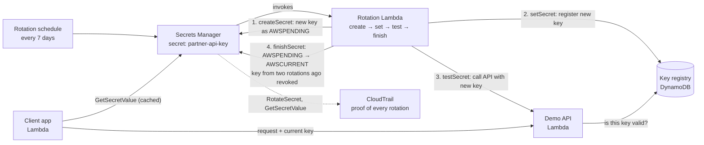

# Architecture – 13 Automatic Secret Rotation

| Piece | What it does |
|-------|--------------|
| Secret `partner-api-key` | The API key, with a rotation schedule every 7 days (and an on-demand "rotate now") |
| Rotation Lambda | Runs the four steps; only Secrets Manager can invoke it |
| Key registry (DynamoDB) | Stands in for a partner system that has to accept the new key; holds the current and previous keys |
| Demo API Lambda | Accepts a request only if its key is in the registry |
| Client app Lambda | Reads the secret (cached) and calls the API |
| CloudTrail | Records every rotation and every read of the secret |

## AWS names

| Component | Name |
|-----------|------|
| Secret | `secret-rotation-dev/partner-api-key` |
| Lambdas | `secret-rotation-dev-rotation`, `-api`, `-client` |
| Key registry table | `secret-rotation-dev-key-registry` |
| Log groups | `/aws/lambda/secret-rotation-dev-*` (1-day retention) |
