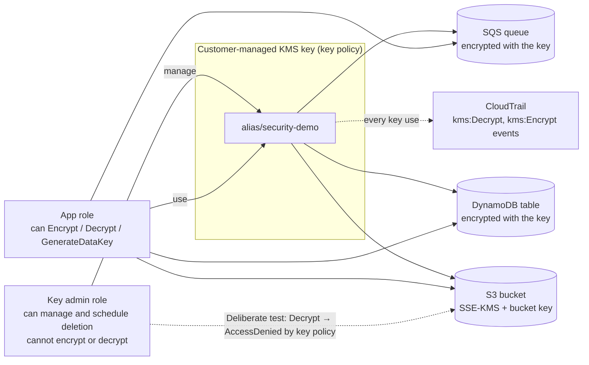
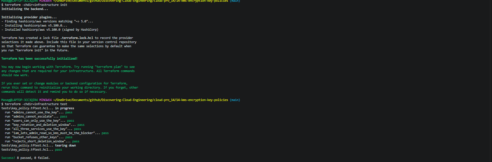
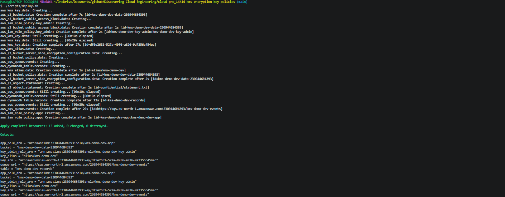
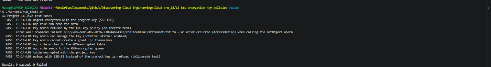
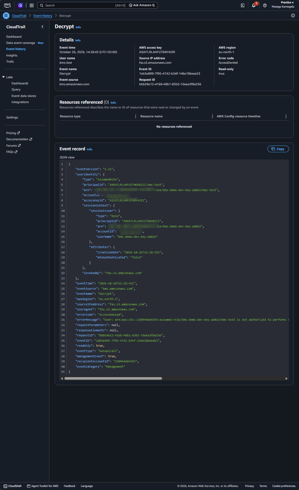
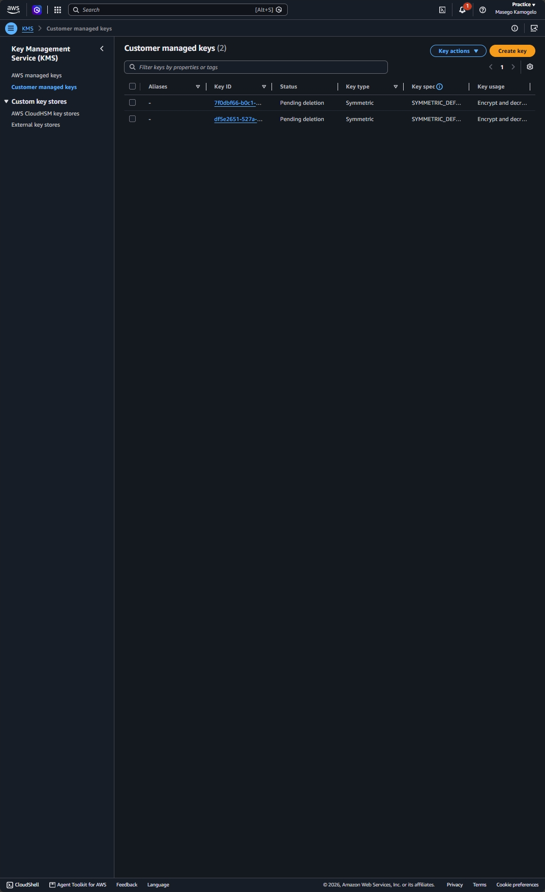
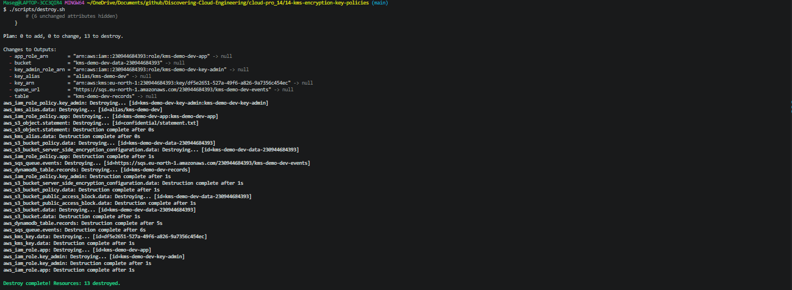

# 🗝️ 14 – KMS Encryption and Key Policies

**One customer-managed KMS key encrypting S3, DynamoDB and SQS, with a key policy that separates the people who **manage** the key from the applications that **use** it, proved with a deliberate access-denied test.**

> 🔐 Part of the **Security & Identity track** of [Discovering Cloud Engineering](../../README.md). Real-world context: [PROJECT-CONTEXT.md](../../PROJECT-CONTEXT.md#14--kms-encryption-and-key-policies--capitec-planned).
>
> 📅 **Status: code and tests ready, building Tuesday 27 October 2026.** Screenshots and results are added when it has been deployed.

## 💡 Why I Built This

Every project so far said "encrypted at rest", but AWS chose and managed the keys. I couldn't have said *who* could decrypt the data. I built this to understand KMS properly: how a key policy and IAM policies combine, why separating key administrators from key users matters, and how to prove that an administrator can't read data they shouldn't.

## 🎯 The Problem It Solves

Regulated companies must control and audit who can decrypt sensitive data, and show that the people who administer encryption keys can't use them to read that data. Default AWS-managed keys don't give that separation.

## 🧠 What This Project Shows

- **Customer-managed key** with automatic yearly rotation turned on
- **Separation of duties:** a key-admin role can manage and schedule deletion of the key but **cannot** encrypt or decrypt
- **One key, three services:** S3 (with an S3 Bucket Key to cut KMS calls), DynamoDB and SQS
- **How key policies and IAM combine,** including why the account statement in the key policy lets IAM grant access
- **Deliberate test:** the key-admin role tries to read an encrypted object and gets `AccessDenied` from the key policy
- **Audit:** every `Encrypt` and `Decrypt` call visible in CloudTrail

## 🛠️ Technologies

`AWS KMS` · `Key policies` · `Amazon S3` · `Amazon DynamoDB` · `Amazon SQS` · `AWS CloudTrail` · `IAM` · `Terraform`

## 🏗️ Architecture



| Piece | What it does |
|-------|--------------|
| KMS key `alias/security-demo` | Customer-managed, rotation on, with a written key policy |
| Key-admin role | Manages the key; no permission to use it |
| App role | Encrypts and decrypts through the services, nothing else |
| S3 bucket | SSE-KMS with an S3 Bucket Key; a bucket policy denies uploads that aren't encrypted with this key |
| DynamoDB table and SQS queue | Both encrypted with the same key |
| CloudTrail | Shows each use of the key and who made it |

## 🧰 Services Used, in Detail

Every service and tool in this project: what it is, how it works, exactly how this project uses it, why I chose it, and what it costs. Expand a service below for the full detail.

| Service | What it is |
| --- | --- |
| **AWS KMS (customer-managed key)** | A key that I own and control, used to encrypt data in other AWS services. |
| **KMS key policy** | The resource policy on the key. |
| **Amazon S3 with SSE-KMS and a Bucket Key** | Encrypts each object with the customer-managed key. |
| **Amazon DynamoDB and Amazon SQS** | A table and a queue encrypted with the same key. |
| **AWS CloudTrail** | Records every KMS call. |
| **AWS IAM** | The two roles the key policy refers to. |
| **Terraform** | Infrastructure as Code. |

<details>
<summary><b>AWS KMS (customer-managed key)</b></summary>

- **What it is:** A key that I own and control, used to encrypt data in other AWS services.
- **How it works:** KMS never releases the key itself. Services ask KMS to create a **data key**, encrypt data with it, and store the data key encrypted alongside the data (envelope encryption). Every use of the key is a KMS API call that can be allowed, denied and logged.
- **How this project uses it:** One key with automatic yearly rotation and a deletion waiting period of 7 days (allowed range 7–30), plus the alias `alias/kms-demo-dev`.
- **Why this choice:** AWS managed keys can't separate who manages a key from who uses it.
- **Cost:** About $1 a month (prorated) plus $0.03 per 10,000 requests.

</details>

<details>
<summary><b>KMS key policy</b></summary>

- **What it is:** The resource policy on the key. It is the main control: without it, nobody, not even the account root, can use the key.
- **How it works:** A request is allowed only if the key policy allows it, either directly or through a statement that lets IAM policies in the account grant access.
- **How this project uses it:** Three kinds of statement: the account statement (so IAM can grant access), a **key admin** role that can manage, rotate and schedule deletion of the key but **not** encrypt or decrypt, and an **app (key user)** role that can encrypt, decrypt and generate data keys.
- **Why this choice:** Separation of duties: the people who administer encryption can't read the data.
- **Cost:** Free.

</details>

<details>
<summary><b>Amazon S3 with SSE-KMS and a Bucket Key</b></summary>

- **What it is:** Encrypts each object with the customer-managed key.
- **How it works:** With an **S3 Bucket Key**, S3 gets one data key from KMS per bucket for a period instead of one per object, which cuts KMS calls and cost.
- **How this project uses it:** Default encryption with the key and Bucket Key on. The bucket policy denies uploads that ask for another encryption type (`DenyOtherEncryptionTypes`) or another key (`DenyOtherKmsKeys`), and any plain-HTTP request (`DenyInsecureTransport`).
- **Why this choice:** Data can't end up encrypted with a key outside this project's control.
- **Cost:** Within the Free Tier.

</details>

<details>
<summary><b>Amazon DynamoDB and Amazon SQS</b></summary>

- **What it is:** A table and a queue encrypted with the same key.
- **How it works:** Both services call KMS for data keys when reading and writing.
- **How this project uses it:** The records table and the events queue both name the customer-managed key.
- **Why this choice:** One key, three services, one policy deciding who can read any of them.
- **Cost:** Within the Free Tier.

</details>

<details>
<summary><b>AWS CloudTrail</b></summary>

- **What it is:** Records every KMS call.
- **How it works:** `Encrypt`, `Decrypt` and `GenerateDataKey` calls appear in event history with the caller's identity.
- **How this project uses it:** The event history shows the key admin's denied decrypt next to the app role's successful one; it is checked in the console and captured as a screenshot.
- **Why this choice:** Proof of who used the key, and when.
- **Cost:** Event history is free.

</details>

<details>
<summary><b>AWS IAM</b></summary>

- **What it is:** The two roles the key policy refers to.
- **How it works:** Roles are assumed with temporary credentials for each test.
- **How this project uses it:** A key-admin role and an app role. The deliberate test assumes the key-admin role, tries to read an encrypted object and expects `AccessDenied` from the key policy, even though IAM and S3 would allow the read. Another test checks the key admin can't give itself a grant.
- **Why this choice:** The test proves the separation instead of just claiming it.
- **Cost:** Free.

</details>

<details>
<summary><b>Terraform</b></summary>

- **What it is:** Infrastructure as Code.
- **How it works:** Terraform reads `.tf` files that describe the end state, compares them with a state file of what it built before, and makes only the API calls needed to close the gap. `plan` shows the changes; `apply` makes them; `destroy` removes everything it created. Offline `terraform test` files in `infrastructure/tests/` use a mock AWS provider, so the rules are checked for free on every push, before anything is deployed.
- **How this project uses it:** 8 offline tests check the key policy statements and the bucket policy denies.
- **Why this choice:** Removing a deny by accident fails the build.
- **Cost:** Free.

</details>

## 🚀 Quickstart

```bash
cd cloud-pro_14/14-kms-encryption-key-policies
terraform -chdir=infrastructure init && terraform -chdir=infrastructure test   # 7 offline test cases, free
cp infrastructure/terraform.tfvars.example infrastructure/terraform.tfvars    # set owner
./scripts/deploy.sh
./scripts/run_tests.sh      # 8 live test cases: who can and can't decrypt, PASS/FAIL each
./scripts/destroy.sh        # the key waits 7 days before it is really deleted
```

New to this project? Follow the full step-by-step guide: **[docs/START-HERE.md](docs/START-HERE.md)**. Short operations card: [docs/runbook.md](docs/runbook.md).

## 🧪 Test Cases

**17 test cases**, each with an ID (full list: [docs/TEST-CASES.md](docs/TEST-CASES.md)).

| Level | Cases | Needs AWS? | Cost | How to run |
|-------|-------|------------|------|------------|
| Offline Terraform tests (T) | 8 | No | Free | `terraform -chdir=infrastructure test` |
| Live tests (L) | 9 | Yes, after `./scripts/deploy.sh` | under $0.01 | `./scripts/run_tests.sh` |

Offline and unit tests use a mocked AWS, so a broken security rule fails before anything is deployed, and they run in GitHub Actions on every push. Deliberate tests are labelled as such.

## 🧩 Key Design Decisions

- [0001 – A customer-managed key with a written key policy](docs/adr/0001-customer-managed-key.md)
- [0002 – Separate key administrators from key users](docs/adr/0002-separation-of-duties.md)
- [0003 – S3 Bucket Keys and a deny-unencrypted bucket policy](docs/adr/0003-bucket-key.md)

## 🔐 Security Highlights

- Key administrators can't decrypt; key users can't change the key policy
- The bucket refuses uploads that ask for another encryption type or another key, and any plain-HTTP request
- Deleting the key needs a 7–30 day waiting period, so it can't be destroyed by one mistake

## 📸 Screenshots

| # | What it proves | Image |
|---|----------------|-------|
| 1 | Offline test cases pass |  |
| 2 | Infrastructure deployed from code |  |
| 3 | The key policy: admins manage, the app uses |  |
| 4 | Bucket default encryption uses the project key |  |
| 5 | Live test cases: the key admin is refused (deliberate test) |  |
| 6 | CloudTrail: the denied Decrypt and who tried it |  |
| 7 | Key scheduled for deletion after destroy |  |
| 8 | Everything torn down |  |

## 💰 Cost and Teardown

A customer-managed key costs about **$1 per month** (prorated) plus **$0.03 per 10,000 requests**. S3, DynamoDB and SQS stay inside the free tier. A build session is about **$0.05**. The key goes into a 7-day waiting period on `destroy`; check the KMS pricing page for how that period is billed. `./scripts/destroy.sh` removes everything.

_Estimates from AWS list prices, October 2026, for eu-north-1 (Stockholm). Check the AWS pricing pages and your own bill in Billing → Cost Explorer._

## 🚦 Account Check

✅ Nothing here should be blocked by my account's limits. Run `./scripts/preflight.sh` before deploying.

## 📚 Lessons Learned

<!-- Fill in after building: what broke, the exact error, the cause, the fix and the lesson. Only write what actually happened. -->
