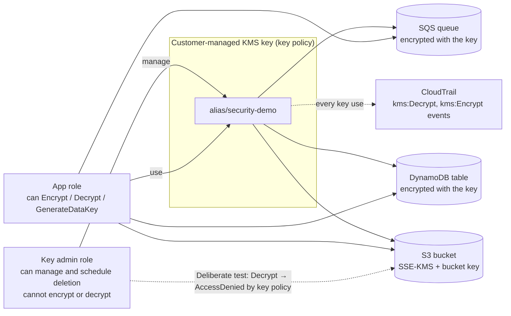

# Architecture – 14 KMS Encryption and Key Policies

| Piece | What it does |
|-------|--------------|
| KMS key `alias/security-demo` | Customer-managed, rotation on, with a written key policy |
| Key-admin role | Manages the key; no permission to use it |
| App role | Encrypts and decrypts through the services, nothing else |
| S3 bucket | SSE-KMS with an S3 Bucket Key; a bucket policy denies uploads that aren't encrypted with this key |
| DynamoDB table and SQS queue | Both encrypted with the same key |
| CloudTrail | Shows each use of the key and who made it |

## AWS names

| Component | Name |
|-----------|------|
| KMS key | `alias/kms-demo-dev` |
| Roles | `kms-demo-dev-key-admin`, `kms-demo-dev-app` |
| Bucket | `kms-demo-dev-data-<account id>` |
| Table, queue | `kms-demo-dev-records`, `kms-demo-dev-events` |
