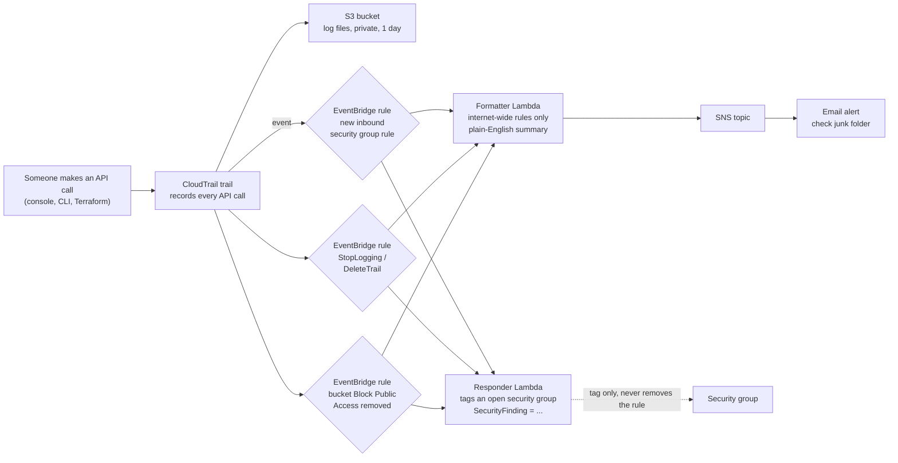
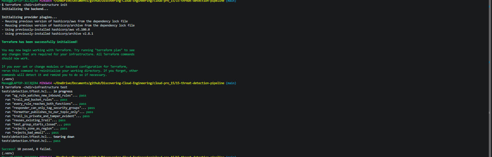
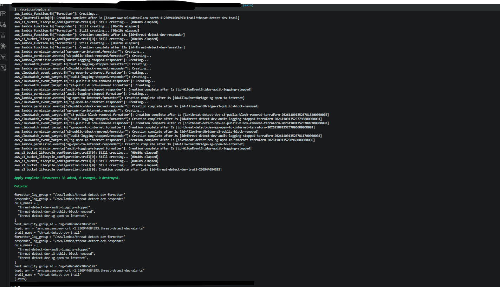
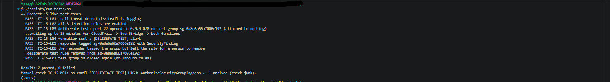
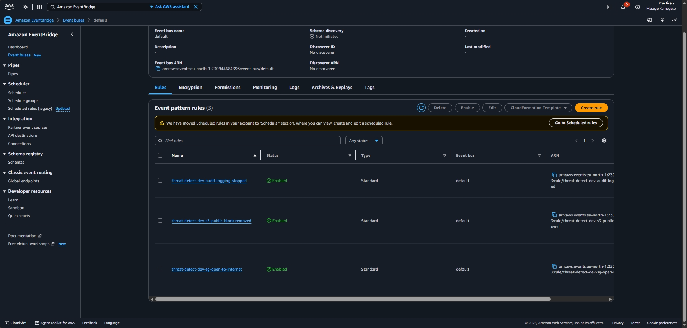
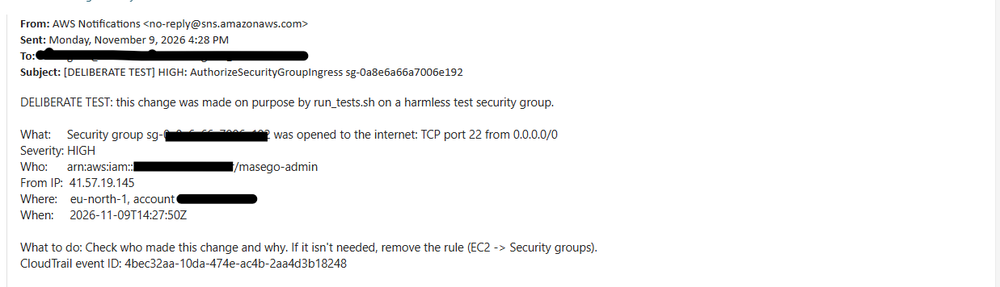
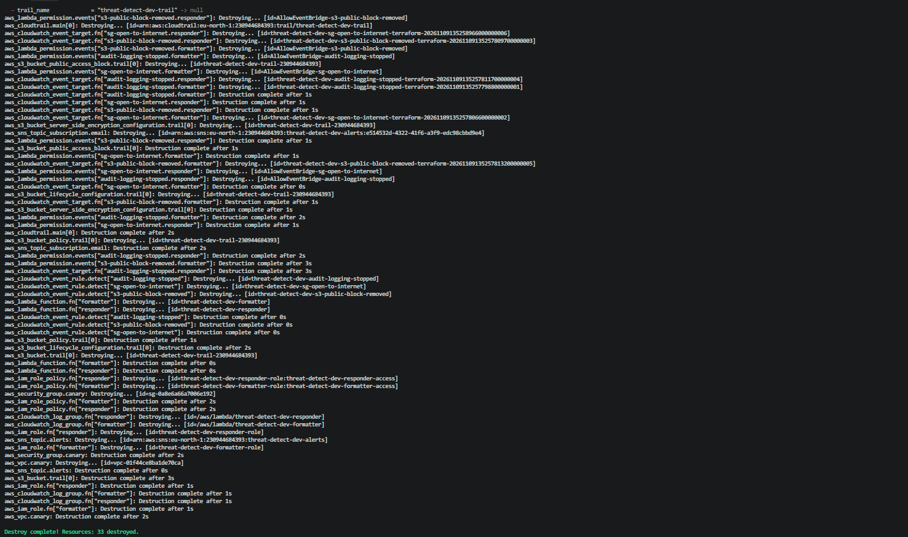

# 🚨 15 – Threat Detection Pipeline with CloudTrail and EventBridge

**Risky actions in my AWS account become plain-English email alerts within minutes, and a security group opened to the internet is tagged for investigation automatically. Built on CloudTrail and EventBridge, because my organisation blocks GuardDuty and Security Hub.**

> 🔐 Part of the **Security & Identity track** of [Discovering Cloud Engineering](../../README.md). Real-world context: [PROJECT-CONTEXT.md](../../PROJECT-CONTEXT.md#15--threat-detection-pipeline--vodacom-planned).
>
> ⚠️ **Redesigned on 27 October 2026.** The first design used Amazon GuardDuty and AWS Security Hub. Deploying it failed with `explicit deny in a service control policy` for both services, so the project now detects risky actions from CloudTrail instead. See [ADR 0003](docs/adr/0003-cloudtrail-instead-of-guardduty.md).
>
> 📅 **Status: code and tests ready.** Screenshots and results are added when it has been deployed.

> 📝 What changed and when: [CHANGELOG.md](CHANGELOG.md)

## 💡 Why I Built This

Project 07 tells me when a resource is *configured* badly. I also wanted to know the moment someone *does* something risky: opens a server to the whole internet, switches off the audit log, or removes the safety switch that keeps a bucket private. A finding nobody reads is useless, and after my emails went to junk in Project 06, I know alerting is its own problem. I built this to learn how detection becomes a response, using only services my account is allowed to use.

## 🎯 The Problem It Solves

Every API call in an AWS account is recorded, but nobody reads raw CloudTrail JSON. Teams need the few dangerous actions picked out, turned into a clear alert quickly, and the affected resource marked, without an automation that breaks things by "fixing" them.

## 🧠 What This Project Shows

- **CloudTrail as a detection source:** every API call becomes an event that EventBridge can match
- **Three detection rules:** a security group opened to the internet (`0.0.0.0/0` or `::/0`), CloudTrail logging stopped or a trail deleted, and an S3 bucket's Block Public Access removed
- **Formatter Lambda** turning CloudTrail JSON into a short email: what happened, who did it, from which IP, how serious, what to do
- **Safe automated response:** a Lambda that only **tags** the security group. It never removes the rule, and its IAM policy makes that impossible
- **Honest testing:** a deliberate, labelled test opens port 22 on a harmless security group that is attached to nothing, then closes it again
- **Working around an organisation guardrail:** redesigning when GuardDuty and Security Hub turned out to be blocked

## 🛠️ Technologies

`AWS CloudTrail` · `Amazon EventBridge` · `AWS Lambda` · `Amazon SNS` · `Amazon S3` · `Amazon EC2 security groups` · `IAM` · `Terraform` · `Python`

## 🏗️ Architecture



| Piece | What it does |
|-------|--------------|
| CloudTrail trail | Records the account's API calls; EventBridge only receives CloudTrail events while a trail is logging |
| Three EventBridge rules | Pick out the risky actions from the stream of events |
| Formatter Lambda | Keeps only rules open to the whole internet, then writes the alert: what, who, from where, how serious, what to do |
| Responder Lambda | Tags a security group that was opened to the internet; leaves everything else for a person |
| SNS topic | Emails the alert |
| Test VPC and security group | A harmless target for the deliberate test: empty VPC, attached to nothing |

## 🧰 Services Used, in Detail

Every service and tool in this project: what it is, how it works, exactly how this project uses it, why I chose it, and what it costs. Expand a service below for the full detail.

| Service | What it is |
| --- | --- |
| **AWS CloudTrail** | The account's audit log: a record of every API call. |
| **Amazon EventBridge** | An event bus that matches events against rules and sends them to targets. |
| **AWS Lambda (formatter and responder)** | Two small Python functions: one writes the alert, one tags the security group. |
| **Amazon SNS** | Delivers the alerts by email. |
| **Amazon S3** | Stores the trail's log files. |
| **Amazon VPC and security group (test target)** | An empty network with one security group, used only for the deliberate test. |
| **AWS IAM** | Least-privilege roles for the two functions. |
| **Terraform, pytest and moto** | Infrastructure as Code, plus free tests. |

<details>
<summary><b>AWS CloudTrail</b></summary>

- **What it is:** The account's audit log: a record of every API call, whether it came from the console, the CLI, Terraform or another AWS service.
- **How it works:** A **trail** delivers event records to S3. While a trail is logging, CloudTrail also sends each write (mutating) management event to EventBridge as an `AWS API Call via CloudTrail` event. Log file validation adds signed digest files that prove the logs weren't changed afterwards.
- **How this project uses it:** One single-region trail of management events in eu-north-1, with log file validation on. It writes to a private, encrypted S3 bucket. Global events such as IAM and console sign-in are recorded in us-east-1, which my account can't use, so they are left out. If a trail is already logging in eu-north-1, `create_trail = false` reuses it.
- **Why this choice:** GuardDuty and Security Hub are blocked by my organisation's SCP. CloudTrail is allowed, and it already sees every action I want to detect. EventBridge doesn't receive these events without a logging trail.
- **Cost:** The first copy of management events is free; S3 storage for a day of logs is fractions of a cent.

</details>

<details>
<summary><b>Amazon EventBridge</b></summary>

- **What it is:** An event bus that matches events against rules and sends them to targets.
- **How it works:** A rule has an **event pattern**; matching events go to its targets. AWS service events, including CloudTrail API calls, arrive on the default event bus.
- **How this project uses it:** Three rules. `sg-open-to-internet` matches `AuthorizeSecurityGroupIngress` (any new inbound rule). `audit-logging-stopped` matches `StopLogging` and `DeleteTrail`. `s3-public-block-removed` matches `DeleteBucketPublicAccessBlock`. Each rule sends to both Lambdas: 6 targets in total.
- **Why this choice:** Rules pick out a handful of events from thousands without any servers. Whether a security-group rule is open to the internet is decided in the code, where it is unit-tested, instead of in a pattern I couldn't test offline (ADR 0002).
- **Cost:** Free for AWS service events.

</details>

<details>
<summary><b>AWS Lambda (formatter and responder)</b></summary>

- **What it is:** Runs code without a server; here, two small Python 3.12 functions.
- **How it works:** EventBridge invokes each function with the CloudTrail event; the function reads `eventName`, `requestParameters`, `userIdentity` and `sourceIPAddress`.
- **How this project uses it:** The **formatter** ignores security-group rules that aren't open to the internet. Otherwise it writes the email: severity (CRITICAL for all traffic or a stopped trail, HIGH for a single port or a removed bucket block, LOW if the call failed), what, who, from which IP and what to do. Alerts about the project's own test group are labelled **[DELIBERATE TEST]**. The **responder** adds a `SecurityFinding` tag to a security group opened to the internet and leaves every other event for a person.
- **Why this choice:** A tag marks the resource for investigation safely. Removing the rule automatically could break a real service if the alert were a false positive (ADR 0001).
- **Cost:** Within the Free Tier.

</details>

<details>
<summary><b>Amazon SNS</b></summary>

- **What it is:** A messaging service that pushes a message to subscribers such as email addresses.
- **How it works:** Only confirmed subscriptions receive messages.
- **How this project uses it:** One topic and one email subscription. Check the **junk folder** for the confirmation, as in Project 06.
- **Why this choice:** An alert must reach a person to be useful.
- **Cost:** The first 1,000 emails a month are free.

</details>

<details>
<summary><b>Amazon S3</b></summary>

- **What it is:** Object storage; here, the trail's log files.
- **How it works:** A bucket policy lets only the CloudTrail service write, and only for this trail (`aws:SourceArn`).
- **How this project uses it:** All public access blocked, SSE-S3 encryption, plain-HTTP requests denied, and log files deleted after 1 day. `force_destroy` lets `destroy` remove the logs too, because this is a practice project.
- **Why this choice:** Audit evidence should be stored where ordinary users can't change it.
- **Cost:** Fractions of a cent.

</details>

<details>
<summary><b>Amazon VPC and security group (test target)</b></summary>

- **What it is:** A private network (VPC) and a security group, the firewall that EC2 network interfaces use.
- **How it works:** A security group with no attached network interface protects nothing, so changing its rules exposes nothing.
- **How this project uses it:** An empty VPC (`10.70.0.0/16`) with one security group tagged `Purpose = deliberate-test`. `run_tests.sh` opens port 22 to `0.0.0.0/0` on it, checks the alert and the tag, then closes it again, even if the script is interrupted.
- **Why this choice:** The test produces a real CloudTrail event, so nothing is faked, without opening anything that could be attacked.
- **Cost:** Free.

</details>

<details>
<summary><b>AWS IAM</b></summary>

- **What it is:** Permissions for each function.
- **How it works:** Each Lambda has its own role listing exactly what it may do.
- **How this project uses it:** The formatter may only publish to this project's topic. The responder may only call `ec2:CreateTags` on security groups, and only with the tag key `SecurityFinding`. It has no permission to remove rules, stop or delete anything. Each function writes only to its own log group.
- **Why this choice:** Least privilege keeps the automation safe even if its code has a bug.
- **Cost:** Free.

</details>

<details>
<summary><b>Terraform, pytest and moto</b></summary>

- **What it is:** Infrastructure as Code, plus free tests.
- **How it works:** Terraform reads `.tf` files that describe the end state and makes only the API calls needed to reach it. Offline `terraform test` files use a mock AWS provider, and moto fakes AWS for the Python tests, so everything is checked for free on every push.
- **How this project uses it:** 14 unit tests cover the alert wording, severity, internet-wide detection (IPv4, IPv6, all traffic, and both ways CloudTrail records a rule), failed calls and the responder's tag-only behaviour. 10 offline Terraform tests check the rules, targets, IAM limits, the trail settings and the input rules.
- **Why this choice:** The detection and response logic is proven before anything is deployed.
- **Cost:** Free.

</details>

## 🚀 Quickstart

```bash
cd cloud-pro_15/15-threat-detection-pipeline
python -m venv .venv && source .venv/Scripts/activate     # Windows Git Bash
python -m pip install -r requirements-dev.txt && python -m pytest -v    # 14 unit test cases, free
terraform -chdir=infrastructure init && terraform -chdir=infrastructure test   # 10 offline test cases
cp infrastructure/terraform.tfvars.example infrastructure/terraform.tfvars   # set owner and alert_email
./scripts/deploy.sh                                       # then confirm the email (check junk)
./scripts/run_tests.sh      # deliberate test on a harmless security group, PASS/FAIL each
./scripts/destroy.sh
```

New to this project? Follow the full step-by-step guide: **[docs/START-HERE.md](docs/START-HERE.md)**. Short operations card: [docs/runbook.md](docs/runbook.md).

## 🧪 Test Cases

**32 test cases**, each with an ID (full list: [docs/TEST-CASES.md](docs/TEST-CASES.md)).

| Level | Cases | Needs AWS? | Cost | How to run |
|-------|-------|------------|------|------------|
| Offline Terraform tests (T) | 10 | No | Free | `terraform -chdir=infrastructure test` |
| Unit tests (U) | 14 | No (AWS is mocked) | Free | `python -m pytest -v` |
| Live tests (L) | 7 | Yes, after `./scripts/deploy.sh` | Free | `./scripts/run_tests.sh` |
| Manual checks (M) | 1 | Yes | Free | Your inbox (see the guide) |

Offline and unit tests use a mocked AWS, so a broken rule fails before anything is deployed, and they run in GitHub Actions on every push. The live test is a deliberate test, labelled as such.

## 🧩 Key Design Decisions

- [0001 – Tag, don't remove the rule](docs/adr/0001-tag-dont-delete.md)
- [0002 – Match the action in EventBridge, decide "open to the internet" in code](docs/adr/0002-filter-in-code.md)
- [0003 – CloudTrail instead of GuardDuty and Security Hub](docs/adr/0003-cloudtrail-instead-of-guardduty.md)

## 🔐 Security Highlights

- The responder can only add one tag to security groups; its IAM policy has no permission to remove rules, stop or delete anything
- Stopping or deleting the audit trail raises a CRITICAL alert: the classic first move to hide what comes next
- The trail's logs are private, encrypted, tamper-evident (log file validation) and only writable by CloudTrail
- Deliberate tests are labelled in the email subject, the email body and every screenshot

## 📸 Screenshots

| # | What it proves | Image |
|---|----------------|-------|
| 1 | Unit and offline test cases pass |  |
| 2 | Infrastructure deployed from code |  |
| 3 | Live test cases (deliberate test on a harmless security group) |  |
| 4 | The three EventBridge rules |  |
| 5 | The `[DELIBERATE TEST]` alert email |  |
| 6 | The test security group with its `SecurityFinding` tag |  |
| 7 | The `AuthorizeSecurityGroupIngress` event in CloudTrail event history |  |
| 8 | Everything torn down |  |

## 💰 Cost and Teardown

CloudTrail's first copy of management events is free. EventBridge (AWS service events), Lambda and SNS stay inside the free tier. The VPC and security group are free, and a day of log files in S3 costs fractions of a cent. A build session should be **free**. `./scripts/destroy.sh` removes everything.

_Estimates from AWS list prices, October 2026, for eu-north-1 (Stockholm). Check the AWS pricing pages and your own bill in Billing → Cost Explorer._

## 🚦 Account Check

✅ Uses only services my account has already used in earlier projects: CloudTrail (Project 07), EventBridge, Lambda and SNS (Project 06), and S3 and VPC. GuardDuty and Security Hub are blocked by my organisation's SCP, so they are no longer used (ADR 0003).

## 📚 Lessons Learned

### The first design was blocked by my organisation

- **What I saw:** `AccessDeniedException ... guardduty:ListDetectors ... with an explicit deny in a service control policy`, and the same for `securityhub:DescribeHub`.
- **Cause:** My account's organisation blocks GuardDuty and Security Hub with an SCP. An SCP deny can't be overridden from inside the account, not even by an admin.
- **Fix:** I cleaned up with `create_detector = true`, so the destroy didn't need to read GuardDuty. Then I redesigned the project around CloudTrail and EventBridge, which my account allows.
- **Lesson:** Check the organisation's guardrails before designing around a service: one read-only call per service in the preflight script would have shown this before I built anything.

<!-- Add more after building: what broke, the exact error, the cause, the fix and the lesson. Only write what actually happened. -->
