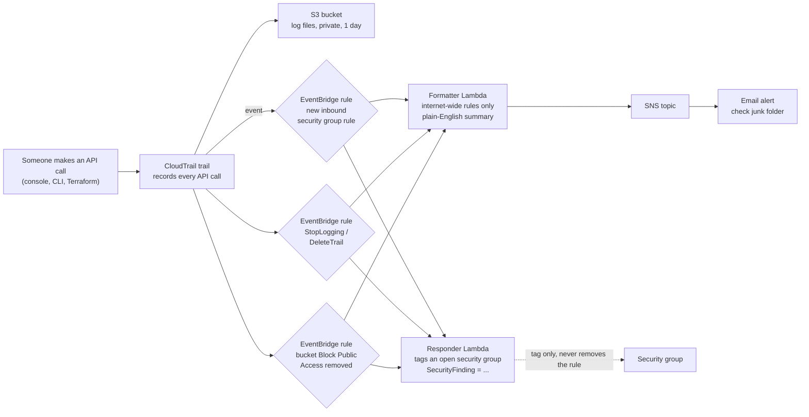

# Architecture – 15 Threat Detection Pipeline

| Piece | What it does |
|-------|--------------|
| CloudTrail trail | Records the account's API calls; EventBridge only receives CloudTrail events while a trail is logging |
| Three EventBridge rules | Pick out the risky actions from the stream of events |
| Formatter Lambda | Keeps only rules open to the whole internet, then writes the alert |
| Responder Lambda | Tags a security group opened to the internet; leaves everything else for a person |
| SNS topic | Emails the alert |
| Test VPC and security group | A harmless target for the deliberate test |

## Severity

| Event | Severity |
|-------|----------|
| Security group rule open to the internet for all traffic | CRITICAL |
| Security group rule open to the internet for one port or a range | HIGH |
| `StopLogging` or `DeleteTrail` | CRITICAL |
| `DeleteBucketPublicAccessBlock` | HIGH |
| Any of these where the API call itself failed (for example AccessDenied) | LOW |

## AWS names

| Component | Name |
|-----------|------|
| Trail | `threat-detect-dev-trail` (or an existing one with `create_trail = false`) |
| Log bucket | `threat-detect-dev-trail-<account id>` |
| EventBridge rules | `threat-detect-dev-sg-open-to-internet`, `threat-detect-dev-audit-logging-stopped`, `threat-detect-dev-s3-public-block-removed` |
| Lambdas | `threat-detect-dev-formatter`, `threat-detect-dev-responder` |
| SNS topic | `threat-detect-dev-alerts` |
| Test security group | `threat-detect-dev-canary-sg` in `threat-detect-dev-canary-vpc` |
