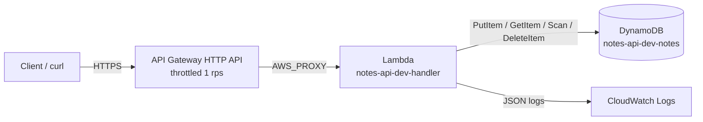

# Architecture

| Component | AWS name | Role |
|-----------|----------|------|
| API Gateway HTTP API | `notes-api-dev-http-api` | Public HTTPS entry point; throttles requests |
| Lambda | `notes-api-dev-handler` | Validates input and routes the four operations |
| IAM role | `notes-api-dev-lambda-role` | Least-privilege identity for the function |
| DynamoDB table | `notes-api-dev-notes` | Stores notes; key `note_id`; 1 RCU / 1 WCU (sandbox fixed) |
| CloudWatch log group | `/aws/lambda/notes-api-dev-handler` | Function logs, 1-day retention |

**Request flow:** API Gateway receives the request and passes it to the Lambda as a version 2.0 proxy event. The function reads `routeKey`, validates the body, calls DynamoDB, and returns a JSON response with a status code.
