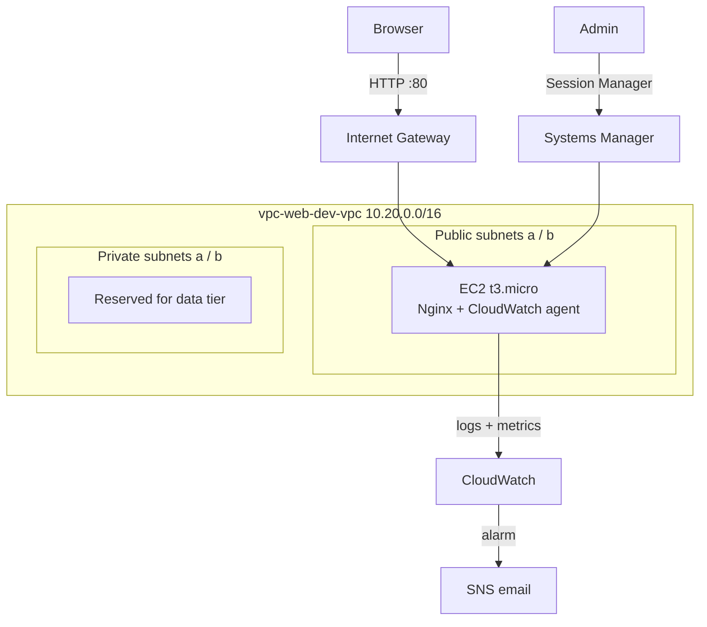

# Architecture

## How a request reaches the server

1. The browser connects to the instance's public IP on port 80.
2. The internet gateway translates the public IP to the instance's private IP (10.20.1.x).
3. The security group allows inbound TCP 80 and drops everything else.
4. Nginx serves the page. Because security groups are stateful, the reply is allowed out automatically.

## How Session Manager works with no inbound ports

The SSM agent on the instance makes an **outbound** HTTPS connection to the Systems Manager service, using the instance role. When I start a session, traffic flows over that outbound connection. Nothing needs to listen on the instance.

| Component | AWS name |
|-----------|----------|
| VPC | `vpc-web-dev-vpc` |
| Internet gateway | `vpc-web-dev-igw` |
| Route tables | `vpc-web-dev-public-rt`, `vpc-web-dev-private-rt` |
| Security group | `vpc-web-dev-web-sg` |
| Instance | `vpc-web-dev-web` |
| Instance role / profile | `vpc-web-dev-ec2-role`, `vpc-web-dev-ec2-profile` |
| Log groups | `/vpc-web-dev/nginx/access`, `/vpc-web-dev/nginx/error` |
| SNS topic | `vpc-web-dev-alerts` |
| Alarms | `vpc-web-dev-cpu-high`, `vpc-web-dev-status-check-failed` |
