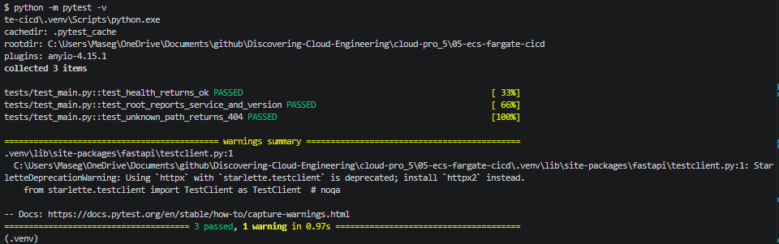
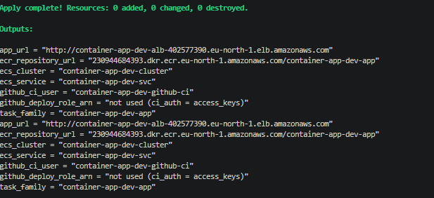
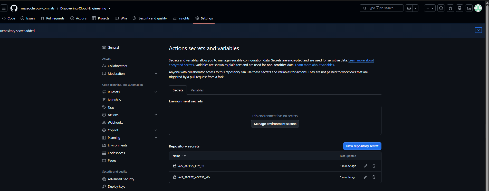
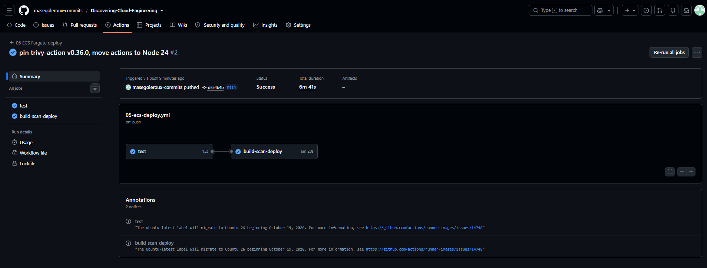
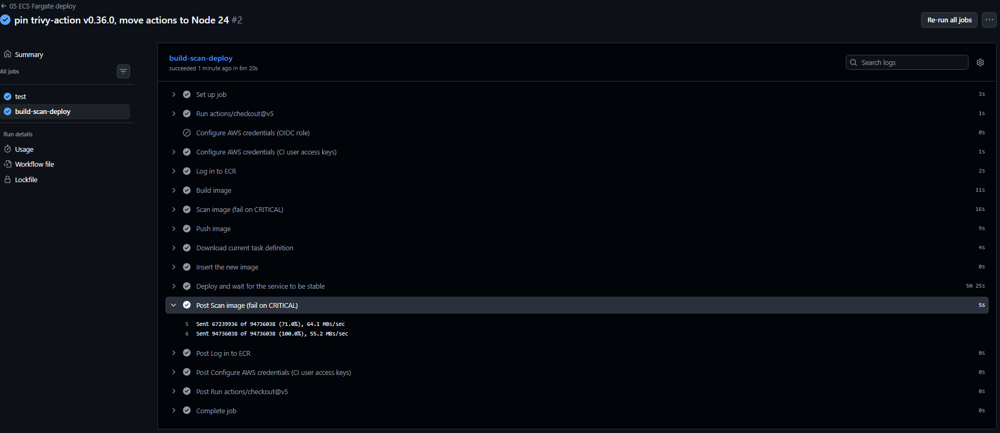
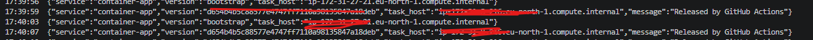
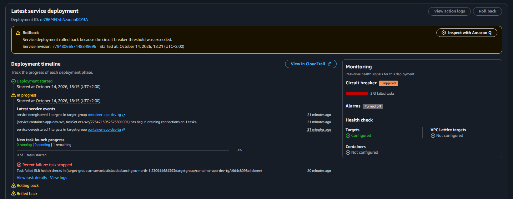
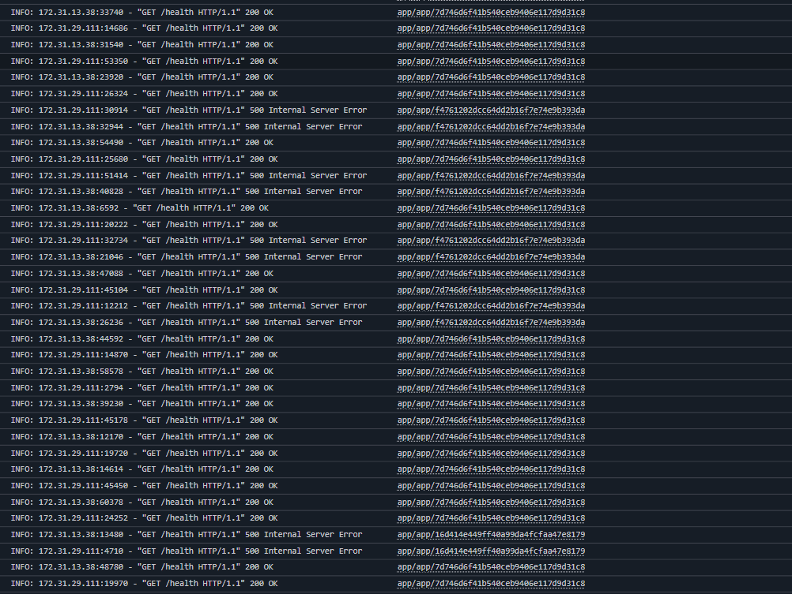
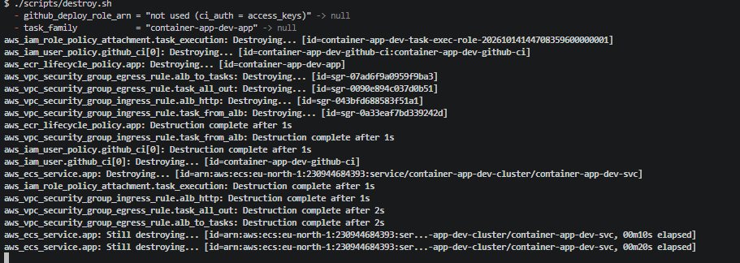

# 05 – Containerised App on ECS Fargate with GitHub Actions

A small FastAPI service packaged as a non-root container, stored in Amazon ECR, and run on ECS Fargate behind an Application Load Balancer. Every push to `main` is tested, built, scanned with Trivy, and released with zero downtime, and a failed release rolls back automatically.


## The problem

Manual deployments are slow and risky: someone forgets a step, or ships an image with a known critical vulnerability. This pipeline makes every release identical, traceable to a commit, and blocked if the image is unsafe.

## Tech stack

`Docker` · `Amazon ECR` · `Amazon ECS` · `AWS Fargate` · `Application Load Balancer` · `IAM` · `CloudWatch Logs` · `GitHub Actions` · `Trivy` · `Terraform` · `Python 3.12` · `FastAPI`

## Who owns what

| Owner | Responsible for |
|-------|-----------------|
| **Terraform** | ECR repository, ECS cluster and service, load balancer, security groups, IAM roles, log group |
| **GitHub Actions** | Which image version runs: test → build → scan → push → deploy |

Terraform ignores changes to the service's task definition, so the two never fight over the running version.

## Quickstart

```bash
cd cloud-pro_5/05-ecs-fargate-cicd
pip install -r requirements-dev.txt && pytest -v
cp infrastructure/terraform.tfvars.example infrastructure/terraform.tfvars   # set owner
./scripts/bootstrap.sh          # first deploy: creates ECR, pushes an image, builds the rest
# save the github_deploy_role_arn output as the GitHub variable AWS_DEPLOY_ROLE_ARN, then push
./scripts/destroy.sh
```

Step-by-step guide: [docs/START-HERE.md](docs/START-HERE.md). Short operations card: [docs/runbook.md](docs/runbook.md).

## Key design decisions

- [0001 – Fargate instead of ECS on EC2](docs/adr/0001-fargate.md)
- [0002 – The pipeline owns the running version](docs/adr/0002-pipeline-owns-version.md)
- [0003 – Immutable tags from the commit SHA](docs/adr/0003-immutable-sha-tags.md)
- [0004 – GitHub Actions uses OIDC, not stored keys](docs/adr/0004-ci-credentials.md)
- [0005 – ECS instead of EKS](docs/adr/0005-ecs-over-eks.md)

## Security and observability

- **Container:** multi-stage build, runs as user 10001 (not root), read-only root filesystem.
- **Pipeline:** Trivy blocks any image with a fixable CRITICAL vulnerability; ECR also scans on push.
- **Least-privilege CI access:** my account's organisation blocks OIDC providers, so by default GitHub Actions uses a dedicated IAM user whose only permissions are pushing to this ECR repository and updating this one ECS service. In accounts that allow it, `ci_auth = "oidc"` switches to keyless OIDC sign-in limited to the `main` branch. Offline Terraform tests (`infrastructure/tests/`) prove which IAM resources each mode creates.
- **Network:** tasks accept traffic only from the load balancer's security group.
- **IAM:** separate execution role (ECS pulls images and writes logs) and task role (the app, with no permissions).
- **Releases:** rolling deploys behind health checks, with the ECS deployment circuit breaker rolling back failures.
- **Logs:** container output in CloudWatch Logs.

## Screenshots

| # | What it proves | File |
|---|----------------|------|
| 1 | Tests pass locally |  |
| 2 | First image built and pushed |  |
| 3 | ECR repository with scan results |  |
| 4 | ECS service running 1 task |  |
| 5 | Healthy target behind the load balancer |  |
| 6 | App live (bootstrap version) |  |
| 7 | GitHub deploy role, locked to this repo and branch |  |
| 8 | Pipeline run succeeded |  |
| 9 | Trivy scan step |  |
| 10 | Rolling deploy with no downtime |  |
| 11 | Failed release rolled back (deliberate test) |  |
| 12 | Container logs |  |
| 13 | Everything torn down |  |

## Cost and teardown

Built and tested in my own AWS account. This is the most expensive project because the load balancer is billed by the hour. While deployed it costs about **$0.05 per hour**: the Application Load Balancer (~$0.0225/h plus usage), one Fargate task with 0.25 vCPU and 0.5 GB (~$0.012/h), and 3 public IPv4 addresses ($0.005/h each). I limited the load balancer to 2 subnets to avoid paying for more addresses. A full day of building is roughly **$0.20–0.40**. `./scripts/destroy.sh` removes everything, including the images.

_Estimates from AWS list prices, October 2026; prices in eu-north-1 (Stockholm), where this was built, are similar. Check your own bill in Billing → Cost Explorer._

## Lessons learned

<!-- Fill in after building. Only record what actually happened. -->
