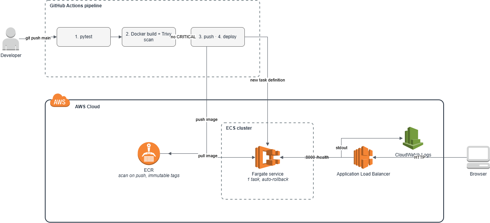
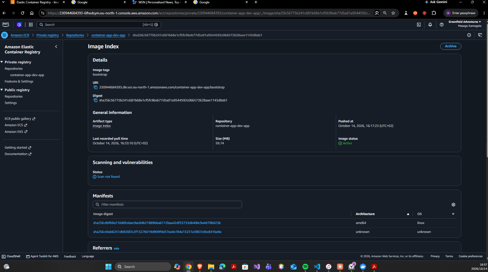
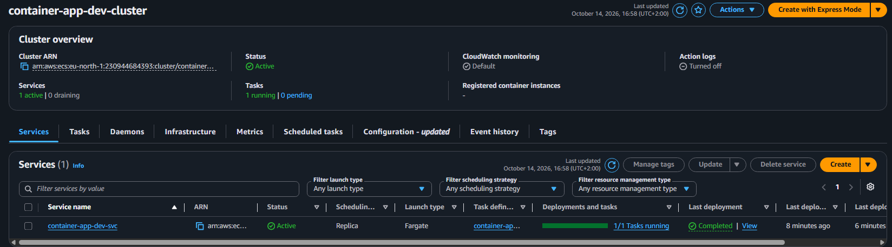
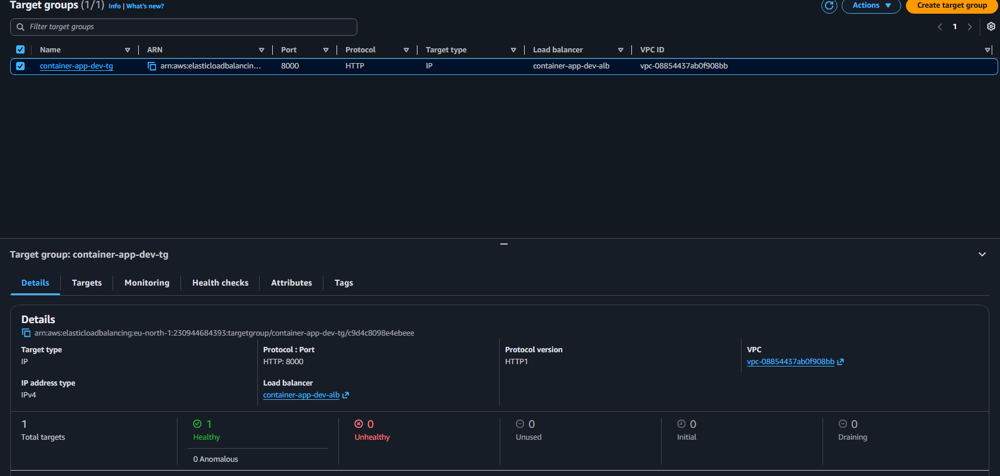

# 05 – Containerised App on ECS Fargate with GitHub Actions

A small FastAPI service packaged as a non-root container, stored in Amazon ECR, and run on ECS Fargate behind an Application Load Balancer. Every push to `main` is tested, built, scanned with Trivy, and released with zero downtime, and a failed release rolls back automatically.



## The problem

Manual deployments are slow and risky: someone forgets a step, or ships an image with a known critical vulnerability. This pipeline makes every release identical, traceable to a commit, and blocked if the image is unsafe.

## Tech stack

`Docker` · `Amazon ECR` · `Amazon ECS` · `AWS Fargate` · `Application Load Balancer` · `IAM` · `CloudWatch Logs` · `GitHub Actions` · `Trivy` · `Terraform` · `Python 3.12` · `FastAPI`

## Who owns what

| Owner | Responsible for |
|-------|-----------------|
| **Terraform** | ECR repository, ECS cluster and service, load balancer, security groups, IAM roles, log group |
| **GitHub Actions** | Which image version runs: test → build → scan → push → deploy |

Terraform ignores changes to the service's task definition, so the two never fight over the running version.

## Quickstart

```bash
cd cloud-pro_5/05-ecs-fargate-cicd
pip install -r requirements-dev.txt && pytest -v
cp infrastructure/terraform.tfvars.example infrastructure/terraform.tfvars   # set owner
./scripts/bootstrap.sh          # first deploy: creates ECR, pushes an image, builds the rest
# save the github_deploy_role_arn output as the GitHub variable AWS_DEPLOY_ROLE_ARN, then push
./scripts/destroy.sh
```

Step-by-step guide: [docs/START-HERE.md](docs/START-HERE.md). Short operations card: [docs/runbook.md](docs/runbook.md).

## Key design decisions

- [0001 – Fargate instead of ECS on EC2](docs/adr/0001-fargate.md)
- [0002 – The pipeline owns the running version](docs/adr/0002-pipeline-owns-version.md)
- [0003 – Immutable tags from the commit SHA](docs/adr/0003-immutable-sha-tags.md)
- [0004 – GitHub Actions uses OIDC, not stored keys](docs/adr/0004-ci-credentials.md)
- [0005 – ECS instead of EKS](docs/adr/0005-ecs-over-eks.md)

## Security and observability

- **Container:** multi-stage build, runs as user 10001 (not root), read-only root filesystem.
- **Pipeline:** Trivy blocks any image with a fixable CRITICAL vulnerability; ECR also scans on push.
- **Least-privilege CI access:** my account's organisation blocks OIDC providers, so by default GitHub Actions uses a dedicated IAM user whose only permissions are pushing to this ECR repository and updating this one ECS service. In accounts that allow it, `ci_auth = "oidc"` switches to keyless OIDC sign-in limited to the `main` branch. Offline Terraform tests (`infrastructure/tests/`) prove which IAM resources each mode creates.
- **Network:** tasks accept traffic only from the load balancer's security group.
- **IAM:** separate execution role (ECS pulls images and writes logs) and task role (the app, with no permissions).
- **Releases:** rolling deploys behind health checks, with the ECS deployment circuit breaker rolling back failures.
- **Logs:** container output in CloudWatch Logs.

## Screenshots

| # | What it proves | File |
|---|----------------|------|
| 1 | Tests pass locally |  |
| 2 | First image built and pushed |  |
| 3 | ECR repository with scan results |  |
| 4 | ECS service running 1 task |  |
| 5 | Healthy target behind the load balancer |  |
| 6 | App live (bootstrap version) |  |
| 7 | GitHub deploy role, locked to this repo and branch |  |
| 8 | Pipeline run succeeded |  |
| 9 | Trivy scan step |  |
| 10 | Rolling deploy with no downtime |  |
| 11 | Failed release rolled back (deliberate test) |  |
| 12 | Container logs |  |
| 13 | Everything torn down |  |

## Cost and teardown

Built and tested in my own AWS account. This is the most expensive project because the load balancer is billed by the hour. While deployed it costs about **$0.05 per hour**: the Application Load Balancer (~$0.0225/h plus usage), one Fargate task with 0.25 vCPU and 0.5 GB (~$0.012/h), and 3 public IPv4 addresses ($0.005/h each). I limited the load balancer to 2 subnets to avoid paying for more addresses. A full day of building is roughly **$0.20–0.40**. `./scripts/destroy.sh` removes everything, including the images.

_Estimates from AWS list prices, October 2026; prices in eu-north-1 (Stockholm), where this was built, are similar. Check your own bill in Billing → Cost Explorer._

## Lessons learned

## 📚 Lessons Learned: Everything That Went Wrong (and How I Fixed It)
 
These are the real problems I hit while building this project, in the order they happened. Each one taught me something the happy path didn't.
 
### 1. Terraform was refused while checking for GitHub's OIDC provider
 
| | |
|---|---|
| **What I saw** | `Error: finding IAM OIDC Provider by url ... not authorized to perform: iam:ListOpenIDConnectProviders ... with an explicit deny in a service control policy` |
| **Cause** | My plan was for GitHub Actions to sign in to AWS with **OIDC**: short-lived tokens, no stored keys. But my account belongs to an AWS Organization whose **service control policy (SCP)** blocks every IAM action on OIDC providers, even just *listing* them. The AWS Organizations console also says *"Access to this service is not supported"* for my account, so I can't see or change the SCP. |
| **Fix** | I added a `ci_auth` setting with two modes. `oidc` is the preferred design, for accounts that allow it. `access_keys` is the default here: Terraform creates a dedicated IAM user, `container-app-dev-github-ci`, whose policy only allows deploying **this one app**. Its access key is stored as GitHub **Secrets**, and the workflow picks the right sign-in step automatically. |
| **Lesson** | Security design has to fit the guardrails you actually have. When the ideal option is blocked, the next best thing is a **least-privilege, single-purpose** identity, and writing down why ([ADR 0004](docs/adr/0004-ci-credentials.md)). |
 
### 2. The same error came back after the "fix"
 
| | |
|---|---|
| **What I saw** | Exactly the same OIDC error as in lesson 1, from `data.aws_iam_openid_connect_provider.github[0]`. |
| **Cause** | My `terraform.tfvars` still had an old line, `create_github_oidc_provider = false`, and OIDC was still the default mode. Together those told Terraform to *look up* an existing provider, which is precisely the call the SCP blocks. |
| **Fix** | I made `access_keys` the default, deleted the leftover line, and added automatic tests in `infrastructure/tests/ci_auth.tftest.hcl`. They run with a mocked AWS provider and prove that the default makes **no** OIDC lookup, that an old leftover setting does no harm, and that `oidc` mode still works. |
| **Lesson** | A fix isn't finished until it's **tested against the exact settings that failed**. Old values in `tfvars` files outlive the code they were written for, so check them when behaviour doesn't change. |
 
### 3. Re-running the setup script failed: "tag 'bootstrap' already exists"
 
| | |
|---|---|
| **What I saw** | `The image tag 'bootstrap' already exists in the 'container-app-dev-app' repository and cannot be overwritten because the tag is immutable.` |
| **Cause** | My ECR repository uses **immutable tags**, so a tag can never be pointed at a different image. The first run had already pushed `bootstrap` before Terraform stopped on the OIDC error, so the second run tried to push it again. |
| **Fix** | `bootstrap.sh` now checks with `aws ecr describe-images` and skips the build and push if the tag is already there. It's safe to run again. |
| **Lesson** | Immutable tags are working as intended: they guarantee a tag always means the same image. Scripts that touch them must be **safe to re-run** (idempotent), because scripts often stop halfway. |
 
### 4. `deploy.sh` or `bootstrap.sh`?
 
| | |
|---|---|
| **What confused me** | Two scripts that both run `terraform apply`. |
| **The answer** | It's a chicken-and-egg problem. The ECS service needs an image to start, but the image needs the ECR repository to exist first. `bootstrap.sh` breaks the loop: it creates the repository, pushes one image, then builds everything else. `deploy.sh` only runs Terraform, for later changes once the image exists. After the first deploy, GitHub Actions pushes every new image. |
| **Lesson** | Understand **why** a step exists before running it. The order of creation is part of the design. |
 
### 5. Python code copied from my PDF guide lost its indentation (twice)
 
| | |
|---|---|
| **What I saw** | Locally: the tests wouldn't run after I edited `root()`. On GitHub Actions: `IndentationError: expected an indented block after function definition on line 14` |
| **Cause** | Copying code out of a PDF strips the spaces at the start of each line. Python uses those spaces to know which lines belong inside a function. |
| **Fix** | I replaced the files with correctly indented versions, and I now run `pytest -v` on my own machine before every `git push`. |
| **Lesson** | The pipeline did its job: the **test stage stopped broken code before it was built or deployed**. But running tests locally is faster and cheaper than waiting for CI to tell me. Copy code from a code file or a Markdown file, never from a PDF. |
 
### 6. The pipeline failed: "Unable to resolve action `aquasecurity/trivy-action@0.28.0`"
 
| | |
|---|---|
| **What I saw** | The `test` job passed, then `build-scan-deploy` failed in 3 seconds with `unable to find version 0.28.0`. There was also a warning that **Node.js 20 is deprecated** for `actions/checkout@v4` and `actions/setup-python@v5`. |
| **Cause** | The Trivy action's old tags without a "v" (like `0.28.0`) no longer exist; current releases use `v0.x.y` names. A tag is just a label, and its owner can move or delete it. Separately, GitHub is retiring the Node 20 runtime that the older action versions used. |
| **Fix** | I pinned Trivy to the **full commit SHA** of release v0.36.0, which can't be moved or deleted. I also moved `checkout`, `setup-python`, `configure-aws-credentials` and `setup-terraform` to versions that run on Node 24. I checked the result with `actionlint` and confirmed every version exists. |
| **Lesson** | Third-party actions run with access to my AWS credentials, so they're part of my **software supply chain**. Pin them to a commit SHA, and treat deprecation warnings as a to-do list, not noise. |
 
### 7. Deliberate failure test: the circuit breaker rollback
 
| | |
|---|---|
| **What I did** | On purpose, I made `/health` return HTTP 500 and changed its test to match, so the broken version would get through the tests and reach ECS. *This was a deliberate test, not an incident.* |
| **What happened** | <!-- Write ONE honest line after the test, e.g. "ECS rolled back after ~N minutes; watch_versions.sh showed the old version answering the whole time (N 'no response' lines)." --> |
| **Lesson** | A rollback you've never tested is only a hope. The deployment circuit breaker plus load balancer health checks mean a bad release fails safely, and I've now **seen** it happen. |
 
### What I'd do differently next time
 
- Find out what the account's guardrails (SCPs) allow **before** choosing a design: try the key API calls first, such as `aws iam list-open-id-connect-providers`.
- Keep `terraform.tfvars` minimal and check it whenever behaviour doesn't match the code.
- Write tests for infrastructure decisions too (`terraform test` with a mocked provider), not just for the app.
- Run `pytest -v` before every push, and pin every third-party action to a commit SHA from the start.
### 📖 What I read to fix these
 
- [Service control policies (AWS Organizations)](https://docs.aws.amazon.com/organizations/latest/userguide/orgs_manage_policies_scps.html): why an explicit deny overrides IAM
- [Configuring OpenID Connect in Amazon Web Services (GitHub Docs)](https://docs.github.com/en/actions/security-for-github-actions/security-hardening-your-deployments/configuring-openid-connect-in-amazon-web-services): the design I'd use where it's allowed
- [Managing access keys for IAM users](https://docs.aws.amazon.com/IAM/latest/UserGuide/id_credentials_access-keys.html): rotating and protecting the CI user's key
- [Preventing image tags from being overwritten in Amazon ECR](https://docs.aws.amazon.com/AmazonECR/latest/userguide/image-tag-mutability.html): immutable tags and `ImageTagAlreadyExistsException`
- [Secure use reference (GitHub Docs)](https://docs.github.com/en/actions/reference/security/secure-use): pinning actions to a full-length commit SHA
- [How the Amazon ECS deployment circuit breaker detects failures](https://docs.aws.amazon.com/AmazonECS/latest/developerguide/deployment-circuit-breaker.html): automatic rollback
 
