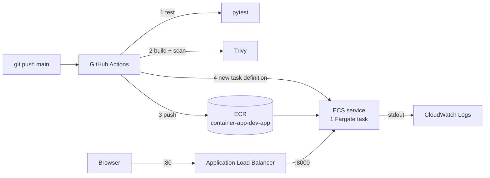

# Architecture

## What happens during a release

1. The pipeline registers a new task definition revision with the new image.
2. ECS starts **one new task** alongside the old one (maximum 200%, so briefly 2 tasks).
3. The load balancer checks `/health` on the new task. After 2 passes it starts sending traffic.
4. ECS drains the old task (15 seconds) and stops it.
5. If new tasks keep failing health checks, the circuit breaker marks the deployment failed and returns the service to the last working revision.

| Component | AWS name |
|-----------|----------|
| ECR repository | `container-app-dev-app` |
| ECS cluster / service | `container-app-dev-cluster` / `container-app-dev-svc` |
| Task definition family | `container-app-dev-app` |
| Load balancer / target group | `container-app-dev-alb` / `container-app-dev-tg` |
| Security groups | `container-app-dev-alb-sg`, `container-app-dev-task-sg` |
| IAM roles | `container-app-dev-task-exec-role`, `container-app-dev-task-role` |
| Log group | `/ecs/container-app-dev` |
