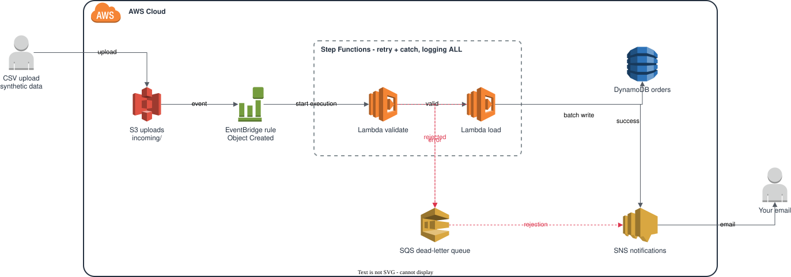
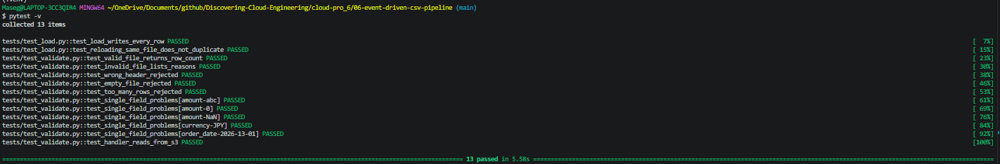
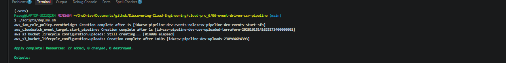
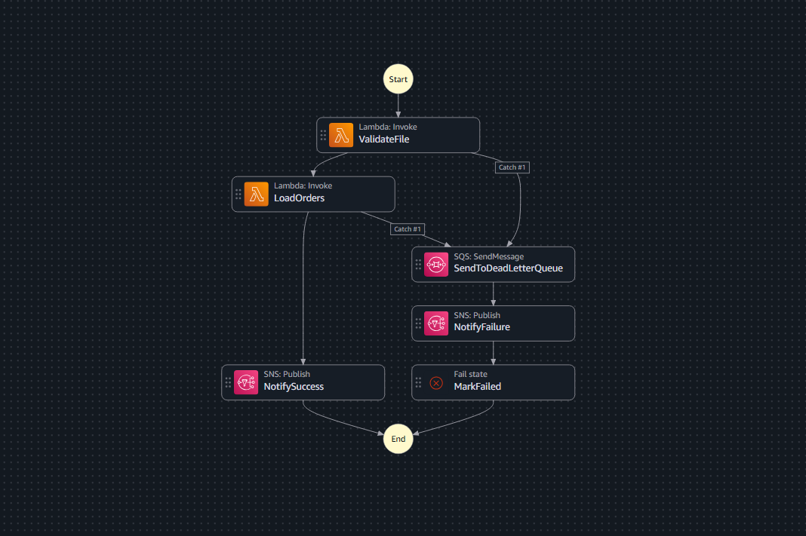
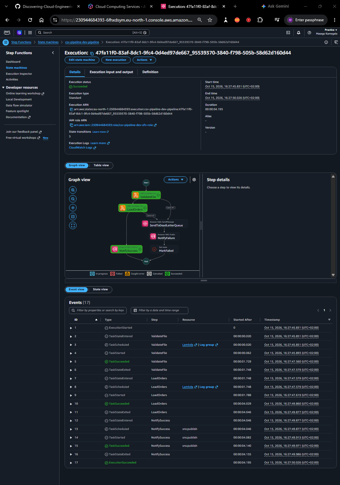
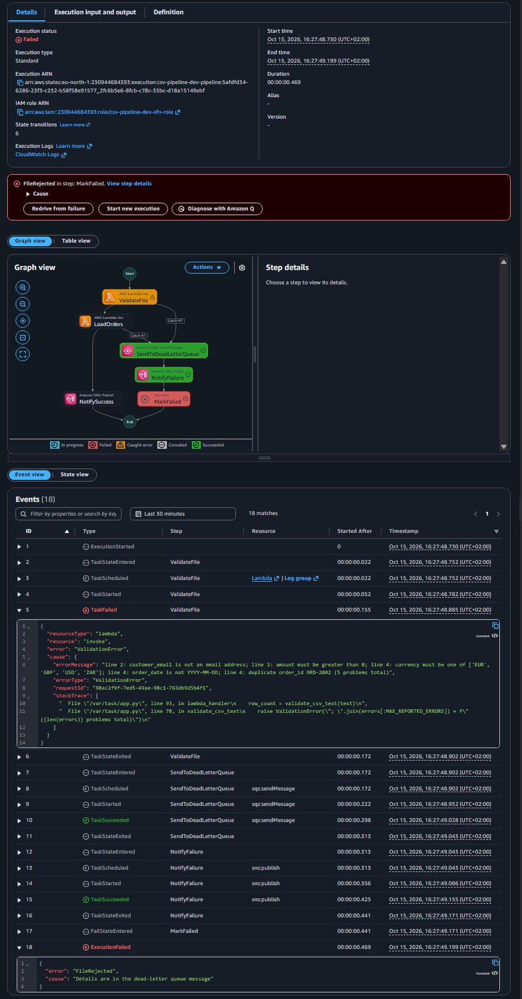
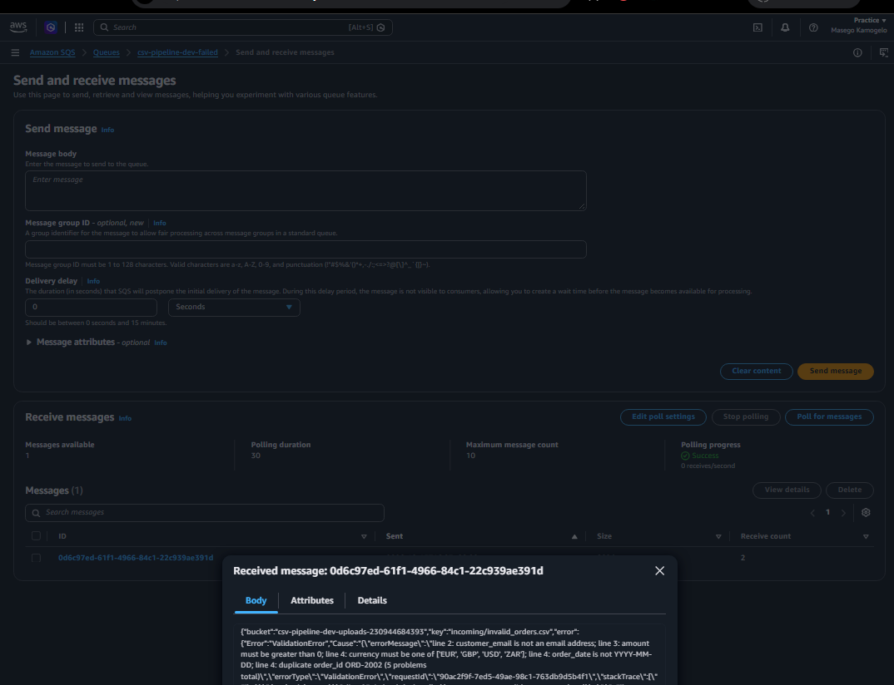
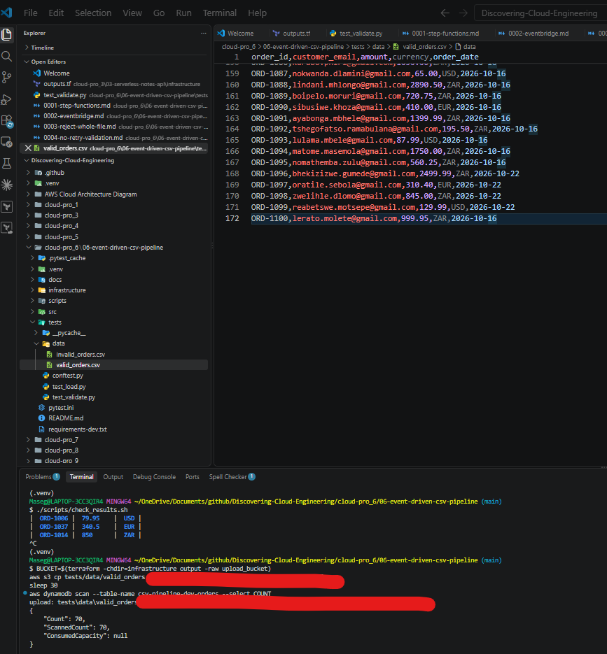
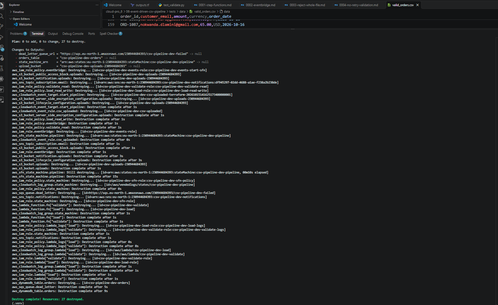

# 06 – Event-Driven CSV Processing Pipeline

Dropping a CSV of orders into an S3 folder starts a Step Functions workflow that validates the file, loads good rows into DynamoDB, and emails the result. A bad file is never silently lost: it goes to an SQS dead-letter queue with the reason, and I get a rejection email. All test data is synthetic.



## The problem

File-based integrations fail quietly: a partner sends a malformed file, half of it loads, and nobody notices until a report is wrong. This pipeline rejects bad files whole, explains why, and keeps a record of every failure.

## Tech stack

`Amazon S3` · `Amazon EventBridge` · `AWS Step Functions` · `AWS Lambda` · `DynamoDB` · `Amazon SQS` · `Amazon SNS` · `IAM` · `CloudWatch Logs` · `Terraform` · `Python 3.12` · `pytest` · `moto`

## Input file contract

| Column | Rule | Example |
|--------|------|---------|
| `order_id` | Required, unique within the file | `ORD-1001` |
| `customer_email` | Required, contains `@` | `test.user@example.com` |
| `amount` | Decimal greater than 0 | `249.99` |
| `currency` | `ZAR`, `USD`, `EUR` or `GBP` | `ZAR` |
| `order_date` | `YYYY-MM-DD` | `2026-10-15` |

Files must be UTF-8, at most 1 MB and 1,000 rows, so each load finishes well inside the 10-second Lambda timeout.

## Quickstart

```bash
cd cloud-pro_6/06-event-driven-csv-pipeline
pip install -r requirements-dev.txt && pytest -v
cp infrastructure/terraform.tfvars.example infrastructure/terraform.tfvars   # set owner and alert_email
./scripts/deploy.sh
./scripts/upload_samples.sh && sleep 30 && ./scripts/check_results.sh
./scripts/destroy.sh
```

Step-by-step guide: [docs/START-HERE.md](docs/START-HERE.md). Short operations card: [docs/runbook.md](docs/runbook.md).

## Key design decisions

- [0001 – Step Functions instead of chained Lambdas](docs/adr/0001-step-functions.md)
- [0002 – EventBridge instead of direct S3 notifications](docs/adr/0002-eventbridge.md)
- [0003 – Reject the whole file](docs/adr/0003-reject-whole-file.md)
- [0004 – Never retry validation errors](docs/adr/0004-no-retry-validation.md)

## Reliability, security and observability

- **Retries** only for temporary AWS errors (2 attempts with backoff); a `ValidationError` is never retried.
- **Idempotent loads:** re-uploading a file overwrites rows by `order_id` instead of duplicating them.
- **Separate IAM roles:** the validator can only read uploads; only the loader can write to the table.
- **Encryption:** S3 (SSE-S3) and SQS (SSE-SQS) at rest; the bucket blocks all public access.
- **Logs:** every state transition is logged (`level = ALL`), plus structured JSON from both Lambdas.

## Screenshots

| # | What it proves | File |
|---|----------------|------|
| 1 | Tests pass locally |  |
| 2 | Infrastructure deployed from code |  |
| 3 | The workflow definition |  |
| 4 | A good file loaded (green path) |  |
| 5 | A bad file rejected (red path) |  |
| 6 | Rows in DynamoDB |  |
| 7 | Rejection reason in the dead-letter queue |  |
| 8 | Success and rejection emails |  |
| 9 | Re-upload doesn't duplicate rows |  |
| 10 | Everything torn down |  |

## Cost and teardown

Built and tested in my own AWS account. Every service here is billed per use (Lambda, Step Functions, on-demand DynamoDB, SQS, SNS, S3), so a build-and-test session costs **well under $0.01** and is usually covered by the AWS Free Tier. `./scripts/destroy.sh` removes everything; uploaded files also expire after 1 day.

_Estimates from AWS list prices, October 2026; prices in eu-north-1 (Stockholm), where this was built, are similar. Check your own bill in Billing → Cost Explorer._

## Lessons learned

## 📚 Lessons Learned
 
Two kinds of lessons: the **problems I hit** while building, and the **design lessons** the project taught me about building pipelines that fail safely.
 
### Part A – What went wrong (and how I fixed it)
 
<!-- Only record what actually happened, with the exact error message. Delete any row you didn't hit, and add your own. -->
 
### 1. <!-- Short title, e.g. "No emails arrived" -->
 
Two kinds of lessons: the **problems I hit** while building, and the **design lessons** the project taught me about building pipelines that fail safely.
 
### Part A – What went wrong (and how I fixed it)
 
### 1. The pipeline's emails went to my junk folder
 
| | |
|---|---|
| **What I saw** | The pipeline ran, but no emails showed up in my inbox. I found them in my **junk folder**. |
| **Cause** | The emails come from Amazon SNS's automatic sender address, and my email provider filtered them as junk. The pipeline was working; the alerts just weren't reaching me. |
| **Fix** | I opened the emails from junk, marked the sender as **not junk** so future alerts land in my inbox, and checked that the subscription shows **Confirmed** in **SNS → Subscriptions**. |
| **Lesson** | **An alert nobody sees isn't an alert.** After setting up any notification, send a test and check that it actually arrives where I'll see it, including junk. Real teams send alerts to more than one channel (email plus Slack or a paging tool) for the same reason. |
 
 
### Part B – Design lessons
 
### 3. A failed file should never disappear silently
 
| | |
|---|---|
| **The risk** | In a file integration, a partner sends a malformed CSV, half of it loads, and nobody notices until a report is wrong. |
| **What I built** | Every failure, from validation or loading, is caught by Step Functions and sent to an **SQS dead-letter queue** with the reason, and I get an email. The deliberate bad-file test shows the red path in the execution graph. *(Synthetic test data.)* |
| **Lesson** | "No errors" doesn't mean "no failures". A pipeline needs a place for failures **to go** and someone who's told about them. |
 
### 4. Reject the whole file, not just the bad rows
 
| | |
|---|---|
| **The choice** | Load the good rows and report the bad ones, or reject the file completely. |
| **What I chose** | If any row is invalid, nothing loads ([ADR 0003](docs/adr/0003-reject-whole-file.md)). |
| **Lesson** | Partial loads create reconciliation work that's harder than a clean rejection. A file is either fully in or fully out, which is simple to explain and to check. |
 
### 5. Only retry errors that a retry can fix
 
| | |
|---|---|
| **The choice** | Step Functions can retry anything. |
| **What I chose** | Retry only temporary AWS errors (throttling, Lambda service errors): 2 attempts with backoff. A `ValidationError` goes straight to the dead-letter queue ([ADR 0004](docs/adr/0004-no-retry-validation.md)). |
| **Lesson** | A bad file is still bad on the second try. Retrying it just costs money and delays the alert. **Sort errors into "temporary" and "permanent"** before deciding how to handle them. |
 
### 6. Make loads safe to run twice
 
| | |
|---|---|
| **The risk** | Events can be delivered more than once, and people re-send files. A naive pipeline would duplicate every row. |
| **What I built** | Rows are written with `order_id` as the key, so a re-upload overwrites instead of duplicating. The re-upload test (screenshot 9) shows the row count staying the same. |
| **Lesson** | Design every step to be **idempotent**: same input, same result, however many times it runs. It's the same lesson as Project 05's re-runnable bootstrap script. |
 
### 7. Test cloud code without the cloud
 
| | |
|---|---|
| **What I did** | 13 unit tests run against **moto**, a fake AWS on my laptop, so testing costs nothing and needs no AWS account. GitHub Actions runs them on every push. |
| **Lesson** | Fast, free tests get run; slow, paid ones get skipped. And after Project 05, I run `pytest -v` **before** every push, not after CI fails. |
 
### What I'd do differently next time
 
- Add a **CloudWatch alarm on the dead-letter queue's message count**, so a rejection is noticed even if the email is missed.
- Write the **input file contract** (columns and rules) before the code, and agree it with whoever sends the files.
- For bigger files, split the load into batches, or use a Step Functions **Distributed Map** instead of one Lambda call.
### 📖 What I read
 
- [Handling errors in Step Functions workflows](https://docs.aws.amazon.com/step-functions/latest/dg/concepts-error-handling.html): `Retry` and `Catch`
- [Using EventBridge with Amazon S3](https://docs.aws.amazon.com/AmazonS3/latest/userguide/EventBridge.html): sending bucket events to EventBridge
- [Using dead-letter queues in Amazon SQS](https://docs.aws.amazon.com/AWSSimpleQueueService/latest/SQSDeveloperGuide/sqs-dead-letter-queues.html)
- [Moto: mock AWS services](https://docs.getmoto.org/en/latest/): testing boto3 code offline
