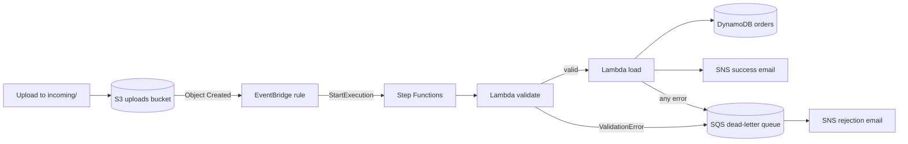
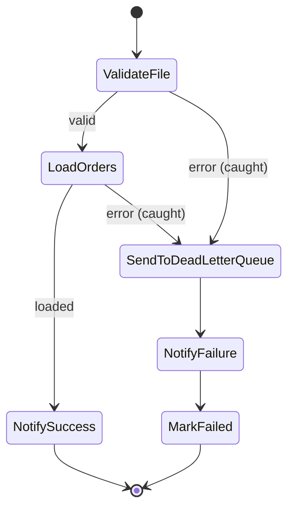

# Architecture

## Workflow states

Each task adds its result under its own field (`ResultPath`), so `bucket` and `key` from the original input stay available in every later state.

| Component | AWS name |
|-----------|----------|
| Upload bucket | `csv-pipeline-dev-uploads-<account_id>` |
| EventBridge rule | `csv-pipeline-dev-csv-uploaded` |
| State machine | `csv-pipeline-dev-pipeline` |
| Lambdas | `csv-pipeline-dev-validate`, `csv-pipeline-dev-load` |
| Table | `csv-pipeline-dev-orders` |
| Dead-letter queue | `csv-pipeline-dev-failed` |
| SNS topic | `csv-pipeline-dev-notifications` |
