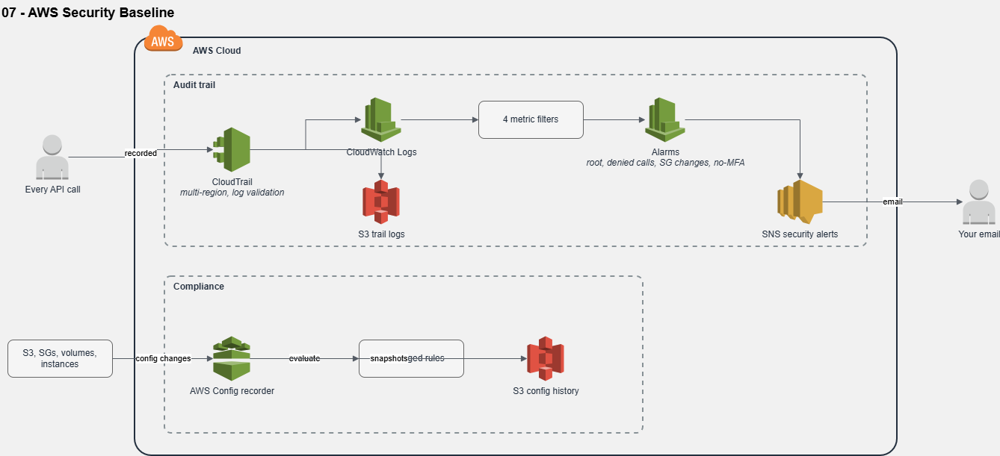
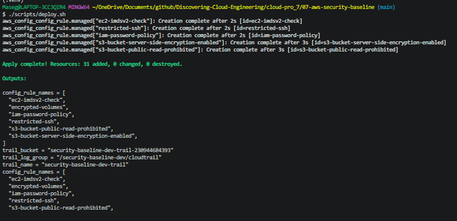
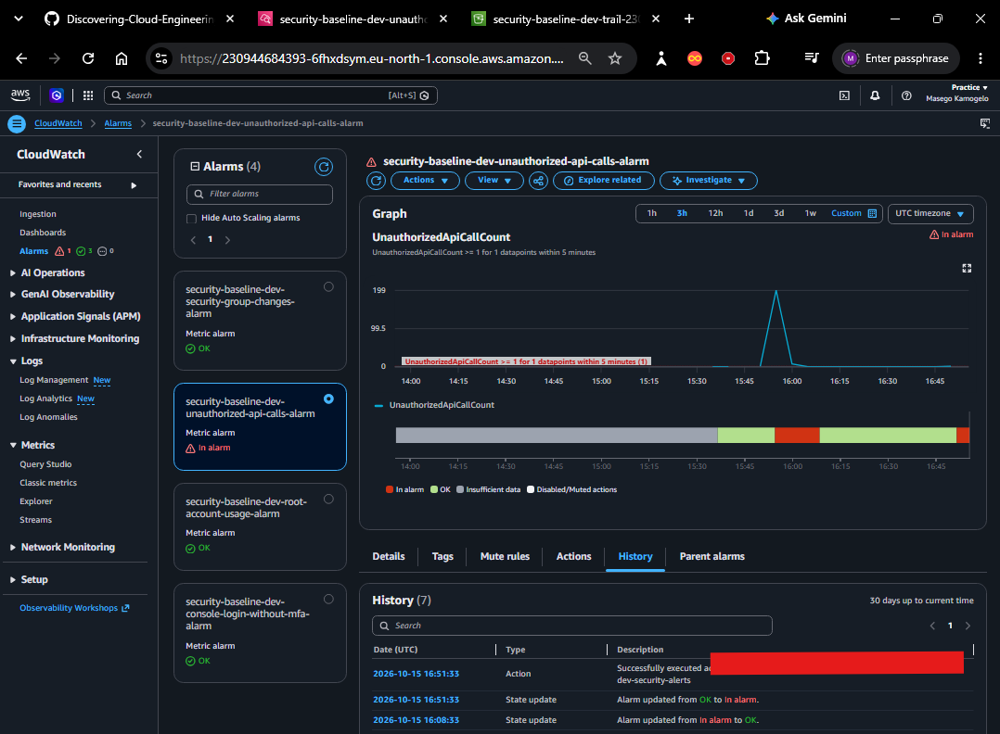
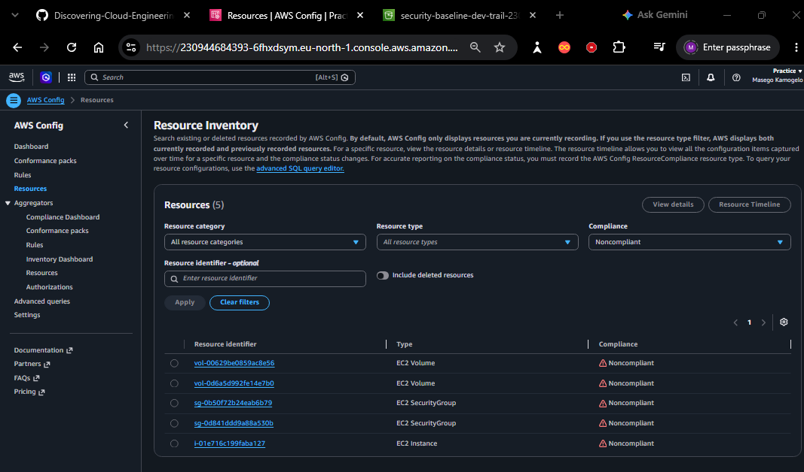
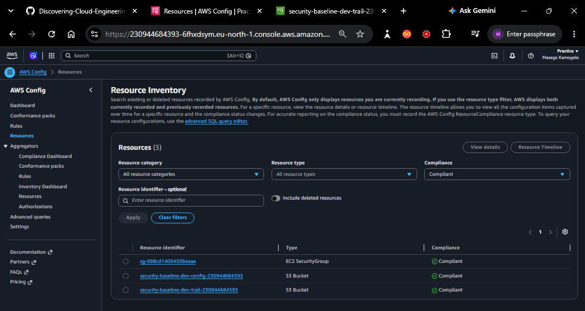
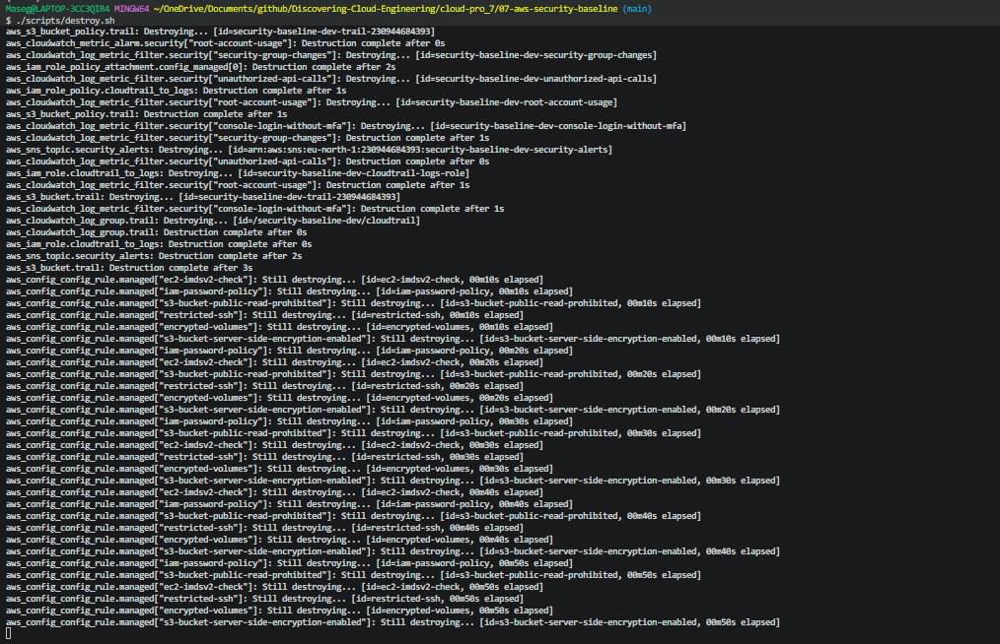

# 07 – AWS Security Baseline

Account-level guardrails: CloudTrail records every API call with tamper-evident logs, AWS Config checks resources against 6 managed rules, and CloudWatch alarms email me about the 4 events security benchmarks flag first. I then used it to audit my own projects 03–06.



## The problem

Misconfigurations, such as an open SSH port, an unencrypted disk or a public bucket, are among the most common causes of cloud breaches, and they're easy to miss by eye. This baseline finds them continuously and tells me when something risky happens.

## Tech stack

`AWS CloudTrail` · `AWS Config` · `CloudWatch Logs` · `CloudWatch metric filters & alarms` · `Amazon SNS` · `Amazon S3` · `IAM` · `Terraform` · `Bash`

## What gets checked

| Control | Type | Catches |
|---------|------|---------|
| `s3-bucket-public-read-prohibited` | Config rule | Buckets anyone can read |
| `s3-bucket-server-side-encryption-enabled` | Config rule | Buckets without default encryption |
| `restricted-ssh` | Config rule | Security groups open to port 22 from `0.0.0.0/0` |
| `encrypted-volumes` | Config rule | Unencrypted attached EBS volumes |
| `ec2-imdsv2-check` | Config rule | Instances still allowing IMDSv1 |
| `iam-password-policy` | Config rule (periodic) | Weak account password policy |
| Root account usage | Metric filter + alarm | Anyone using the root user |
| Unauthorised API calls | Metric filter + alarm | `AccessDenied` / `UnauthorizedOperation` errors |
| Security group changes | Metric filter + alarm | Any security group created, deleted or changed |
| Console login without MFA | Metric filter + alarm | IAM users signing in with only a password |

## Quickstart

```bash
cd cloud-pro_7/07-aws-security-baseline
cp infrastructure/terraform.tfvars.example infrastructure/terraform.tfvars   # set owner and alert_email
./scripts/deploy.sh
./scripts/create_test_violations.sh      # deliberate test
./scripts/compliance_report.sh           # after ~15 minutes
./scripts/cleanup_test_violations.sh
./scripts/destroy.sh
```

Step-by-step guide: [docs/START-HERE.md](docs/START-HERE.md). Short operations card: [docs/runbook.md](docs/runbook.md). Findings from auditing my projects: [docs/findings.md](docs/findings.md).

## Key design decisions

- [0001 – AWS managed Config rules](docs/adr/0001-managed-config-rules.md)
- [0002 – Record only 4 resource types](docs/adr/0002-limited-recording.md)
- [0003 – Multi-region trail](docs/adr/0003-multi-region-trail.md)
- [0004 – Detect and alert, no automatic fixes yet](docs/adr/0004-detect-before-remediate.md)

## Screenshots

| # | What it proves | File |
|---|----------------|------|
| 1 | Baseline deployed from code |  |
| 2 | Trail logging, with log file validation |  |
| 3 | API events arriving in CloudWatch Logs |  |
| 4 | Config rules in place |  |
| 5 | Four security alarms |  |
| 6 | Deliberate violations created |  |
| 7 | Security group change alarm fired |  |
| 8 | Config flagged the violations |  |
| 9 | Compliance report |  |
| 10 | Back to compliant after clean-up |  |
| 11 | Baseline torn down |  |

## Cost and teardown

Built and tested in my own AWS account. The first CloudTrail trail's management events are free. AWS Config charges about $0.003 per configuration item recorded and $0.001 per rule evaluation, which is why only 4 resource types are recorded. The deliberate test instance runs for under an hour. A full session is roughly **$0.10–0.50**. Config keeps charging while the recorder runs, so `./scripts/destroy.sh` removes everything, including the log buckets.

_Estimates from AWS list prices, October 2026; prices in eu-north-1 (Stockholm), where this was built, are similar. Check your own bill in Billing → Cost Explorer._

## Lessons learned

<!-- Fill in after building. Only record what actually happened. -->
