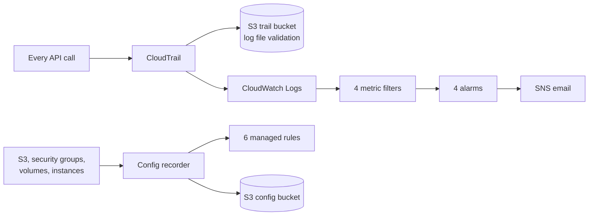

# Architecture

**CloudTrail** answers *who did what, and when*. **AWS Config** answers *what does this resource look like now, and is that allowed*. They complement each other: CloudTrail sees someone open port 22; Config tells me the security group now breaks the `restricted-ssh` rule.

| Component | AWS name |
|-----------|----------|
| Trail | `security-baseline-dev-trail` |
| Trail bucket | `security-baseline-dev-trail-<account_id>` |
| Trail log group | `/security-baseline-dev/cloudtrail` |
| Config recorder / delivery channel | `security-baseline-dev-recorder` / `security-baseline-dev-delivery` |
| Config bucket | `security-baseline-dev-config-<account_id>` |
| Alarms | `security-baseline-dev-<event>-alarm` (4) |
| SNS topic | `security-baseline-dev-security-alerts` |
