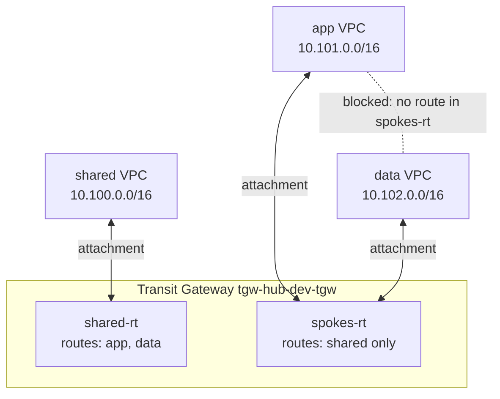
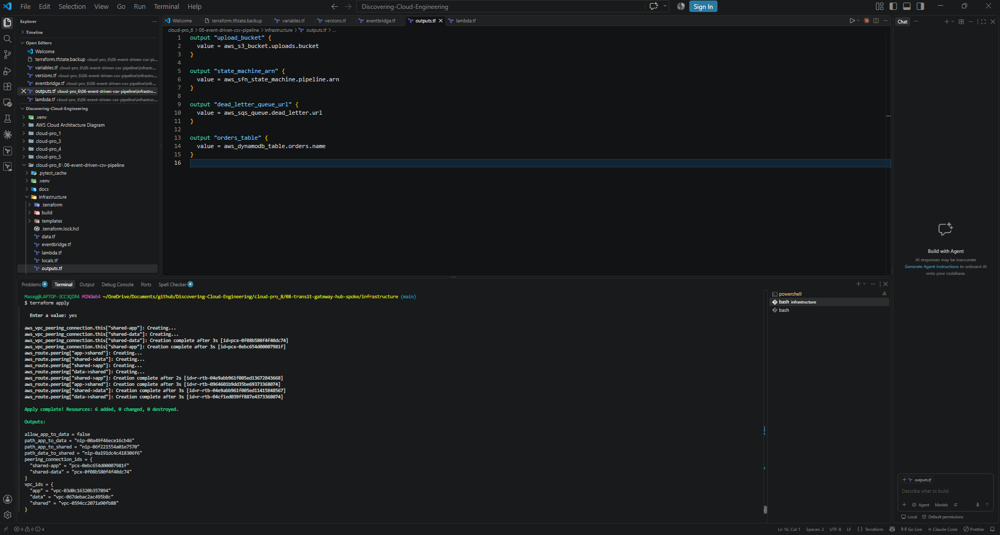
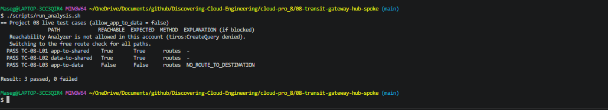
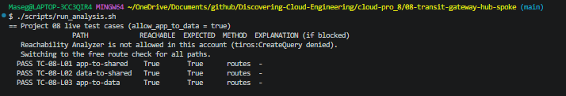
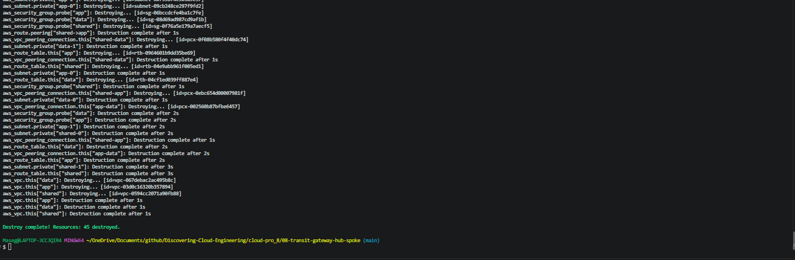

# 🔀 08 – Hub-and-Spoke Network with AWS Transit Gateway

**Three VPCs joined through one Transit Gateway, with route tables that let app and data reach shared services but not each other, proved with VPC Reachability Analyzer.**

<p align="center">
  
</p>

> 🌐 Part of the **Networking track** of [Discovering Cloud Engineering](../../README.md).

## 💡 Why I Built This

Most companies don't have one VPC; they have dozens, and they can't all be allowed to talk to each other. Job adverts for cloud and network engineers keep asking for **Transit Gateway**, **network segmentation** and **multi-account / multi-VPC design**, and my earlier projects only used a single VPC. I built this to learn how traffic is *allowed or blocked between networks by routing alone*, and to prove it with evidence instead of a diagram. I deliberately used Reachability Analyzer on free network interfaces instead of test servers, which keeps the cost low and teaches a troubleshooting tool real teams use.

## 🎯 The Problem It Solves

As a company grows, connecting VPCs one-to-one with peering turns into a tangle (10 VPCs need 45 peerings), and it's hard to see which systems can reach which. A hub-and-spoke design gives one place to control connectivity: for example, letting every application reach shared services such as logging or DNS, while keeping the payment database's network unreachable from ordinary apps.

## 🧠 What This Project Shows

- **Transit Gateway** hub with default route tables switched off, so every attachment's routing is a deliberate choice
- **Segmentation with TGW route tables**: associations decide which table a VPC uses; propagations decide which routes it learns
- **Non-overlapping IP planning** across three VPCs and two Availability Zones
- **VPC Reachability Analyzer** to prove reachable *and* blocked paths, with AWS's own explanation of the block
- **A one-line segmentation switch** (`allow_app_to_data`) showing a change of network policy as a code review, not a console click

## 🛠️ Technologies

`AWS Transit Gateway` · `Amazon VPC` · `TGW route tables` · `VPC Reachability Analyzer` · `Security Groups` · `Elastic Network Interfaces` · `Terraform` · `Bash`

## 🏗️ Architecture



| Piece | What it does |
|-------|--------------|
| `shared` VPC | Shared services (DNS, logging, CI runners in a real company) |
| `app`, `data` VPCs | Spokes: an application network and a data network |
| Transit Gateway | The hub; one attachment per VPC across 2 AZs |
| `shared-rt` | Used by shared; learns routes to app and data |
| `spokes-rt` | Used by app and data; learns only the shared route, so app ↔ data is blocked |
| Probe ENIs | One free network interface per VPC, used as test endpoints |
| Reachability paths | Saved tests: app→shared, data→shared, app→data on TCP 443 |

## 🚀 Quickstart

```bash
cd cloud-pro_8/08-transit-gateway-hub-spoke
cp infrastructure/terraform.tfvars.example infrastructure/terraform.tfvars   # set owner
./scripts/deploy.sh
./scripts/run_analysis.sh        # app→shared True, data→shared True, app→data False
./scripts/destroy.sh
```

New to this project? Follow the full step-by-step guide: **[docs/START-HERE.md](docs/START-HERE.md)**. Short operations card: [docs/runbook.md](docs/runbook.md).

## 🧩 Key Design Decisions

- [0001 – Transit Gateway instead of VPC peering](docs/adr/0001-transit-gateway-over-peering.md)
- [0002 – Segmentation with two TGW route tables](docs/adr/0002-two-route-tables.md)
- [0003 – Reachability Analyzer instead of test instances](docs/adr/0003-reachability-analyzer.md)

## 🔐 Security Highlights

- Spokes are isolated **at the routing layer**, before security groups are even checked: defence in depth
- TGW default association and propagation are **off**, so a new VPC attached by mistake can reach nothing
- No internet gateways, no public IPs and no instances: nothing here is reachable from the internet
- Security groups still allow only TCP 443 from the other VPC ranges

## 🧪 Test Cases

**12 test cases**, each with an ID (full list: [docs/TEST-CASES.md](docs/TEST-CASES.md)).

| Level | Cases | Needs AWS? | How to run |
|-------|-------|------------|------------|
| Offline Terraform tests | 8 | No, free | `terraform -chdir=infrastructure test` |
| Live tests (PASS/FAIL) | 3 | Yes | `./scripts/run_analysis.sh` |
| Manual checks | 1 | Yes | Console (see the guide) |

The offline tests run against a mocked AWS, so a broken security rule fails before anything is deployed. Deliberate tests are labelled as such.

## 📸 Screenshots

| # | What it proves | Image |
|---|----------------|-------|
| 1 | Infrastructure deployed from code |  |
| 2 | Three VPCs attached to one Transit Gateway |  |
| 3 | Segmentation: spokes route table only knows shared |  |
| 4 | VPC route table sending other VPCs to the TGW |  |
| 5 | Reachability results from the script |  |
| 6 | app → shared: reachable, hop by hop |  |
| 7 | app → data: blocked, with AWS's explanation |  |
| 8 | Flipping the switch opens app → data |  |
| 9 | Everything torn down |  |

## 💰 Cost and Teardown

Built and tested in my own AWS account. Transit Gateway charges about **$0.05 per attachment per hour**, so 3 attachments cost about **$0.15/hour**. Each Reachability Analyzer run costs about **$0.10**, and the guide runs the script twice (6 analyses, about $0.60). A 2-hour session is roughly **$0.90**. There are no instances or public IPs. `./scripts/destroy.sh` removes everything.

_Estimates from AWS list prices, October 2026; prices in eu-north-1 (Stockholm), where this was built, are similar. Check your own bill in Billing → Cost Explorer._

## 🎤 Interview Questions This Project Prepares Me For

1. What's the difference between a TGW route table **association** and a **propagation**?
2. Why turn off the default route table association and propagation?
3. VPC peering vs Transit Gateway: when would you still choose peering? (Good answer: 2–3 VPCs, lowest latency, no per-attachment cost; peering isn't transitive.)
4. The VPC route table sends app → data traffic to the TGW, so where exactly is it dropped?
5. How would you add on-premises access through a VPN, and which route table would it use?

## 📚 Lessons Learned

<!-- Fill in after you build it: what broke, how you fixed it, what you'd change. Only write what actually happened. -->
