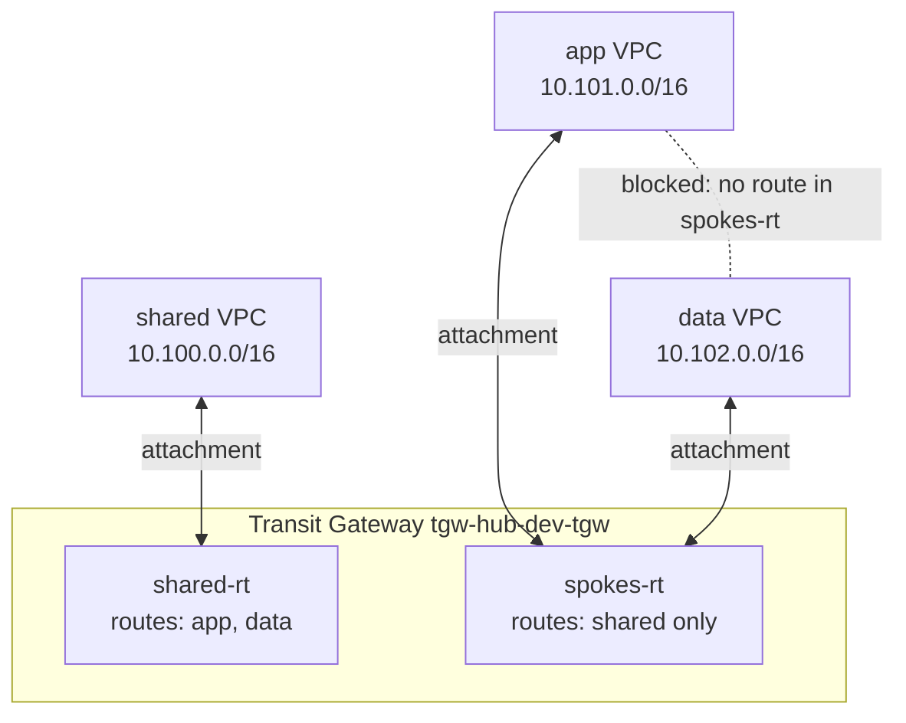

# Architecture

## How a packet from app to shared travels

1. The app VPC's route table has `10.100.0.0/16 → tgw-…`, so the packet goes to the app attachment.
2. The app attachment is **associated** with `spokes-rt`, so the TGW looks there.
3. `spokes-rt` has a **propagated** route `10.100.0.0/16 → shared attachment`, so the packet is forwarded.
4. The shared VPC delivers it; its security group allows TCP 443 from 10.101.0.0/16.

## Why app to data fails

Steps 1–2 are the same, but `spokes-rt` has **no route** for `10.102.0.0/16` (data's route is only propagated into `shared-rt`), so the TGW drops the packet. Reachability Analyzer reports this explicitly.

| Component | AWS name |
|-----------|----------|
| VPCs | `tgw-hub-dev-shared-vpc`, `tgw-hub-dev-app-vpc`, `tgw-hub-dev-data-vpc` |
| Transit Gateway | `tgw-hub-dev-tgw` |
| TGW route tables | `tgw-hub-dev-shared-rt`, `tgw-hub-dev-spokes-rt` |
| Probe ENIs | `tgw-hub-dev-<vpc>-probe` |
| Reachability paths | `tgw-hub-dev-app-to-shared`, `-data-to-shared`, `-app-to-data` |
