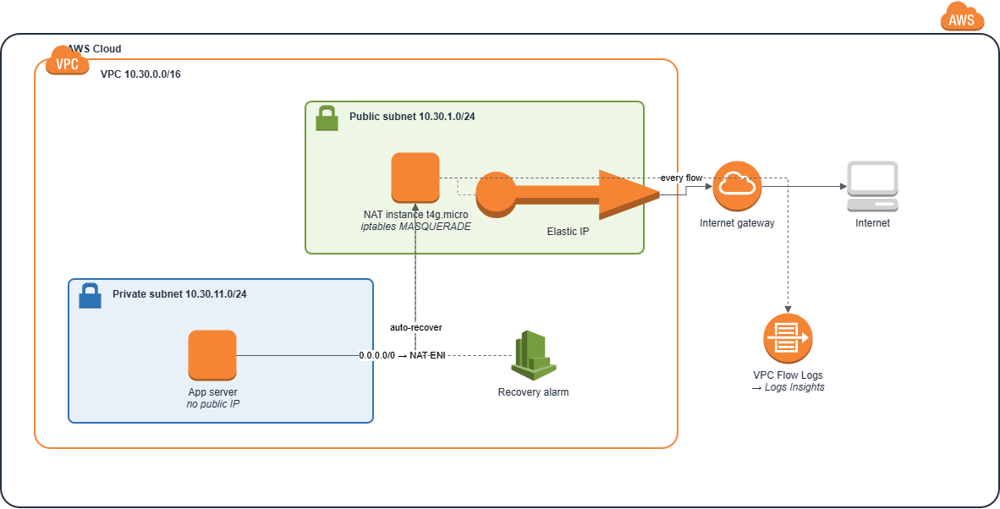
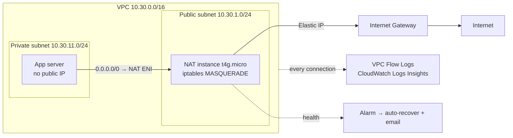
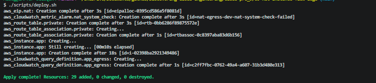
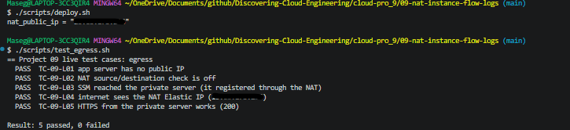
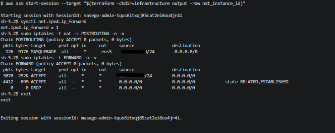
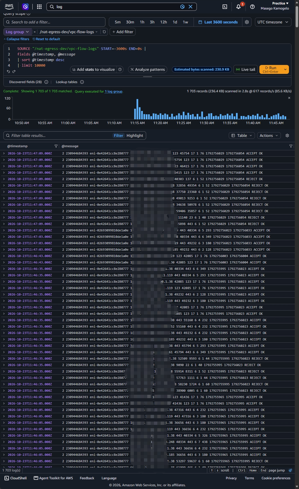
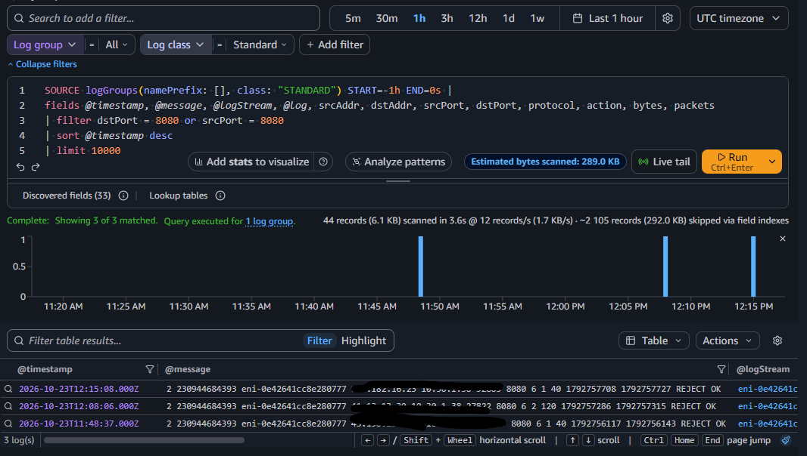
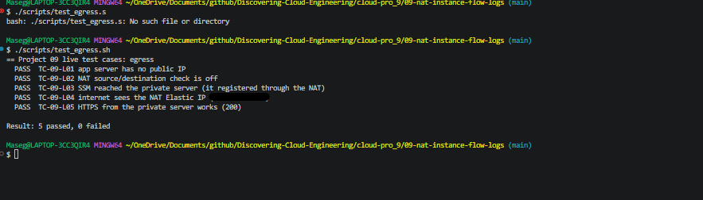
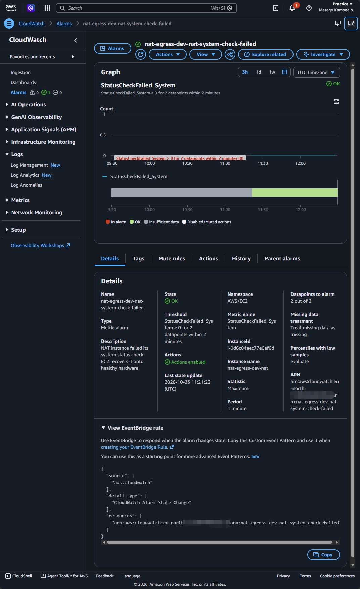
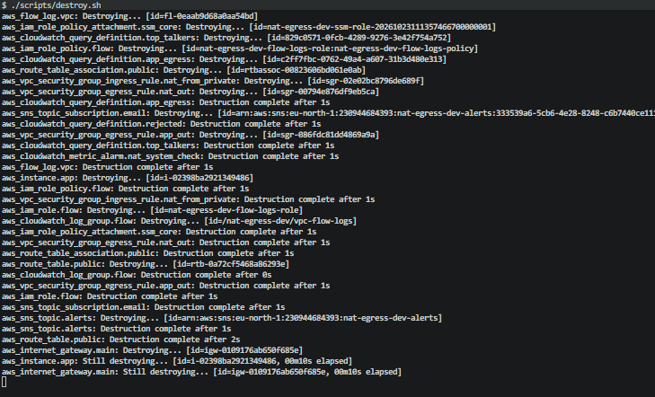

# 🚪 09 – Private Subnets with a NAT Instance and VPC Flow Logs

**A private server with no public IP reaches the internet through a NAT router I built myself on a ~$6-a-month Graviton instance, and every connection in the VPC is recorded and searchable with VPC Flow Logs.**

<p align="center">
  
</p>

> 🌐 Part of the **Networking track** of [Discovering Cloud Engineering](../../README.md).

## 💡 Why I Built This

In Project 04 I left my private subnets with no way out, because a managed NAT gateway costs about **$32 a month even when idle**. That bothered me: real private workloads need to download updates and call APIs. So I built the NAT myself, to understand what a NAT gateway actually *does* (IP forwarding, address translation, source/destination checks) and to compare cost against reliability honestly. I added **VPC Flow Logs** because "is the traffic even arriving?" is the first question in almost every network incident, and I wanted to answer it with queries, not guesses.

## 🎯 The Problem It Solves

Servers that hold data shouldn't be reachable from the internet, but they still need outbound access for patches and API calls. Teams also need evidence of what actually crossed the network, for troubleshooting and for security reviews: which connections were accepted, which were blocked, and who talked to whom.

## 🧠 What This Project Shows

- **NAT from first principles:** kernel IP forwarding, `iptables` MASQUERADE, and turning off the EC2 source/destination check
- **Routing to an instance:** a private route table whose default route targets a network interface, not a gateway
- **A stable egress IP** with an Elastic IP, the address a partner would allow-list
- **VPC Flow Logs** at 1-minute aggregation, with **3 saved Logs Insights queries**: rejected traffic, top talkers, and the app's own egress
- **Self-healing:** a CloudWatch alarm that triggers EC2 auto-recovery if the NAT host fails
- **Access with no SSH:** SSM Run Command reaches the private server through the NAT itself

## 🛠️ Technologies

`Amazon VPC` · `EC2 (Graviton t4g)` · `Amazon Linux 2023` · `iptables` · `Elastic IP` · `VPC Flow Logs` · `CloudWatch Logs Insights` · `CloudWatch Alarms` · `SNS` · `SSM Run Command` · `Terraform` · `Bash`

## 🏗️ Architecture



| Piece | What it does |
|-------|--------------|
| App server | Private subnet, no public IP, no inbound rules |
| NAT instance | Public subnet; forwards and translates the private subnet's traffic |
| Elastic IP | The one public address all outbound traffic uses |
| Private route table | `0.0.0.0/0 → NAT instance network interface` |
| VPC Flow Logs | Every accepted/rejected flow, to CloudWatch Logs |
| Saved queries | `rejected-traffic`, `top-talkers`, `app-egress-via-nat` |
| Recovery alarm | System check failure → email + automatic recovery |

## 🧰 Services Used, in Detail

Every service and tool in this project: what it is, how it works, exactly how this project uses it, why I chose it, and what it costs. Expand a service below for the full detail.

| Service | What it is |
| --- | --- |
| **Amazon VPC (public and private subnets)** | A private network with a public subnet for the NAT router and a private subnet for the application server. |
| **Amazon EC2 as a NAT instance (Graviton t4g.micro)** | An ordinary Linux server configured as a router that translates private addresses to its own public address. |
| **Elastic IP** | A static public IPv4 address that stays the same when the instance restarts. |
| **VPC Flow Logs** | A record of the network connections in a VPC: source, destination, ports, bytes and whether each was ACCEPTED or REJECTED. |
| **CloudWatch Logs Insights** | A query language for searching and summarising logs. |
| **CloudWatch alarm with EC2 auto-recovery, and SNS** | An alarm that repairs the NAT instance automatically if the hardware under it fails, and emails me. |
| **AWS Systems Manager (Run Command)** | Runs commands on servers without SSH. |
| **Terraform** | Infrastructure as Code. |

<details>
<summary><b>Amazon VPC (public and private subnets)</b></summary>

- **What it is:** A private network with a public subnet for the NAT router and a private subnet for the application server.
- **How it works:** A subnet is private when its route table has no route to an internet gateway.
- **How this project uses it:** The private route table's default route `0.0.0.0/0` points at the NAT instance's **network interface**, not at a gateway.
- **Why this choice:** Routing to an instance shows exactly what a NAT gateway does behind the scenes.
- **Cost:** Free.

</details>

<details>
<summary><b>Amazon EC2 as a NAT instance (Graviton t4g.micro)</b></summary>

- **What it is:** An ordinary Linux server configured as a router that translates private addresses to its own public address.
- **How it works:** Three things make it work: kernel IP forwarding (`net.ipv4.ip_forward=1`), an `iptables` **MASQUERADE** rule that rewrites the source address, and turning **off** the EC2 source/destination check, which normally drops traffic not addressed to the instance.
- **How this project uses it:** A t4g.micro running Amazon Linux 2023 in the public subnet, set up by user data, with IMDSv2 and an encrypted disk. A second t4g.micro in the private subnet is the app server; it has no public IP.
- **Why this choice:** A managed NAT gateway costs about $0.045 an hour plus $0.045 per GB; a NAT instance costs about $0.0084 an hour, but I run and patch it myself and it is a single point of failure (ADR 0001).
- **Cost:** About $0.0084 an hour per instance.

</details>

<details>
<summary><b>Elastic IP</b></summary>

- **What it is:** A static public IPv4 address that stays the same when the instance restarts.
- **How it works:** It is attached to the NAT's network interface; every outbound connection from the private subnet appears to come from it.
- **How this project uses it:** One Elastic IP on the NAT. `test_egress.sh` checks that the app server's public address, as seen by a check-IP service, equals it.
- **Why this choice:** A stable address is what a partner would put on their allow-list.
- **Cost:** $0.005 an hour.

</details>

<details>
<summary><b>VPC Flow Logs</b></summary>

- **What it is:** A record of the network connections in a VPC: source, destination, ports, bytes and whether each was ACCEPTED or REJECTED.
- **How it works:** Flow logs are captured outside the instances, so they cost no CPU and can't be switched off by malware on a server.
- **How this project uses it:** Flow logs for ALL traffic, aggregated every 60 seconds (instead of the default 10 minutes), sent to CloudWatch Logs with short retention.
- **Why this choice:** "Is the traffic even arriving?" is the first question in most network incidents, and flow logs answer it with evidence (ADR 0003).
- **Cost:** A few MB in a session: fractions of a cent.

</details>

<details>
<summary><b>CloudWatch Logs Insights</b></summary>

- **What it is:** A query language for searching and summarising logs.
- **How it works:** Queries filter and group log fields, for example counting connections by destination.
- **How this project uses it:** Three saved queries: rejected traffic, top talkers, and the app server's own outbound connections. `test_rejected.sh` makes deliberate blocked connections (ports 22, 3389 and 8080) and then finds them in the flow logs.
- **Why this choice:** Saved queries make troubleshooting repeatable.
- **Cost:** $0.0076 per GB scanned; effectively free here.

</details>

<details>
<summary><b>CloudWatch alarm with EC2 auto-recovery, and SNS</b></summary>

- **What it is:** An alarm that repairs the NAT instance automatically if the hardware under it fails, and emails me.
- **How it works:** When `StatusCheckFailed_System` fails, the `ec2:recover` action moves the instance to healthy hardware, keeping its IP addresses and Elastic IP.
- **How this project uses it:** One alarm with two actions: recover the NAT and publish to an SNS email topic.
- **Why this choice:** It reduces the main weakness of a NAT instance without paying for a NAT gateway.
- **Cost:** About $0.10 per alarm a month, prorated.

</details>

<details>
<summary><b>AWS Systems Manager (Run Command)</b></summary>

- **What it is:** Runs commands on servers without SSH.
- **How it works:** The SSM agent connects out to Systems Manager over HTTPS, here through the NAT itself.
- **How this project uses it:** The test scripts run `curl` on the private server through Run Command. No SSH port or key exists.
- **Why this choice:** It proves the NAT works, because SSM itself is only reachable through it.
- **Cost:** Free.

</details>

<details>
<summary><b>Terraform</b></summary>

- **What it is:** Infrastructure as Code.
- **How it works:** Terraform reads `.tf` files that describe the end state, compares them with a state file of what it built before, and makes only the API calls needed to close the gap. `plan` shows the changes; `apply` makes them; `destroy` removes everything it created. Offline `terraform test` files in `infrastructure/tests/` use a mock AWS provider, so the rules are checked for free on every push, before anything is deployed.
- **How this project uses it:** The offline tests check the NAT setup (source/destination check off, default route to the NAT interface, no public IP on the app server).
- **Why this choice:** Mistakes in routing are caught before deploying.
- **Cost:** Free.

</details>

## 🚀 Quickstart

```bash
cd cloud-pro_9/09-nat-instance-flow-logs
cp infrastructure/terraform.tfvars.example infrastructure/terraform.tfvars   # set owner and alert_email
./scripts/deploy.sh
./scripts/test_egress.sh         # "Seen by the internet as" = the NAT's Elastic IP
./scripts/test_rejected.sh       # deliberate blocked connections, visible in Flow Logs
./scripts/destroy.sh
```

New to this project? Follow the full step-by-step guide: **[docs/START-HERE.md](docs/START-HERE.md)**. Short operations card: [docs/runbook.md](docs/runbook.md).

## 🧩 Key Design Decisions

- [0001 – NAT instance instead of NAT gateway](docs/adr/0001-nat-instance-over-gateway.md)
- [0002 – One Availability Zone](docs/adr/0002-single-az.md)
- [0003 – Flow Logs to CloudWatch Logs](docs/adr/0003-flow-logs-cloudwatch.md)

## 🔐 Security Highlights

- The app server has **no public IP and no inbound rules**; it can start connections but nothing can reach it
- The NAT's security group only accepts traffic **from the private subnet**
- Both instances require **IMDSv2** and have encrypted disks
- Admin access is through **SSM**, with no SSH keys or open ports
- Flow Logs give an audit trail of every connection attempt, including blocked ones

## 🧪 Test Cases

**18 test cases**, each with an ID (full list: [docs/TEST-CASES.md](docs/TEST-CASES.md)).

| Level | Cases | Needs AWS? | How to run |
|-------|-------|------------|------------|
| Offline Terraform tests | 9 | No, free | `terraform -chdir=infrastructure test` |
| Live tests (PASS/FAIL) | 9 | Yes | `./scripts/test_egress.sh`, `./scripts/test_rejected.sh` |
| Manual checks | 1 | Yes | Console (see the guide) |

The offline tests run against a mocked AWS, so a broken security rule fails before anything is deployed. Deliberate tests are labelled as such.

## 📸 Screenshots

| # | What it proves | Image |
|---|----------------|-------|
| 1 | Infrastructure deployed from code |  |
| 2 | Source/destination check off: the instance acts as a router |  |
| 3 | Private route table sends 0.0.0.0/0 to the NAT instance |  |
| 4 | Private server's traffic leaves via the NAT's Elastic IP |  |
| 5 | NAT rules and their packet counters |  |
| 6 | Raw VPC Flow Log records |  |
| 7 | Rejected connection attempts, found with Logs Insights |  |
| 8 | The private server's outbound connections |  |
| 9 | Auto-recovery alarm on the NAT instance |  |
| 10 | Everything torn down |  |

## 💰 Cost and Teardown

Built and tested in my own AWS account. Two t4g.micro instances (~$0.0084/hour each), one Elastic IP ($0.005/hour) and a few MB of Flow Logs come to about **$0.022 per hour**, roughly **$0.07 for a session**. A managed NAT gateway for the same job would be about $0.045/hour plus $0.045 per GB processed. `./scripts/destroy.sh` removes everything.

_Estimates from AWS list prices, October 2026; prices in eu-north-1 (Stockholm), where this was built, are similar. Check your own bill in Billing → Cost Explorer._

## 📚 Lessons Learned

<!-- Fill in after you build it: what broke, how you fixed it, what you'd change. Only write what actually happened. -->
