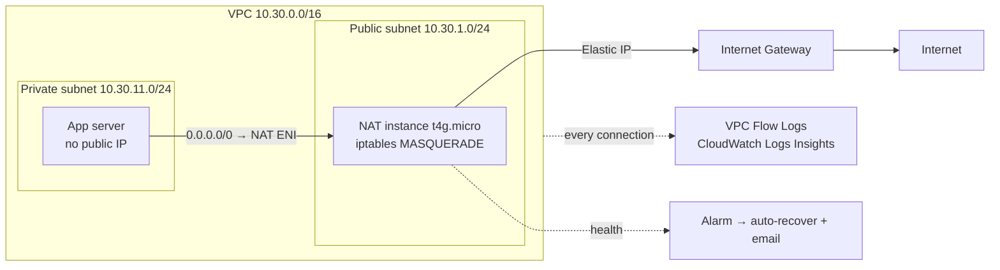

# Architecture

## What happens when the app server calls the internet

1. The app server (10.30.11.x) sends a packet to, say, `checkip.amazonaws.com`.
2. The private route table's `0.0.0.0/0` route points at the **NAT instance's network interface**, so the packet goes there.
3. EC2 normally drops packets that aren't addressed to the instance. With the **source/destination check turned off**, the NAT instance accepts them.
4. The kernel **forwards** the packet (`ip_forward = 1`), and iptables **MASQUERADE** rewrites the source address to the NAT's own private IP.
5. The internet gateway translates that to the **Elastic IP**, so the website sees the Elastic IP.
6. Replies come back to the Elastic IP, and the NAT's connection tracking reverses the translation and returns them to the app server.

| Component | AWS name |
|-----------|----------|
| VPC / subnets | `nat-egress-dev-vpc`, `-public-a`, `-private-a` |
| NAT instance / Elastic IP | `nat-egress-dev-nat`, `nat-egress-dev-nat-eip` |
| App server | `nat-egress-dev-app` |
| Flow log group | `/nat-egress-dev/vpc-flow-logs` |
| Saved queries | `nat-egress-dev/rejected-traffic`, `/top-talkers`, `/app-egress-via-nat` |
| Alarm | `nat-egress-dev-nat-system-check-failed` |
